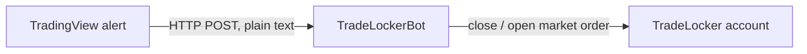

<div align="center">

# TradeLockerBot

**Automated TradeLocker position management driven by TradingView webhook alerts.**

[](https://github.com/Akinzou/TradeLockerBot/actions/workflows/python-package.yml)
[](https://github.com/Akinzou/TradeLockerBot/actions/workflows/docker-image.yml)
[](https://creativecommons.org/licenses/by-nc-sa/4.0/)
[](https://discord.gg/BARYa55KS8)

</div>

> [!WARNING]
> This bot places real orders on the account you connect. Test every strategy
> on a **demo** account first. The software is provided "as is", without any
> warranty; you use it at your own risk.

## Table of contents

- [How it works](#how-it-works)
- [Requirements](#requirements)
- [Quick start](#quick-start)
- [Configuration](#configuration)
- [Connecting TradingView](#connecting-tradingview)
  - [Alert message format](#alert-message-format)
  - [Dynamic lot size](#dynamic-lot-size)
  - [Inverting the direction](#inverting-the-direction)
- [Verifying the setup](#verifying-the-setup)
- [Updating](#updating)
- [Security](#security)
- [Troubleshooting](#troubleshooting)
- [Development](#development)
- [Community](#community)
- [License](#license)

## How it works



1. A TradingView strategy fires an alert with a seven-line message.
2. The bot receives it on its webhook URL and replies immediately; the signal
   is handled in the background.
3. Signals are processed one at a time. For each one the bot reads the
   account balance, closes any open position on the instrument, and, for
   `open`, places a market order with the configured take profit and stop loss.

## Requirements

- A TradeLocker account (demo or live) and its username, password and server.
- [Docker](https://docs.docker.com/get-docker/).
- A host TradingView can reach, ideally behind an HTTPS reverse proxy (see
  [Security](#security)).

## Quick start

Pull the image:

```sh
docker pull ghcr.io/akinzou/tradelocker_bot:latest
```

Create a secret webhook path once and keep it, for example:

```sh
python3 -c "import secrets; print('/' + secrets.token_urlsafe(24))"
```

Start the bot in the background (replace the placeholders, and choose `demo`
or `live`):

```sh
docker run -d -t --name prod --restart unless-stopped -p 443:443 \
  -e username='your_username' \
  -e password='your_password' \
  -e server='your_server' \
  -e env=demo \
  -e url=/your_secret_path \
  ghcr.io/akinzou/tradelocker_bot:latest
```

Follow its output with `docker logs -f prod`. The container keeps running
after you log out and comes back after a reboot, with the same webhook path.

## Configuration

All settings are passed as environment variables (`-e name=value`).

| Variable   | Required | Default     | Description                                                                                         |
|------------|----------|-------------|-----------------------------------------------------------------------------------------------------|
| `username` | yes      |             | TradeLocker username or email.                                                                      |
| `password` | yes      |             | TradeLocker password. Must not contain spaces or shell characters such as `*`, `?`, `$` or `;` (see below). |
| `server`   | yes      |             | TradeLocker server name.                                                                            |
| `env`      | yes      |             | `demo` or `live`.                                                                                   |
| `url`      | no       | `/strategy` | Webhook path. Use a long secret path (see [Quick start](#quick-start)). `generate` prints a new random path on every start. |
| `acc_id`   | no       | `0`         | Trade on the account with this ID. With both `acc_id` and `acc_num` at `0`, the first account listed for your login is used. |
| `acc_num`  | no       | `0`         | Trade on the account with this number. Set either `acc_id` or `acc_num`, not both.                  |

The bot listens on port `443` inside the container. To expose it on another
host port, change the left side of `-p`, for example `-p 8080:443`.

The image passes the credentials to the bot through an unquoted shell command,
so a password with spaces or shell characters is split or expanded and the
login fails. Until this is fixed (see the
[migration roadmap](docs/migration-roadmap.md#known-defects-fixed-in-behaviour-steps-3-and-6-never-during-restructuring)),
use a password without them.

## Connecting TradingView

In your strategy's alert, enable **Webhook URL** and point it at
`https://your-domain/<your-url>` (or `http://your-ip:443/<your-url>` without a
proxy). Paste the message below into the alert's message field.

### Alert message format

The message is plain text, one value per line, in this exact order:

```text
XAUUSD
{{strategy.order.action}}
0.01/100
500
1000
{{strategy.order.alert_message}}
NonInvert
```

| Line | Example                            | Meaning                                                                                                   |
|------|------------------------------------|-----------------------------------------------------------------------------------------------------------|
| 1    | `XAUUSD`                           | Instrument name exactly as TradeLocker lists it.                                                          |
| 2    | `{{strategy.order.action}}`        | Direction: `buy` or `sell`, lowercase. TradingView fills this in.                                         |
| 3    | `0.01/100`                         | Position size; see [Dynamic lot size](#dynamic-lot-size).                                                 |
| 4    | `500`                              | Take profit as a whole-number offset from the entry price.                                                |
| 5    | `1000`                             | Stop loss as a whole-number offset from the entry price.                                                  |
| 6    | `{{strategy.order.alert_message}}` | Action: `open` or `close`, lowercase. Set it as the order's alert message in your Pine Script strategy.   |
| 7    | `NonInvert`                        | `NonInvert` keeps the direction; `Invert` reverses it. See [Inverting the direction](#inverting-the-direction). |

All seven lines must be present and valid for **every** signal, including
`close`: the bot reads lines 3 to 5 and line 7 before it looks at the action.

What each action does:

- **`open`**: closes every open position on the instrument, then opens a new
  market order in the given direction.
- **`close`**: closes every open position on the instrument.

> [!IMPORTANT]
> Values are matched exactly: case and surrounding spaces count, so `Open` or
> `open ` is ignored like any other unknown action. An invalid line 3, 4, 5 or
> 7 stops the signal; with `open`, an invalid line 7 stops it **after**
> existing positions were closed, so no new order is placed. The webhook still
> answers `200 OK` in all these cases, so check the bot's log.

### Dynamic lot size

Line 3 uses the format `<lot>/<balance step>`: open `<lot>` lots for every
`<balance step>` of account balance. The result is rounded to two decimals.
Both parts are required, and the step must not be `0`.

```text
lot = round(balance / balance_step * base_lot, 2)

balance 1000, message 0.01/100  ->  1000 / 100 * 0.01  =  0.10 lots
balance 1234, message 0.01/100  ->  1234 / 100 * 0.01  =  0.12 lots
```

### Inverting the direction

With `Invert` on line 7, `buy` becomes `sell` and `sell` becomes `buy`. This
lets one strategy drive an account that trades against it, for example for
hedging. With `NonInvert` the direction is used unchanged.

## Verifying the setup

After start-up the console shows the bot's banner, followed by a log line
confirming the login:

```text
[INFO] tradelocker.tradelocker_api ... Successfully fetched authentication tokens
```

It also prints the account number and ID it signed in to. Check that this is
the account you intend to trade on.

Opening the webhook URL in a browser should return:

```json
{"detail":"Method Not Allowed"}
```

That is expected: the webhook accepts only `POST` requests, which is what
TradingView sends.

## Updating

```sh
docker pull ghcr.io/akinzou/tradelocker_bot:latest
docker stop prod
```

```sh
docker rm prod
```

Then start the container again with the same `docker run` command. If you use
`url=generate`, a new webhook path is generated, so update your TradingView
alerts.

## Security

- **Keep the webhook path secret.** It is the only thing protecting the
  endpoint: anyone who knows it can open and close trades on your account.
  Create it with a cryptographically secure generator, as in
  [Quick start](#quick-start). `url=generate` is weaker: it uses Python's
  non-cryptographic `random` module (a known defect, tracked in the
  [migration roadmap](docs/migration-roadmap.md#known-defects-fixed-in-behaviour-steps-3-and-6-never-during-restructuring)).
- **Use HTTPS.** The bot serves plain HTTP, so without TLS anyone on the
  network path can read the webhook path and send forged signals. Put the bot
  behind a reverse proxy such as Nginx or Caddy that terminates TLS. The bot's
  own connection to TradeLocker already uses HTTPS.
- **Protect the host.** The password is passed to the process as a
  command-line argument, so other users on the same machine can see it in the
  process list. Run the bot on a host only you control. Moving credentials out
  of the command line is tracked in the
  [migration roadmap](docs/migration-roadmap.md).

## Troubleshooting

| Symptom                                     | Likely cause                                                                                   |
|---------------------------------------------|------------------------------------------------------------------------------------------------|
| No trade after an alert                     | Fewer than seven lines, a different line order, line 6 not exactly `open` or `close` (case and spaces count), a lot without `/` or with step `0`, or a take profit or stop loss that is not a whole number. The log shows the error. |
| Position closed but no new one opened       | Line 7 is not exactly `Invert` or `NonInvert`, line 2 is not lowercase `buy` or `sell` with `NonInvert`, or the broker rejected the order (check the log). |
| Trades on the wrong side                    | Line 2 is not lowercase `buy` or `sell` and line 7 is `Invert`: any other spelling becomes `buy`. |
| Bot does not start, login fails             | Wrong credentials or `env`, or a password with spaces or shell characters (see [Configuration](#configuration)). |
| `Method Not Allowed` in the browser         | Expected; see [Verifying the setup](#verifying-the-setup).                                     |
| Error about account number and ID at start  | Both `acc_id` and `acc_num` are set; keep only one.                                            |

Known defects and their planned fixes are listed in the
[migration roadmap](docs/migration-roadmap.md#known-defects-fixed-in-behaviour-steps-3-and-6-never-during-restructuring).

## Development

Requires Python 3.11 or 3.12.

```sh
python -m venv .venv
.venv/bin/python -m pip install -r requirements-dev.txt   # Windows: .venv\Scripts\python
.venv/bin/python -m pytest
```

- Every pull request to `master` must pass the CI gates described in
  [ADR 0002](docs/adr/0002-ci-quality-gates.md): tests on Python 3.11 and
  3.12, Semgrep, and a Docker build with a smoke run.
- The codebase is being migrated, step by step, to a layered architecture; see
  [`docs/architecture.md`](docs/architecture.md), the
  [decision records](docs/adr) and the
  [migration roadmap](docs/migration-roadmap.md).
- The `tradelocker` client is pinned to the version the test suite's broker
  fake mirrors. Moving to a newer release means updating the pin and
  `TRADELOCKER_VERSION` in `tests/characterization/fake_tradelocker.py`, and
  the fake itself if signatures or defaults changed, in one pull request.

## Community

Questions, ideas and strategy talk: join us on
[Discord](https://discord.gg/BARYa55KS8).

## License

Licensed under [CC BY-NC-SA 4.0](https://creativecommons.org/licenses/by-nc-sa/4.0/).
