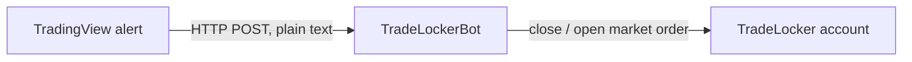
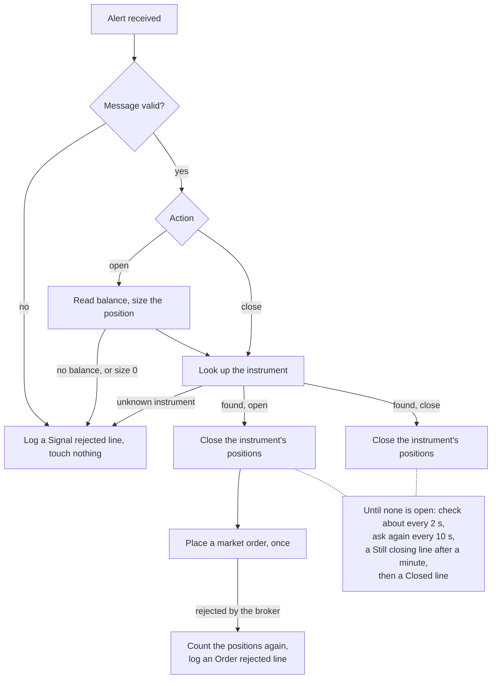

<div align="center">

# TradeLockerBot

**Automated TradeLocker position management driven by TradingView webhook alerts.**

[](https://github.com/Akinzou/TradeLockerBot/actions/workflows/python-package.yml)
[](https://github.com/Akinzou/TradeLockerBot/actions/workflows/docker-image.yml)
[](https://creativecommons.org/licenses/by-nc-sa/4.0/)
[](https://discord.gg/BARYa55KS8)

</div>

> [!WARNING]
> This bot places real orders on the account you connect. Test every strategy
> on a **demo** account first. The software is provided "as is", without any
> warranty; you use it at your own risk.

## Table of contents

- [How it works](#how-it-works)
- [Requirements](#requirements)
- [Quick start](#quick-start)
- [Configuration](#configuration)
- [Connecting TradingView](#connecting-tradingview)
  - [Alert message format](#alert-message-format)
  - [Dynamic lot size](#dynamic-lot-size)
  - [Inverting the direction](#inverting-the-direction)
- [Verifying the setup](#verifying-the-setup)
- [Telegram notifications](#telegram-notifications)
- [Updating](#updating)
- [Security](#security)
- [Troubleshooting](#troubleshooting)
- [Development](#development)
- [Community](#community)
- [License](#license)

## How it works



1. A TradingView strategy fires an alert with a seven-line message.
2. The bot receives it on its webhook URL and replies `200` at once; the
   signal is handled in the background. The reply says the alert arrived,
   not what came of it.
3. The bot checks the message first. An invalid one is logged and ignored.
4. Valid signals are handled one at a time:
   - For `close`, the bot looks up the instrument, then closes every open
     position on it.
   - For `open`, it reads the account balance, sizes the position and looks
     up the instrument. Only then does it close the instrument's open
     positions and place a market order with the configured take profit and
     stop loss.
   - If the balance is missing, the size comes out as zero, or the
     instrument is unknown, the signal is logged and ignored before anything
     is closed.
   - Closing waits until the broker lists no position on the instrument,
     with no time limit. The bot checks about every two seconds and asks
     the broker to close again every 10 seconds. If a position is still
     open a minute after the first request, for example with the market
     closed, the log shows one `Still closing:` line, and once the broker
     lists none, one `Closed:` line. Every later signal
     waits until the close is done, then runs, in no set order. A check or
     request that gets no answer ends the wait with the client's error.
   - If the broker answers the order without creating it, the bot does not
     send it again. The positions stay closed, and the log shows one
     `Order rejected:` line with the broker's reason and what the broker
     lists on the instrument afterwards. A rejection the broker sends as an
     HTTP error still shows as the client's traceback.



For a component-level view, see [docs/architecture.md](docs/architecture.md).

## Requirements

- A TradeLocker account (demo or live) and its username, password and server.
- [Docker](https://docs.docker.com/get-docker/).
- A host TradingView can reach, ideally behind an HTTPS reverse proxy (see
  [Security](#security)).

## Quick start

Pull the image:

```sh
docker pull ghcr.io/akinzou/tradelocker_bot:latest
```

Create a secret webhook path once and keep it, for example:

```sh
python3 -c "import secrets; print('/' + secrets.token_urlsafe(24))"
```

Put your TradeLocker password in a file only you can read, alone on one
line. Use an editor rather than `echo`, which would leave the password in
your shell's history:

```sh
touch ~/.tradelocker_password
chmod 600 ~/.tradelocker_password
nano ~/.tradelocker_password
```

Start the bot in the background (replace the placeholders, and choose `demo`
or `live`):

```sh
docker run -d -t --name prod --restart unless-stopped -p 443:443 \
  --mount type=bind,source="$HOME/.tradelocker_password",target=/run/secrets/tradelocker_password,readonly \
  -e password_file=/run/secrets/tradelocker_password \
  -e username='your_username' \
  -e server='your_server' \
  -e env=demo \
  -e url=/your_secret_path \
  ghcr.io/akinzou/tradelocker_bot:latest
```

The file is mounted read-only and read once at startup, so `docker inspect`
shows only its path. `--mount` rather than `-v`: for a file that does not
exist, `-v` creates a directory in its place, owned by root, and `--mount`
stops with an error
([ADR 0024](docs/adr/0024-read-the-password-from-a-file.md)). You can
instead set `-e password='your_password'`, but not both.

The webhook path is a secret too. To keep it out of your shell's history,
put the variables in a file only you can read, one `name=value` per line,
and pass `--env-file that_file` instead of the `-e` lines.

With Docker Compose, declare the password file as a secret. Compose mounts
it under `/run/secrets/`, with the secret's name:

```yaml
services:
  bot:
    image: ghcr.io/akinzou/tradelocker_bot:latest
    restart: unless-stopped
    ports: ["443:443"]
    env_file: tradelocker.env  # username, server, env and url, one name=value per line
    environment:
      password_file: /run/secrets/tradelocker_password
    secrets: [tradelocker_password]
secrets:
  tradelocker_password:
    file: ./tradelocker_password  # beside this file, readable only by you
```

Follow its output with `docker logs -f prod`. The container keeps running
after you log out and comes back after a reboot, with the same webhook path.

## Configuration

All settings are passed as environment variables (`-e name=value`).

| Variable   | Required | Default     | Description                                                                                         |
|------------|----------|-------------|-----------------------------------------------------------------------------------------------------|
| `username` | yes      |             | TradeLocker username or email.                                                                      |
| `password_file` | one of the two |  | Path, inside the container, of a file that holds the TradeLocker password on one line, such as a mounted secret (see [Quick start](#quick-start)). One line ending at the end is dropped and nothing else; spaces count. The bot refuses to start if the file cannot be read, is empty, is longer than 1024 bytes, holds more than one line or a NUL character, is not UTF-8 or starts with a byte order mark, and never prints its content ([ADR 0024](docs/adr/0024-read-the-password-from-a-file.md)). Read once at startup: after changing the password, restart the bot. |
| `password` | one of the two |       | TradeLocker password, if you do not use `password_file`. Read only from the environment, never from the command line; any character is allowed. `docker inspect` shows it. |
| `server`   | yes      |             | TradeLocker server name.                                                                            |
| `env`      | yes      |             | `demo` or `live`.                                                                                   |
| `url`      | no       | `/strategy` | Webhook path. Use a long secret path (see [Quick start](#quick-start)). It must start with `/` and must not contain `{`, `}`, `?`, `#` or `%`: otherwise the bot refuses to start, with `argument --url: must start with / or be generate` ([ADR 0014](docs/adr/0014-require-a-leading-slash.md)), `argument --url: must not contain { or }` ([ADR 0015](docs/adr/0015-refuse-braces-in-the-webhook-path.md)) or `argument --url: must not contain ?, # or %` ([ADR 0020](docs/adr/0020-refuse-query-fragment-and-escape-characters-in-the-webhook-path.md)). A sender reads `?`, `#` and `%` as URL syntax, so a path with one may be reached only percent-encoded, and alerts sent to it as typed get `404`; images built before ADR 0020 start with it, so keep them out of `url` there. Images built before ADR 0015 read `{name}` as a pattern that also handles signals posted to other paths, so keep braces out of `url` there too. `generate` prints a new random path on every start, made the same way as in Quick start. |
| `acc_id`   | no       | `0`         | Trade on the account with this ID. With both `acc_id` and `acc_num` at `0`, the first account listed for your login is used. |
| `acc_num`  | no       | `0`         | Trade on the account with this number. Set either `acc_id` or `acc_num`, not both.                  |
| `telegram_token_file` | with `telegram_chat_id` | | Path, inside the container, of a file that holds a Telegram bot token on one line, read under the same rules as `password_file`. With `telegram_chat_id`, turns on [Telegram notifications](#telegram-notifications). |
| `telegram_chat_id` | with `telegram_token_file` | | The chat to send to: its number, such as `-1001234567890`, or `@` and a public channel's name. Set both or neither: with one alone the bot does not start. |

The bot listens on port `443` inside the container. To expose it on another
host port, change the left side of `-p`, for example `-p 8080:443`.

The image starts the bot without a shell, so every value reaches it exactly
as set ([ADR 0018](docs/adr/0018-read-the-settings-from-the-environment.md)):
spaces and shell characters are fine, and nothing is trimmed, so a trailing
space in `env` stops the bot. Set exactly one of `password_file` and
`password`; an empty one counts as not set. Without either, the bot stops
with
`no password: set password_file to a file that holds it, or the password environment variable`;
with both, with
`set either password_file or the password environment variable, not both`.
Images built before ADR 0024 ignore `password_file`. Images built
before ADR 0018 pass the values through an unquoted shell, which splits
or expands a value with spaces, `*`, `?` or `[`; on those, use a password
without them.

When you run the bot outside the image, every setting except
`password_file`, `password`, `telegram_token_file` and `telegram_chat_id`
can also be given as an option of the same name, such as `--url /path`.
The option replaces the variable, and `--acc_num` or `--acc_id` replaces
both. On Windows, give `--username`: variable names ignore case there, so
`USERNAME`, your Windows login, would be read as `username`.

## Connecting TradingView

In your strategy's alert, enable **Webhook URL** and point it at
`https://your-domain/<your-url>` (or `http://your-ip:443/<your-url>` without a
proxy). Paste the message below into the alert's message field.

### Alert message format

The message is plain text, one value per line, in this exact order:

```text
XAUUSD
{{strategy.order.action}}
0.01/100
500
1000
{{strategy.order.alert_message}}
NonInvert
```

| Line | Example                            | Meaning                                                                                                   |
|------|------------------------------------|-----------------------------------------------------------------------------------------------------------|
| 1    | `XAUUSD`                           | Instrument name exactly as TradeLocker lists it, case included. A name the broker does not list is rejected before anything is closed. The bot reads the list once at startup. |
| 2    | `{{strategy.order.action}}`        | Direction: `buy` or `sell`; case and surrounding spaces are ignored. TradingView fills this in.           |
| 3    | `0.01/100`                         | Position size; see [Dynamic lot size](#dynamic-lot-size).                                                 |
| 4    | `500`                              | Take profit as a whole-number offset from the entry price.                                                |
| 5    | `1000`                             | Stop loss as a whole-number offset from the entry price.                                                  |
| 6    | `{{strategy.order.alert_message}}` | Action: `open` or `close`; case and surrounding spaces are ignored. Set it as the order's alert message in your Pine Script strategy. |
| 7    | `NonInvert`                        | Exactly `NonInvert` (keep the direction) or `Invert` (reverse it). See [Inverting the direction](#inverting-the-direction). |

`open` needs all seven lines. `close` reads only lines 1 and 6, so the other
lines may hold anything, or be left out.

What each action does:

- **`open`**: closes every open position on the instrument, then opens a new
  market order in the given direction.
- **`close`**: closes every open position on the instrument.

> [!IMPORTANT]
> The bot checks every line a signal needs before it touches the account. If
> one is missing or invalid, nothing is closed or opened, and the log shows a
> red line naming it, for example:
>
> ```text
> Signal rejected: line 3 (lot) is '0.01', expected <lot>/<balance step>, two positive numbers
> ```
>
> A signal can also be rejected once the broker has answered, still before
> anything is closed:
>
> ```text
> Signal rejected: line 1 (symbol) is 'GBPUSD', expected an instrument the broker lists
> Signal rejected: line 3 (lot) gives 0.0 at a balance of 10.0, expected a quantity above 0
> Signal rejected: the account balance is missing or not a number, expected a number to size the position from
> ```
>
> The webhook answers `200 OK` all the same, so TradingView's alert log
> shows the alert as delivered. The answer says the alert arrived, not what
> came of it; the outcome is in the bot's log only
> ([ADR 0023](docs/adr/0023-the-webhook-answer-acknowledges-receipt.md)).

### Dynamic lot size

Line 3 uses the format `<lot>/<balance step>`: open `<lot>` lots for every
`<balance step>` of account balance. The result is rounded to two decimals.
Both parts are required, and both must be positive numbers.

```text
lot = round(balance / balance_step * base_lot, 2)

balance 1000, message 0.01/100  ->  1000 / 100 * 0.01  =  0.10 lots
balance 1234, message 0.01/100  ->  1234 / 100 * 0.01  =  0.12 lots
balance   10, message 0.01/100  ->    10 / 100 * 0.01  =  0.00 lots  (rejected)
```

The result must be above zero. If the balance is too small for the lot to
round up to 0.01, the signal is rejected, and the instrument's open positions
are left as they are. The broker's own minimum lot and lot step still apply:
an order below them is rejected by the broker.

### Inverting the direction

With `Invert` on line 7, `buy` becomes `sell` and `sell` becomes `buy`. This
lets one strategy drive an account that trades against it, for example for
hedging. With `NonInvert` the direction is used unchanged.

## Verifying the setup

After start-up the console shows the bot's banner, followed by a log line
confirming the login:

```text
[INFO] tradelocker.tradelocker_api ... Successfully fetched authentication tokens
```

Then a line names the account it signed in to, by the same names as the
`acc_id` and `acc_num` settings:

```text
Logged in: acc_id 123456, acc_num 1
```

Check that this is the account you intend to trade on.

Opening the webhook URL in a browser should return:

```json
{"detail":"Method Not Allowed"}
```

That is expected: the webhook accepts only `POST` requests, which is what
TradingView sends. Open the URL exactly as `url` sets it: with a trailing `/`
added or missing, the bot answers `{"detail":"Not Found"}` instead.

Each request also leaves one line in the bot's log, without the path:

```text
INFO:     203.0.113.7:52403 - "<request line hidden>" 405 Method Not Allowed
```

## Telegram notifications

The bot can also send to a Telegram chat every line you have to act on:
`Signal rejected:`, `Order rejected:`, `Still closing:`,
`Broker failed:` and `Bot failed:`. It also sends the `Logged in:` line
at each start, `Login failed:` when the login fails, and the
`Closed:` line that ends a `Still closing:` one, so the
chat learns that the wait is over. Other lines for signals that went as
expected stay in the log only.

Sending never delays a trade. If Telegram is slow or down, the bot trades
on, tries each message three times, and logs one red line for each
message it could not send. A message that arrives a minute or more after
the bot logged it says how late it is. If more than 100 messages are
waiting, the newest are dropped, and the chat later hears how many
([ADR 0027](docs/adr/0027-send-the-red-lines-to-telegram.md)).

1. In Telegram, open a chat with **@BotFather**, send `/newbot` and
   follow its questions. It answers with the bot's token, such as
   `123456:ABC-DEF1234ghIkl-zyx57W2v1u123ew11`. Anyone with the token can
   send as your bot, so treat it like a password.
2. Open a chat with your new bot and send it `/start`. A bot cannot write
   to someone who has not. For a group, add the bot to the group; for a
   channel, add it as an administrator that can post.
3. Find the chat's number. Send the bot a message, then open
   `https://api.telegram.org/bot<token>/getUpdates` in your own browser,
   with your token in place of `<token>`, and read `"chat":{"id":...}`.
   A group's or channel's number starts with `-`. For a public channel
   you can use `@` and its name instead.
4. Put the token in a file only you can read, alone on one line, as for
   the password in [Quick start](#quick-start), and mount it the same way:

   ```sh
     --mount type=bind,source="$HOME/.telegram_token",target=/run/secrets/telegram_token,readonly \
     -e telegram_token_file=/run/secrets/telegram_token \
     -e telegram_chat_id=123456789 \
   ```

   With Docker Compose, add a second secret beside the password's:

   ```yaml
       environment:
         password_file: /run/secrets/tradelocker_password
         telegram_token_file: /run/secrets/telegram_token
         telegram_chat_id: "123456789"
       secrets: [tradelocker_password, telegram_token]
   secrets:
     telegram_token:
       file: ./telegram_token
   ```

5. Start the bot. After the greeting the log shows

   ```text
   Telegram: on; the account line, every red line and each Closed line also go to the chat
   ```

   and the chat gets `Logged in: acc_id ..., acc_num ...`. If it does
   not, the log says why in a red line, such as
   `Telegram: the "Logged in" message was not sent: HTTP 403, "Forbidden: bot can't initiate conversation with a user"`;
   see [Troubleshooting](#troubleshooting). If the login fails, the chat
   gets `Login failed: ...` instead, once per start: with
   `--restart unless-stopped`, a wrong password sends one each time
   Docker restarts the bot.

The messages pass through Telegram's servers and are not end-to-end
encrypted: they name the account's id and number, the symbols, sides and
the broker's reasons, and some rejections the account balance. See
[Security](#security).

## Updating

```sh
docker pull ghcr.io/akinzou/tradelocker_bot:latest
docker stop prod
```

```sh
docker rm prod
```

Then start the container again with the same `docker run` command. If you use
`url=generate`, a new webhook path is generated, so update your TradingView
alerts.

> [!NOTE]
> Since signal validation ([ADR 0008](docs/adr/0008-validate-the-signal-before-any-broker-call.md)),
> line 2 and line 6 ignore case and surrounding spaces. An alert with `Open`
> or `close ` used to be ignored and now trades, and `close` no longer needs
> lines 2 to 5 and 7. Check your alerts' messages before you update.
>
> Since [ADR 0009](docs/adr/0009-refuse-what-the-broker-rules-out-before-closing.md),
> an `open` whose size rounds to zero is rejected instead of being sent to the
> broker as a 0-lot order, and the instrument's positions stay open. An
> unknown symbol or a missing balance is logged as one `Signal rejected:` line
> instead of a traceback.
>
> Since [ADR 0021](docs/adr/0021-report-a-rejected-order-and-place-it-once.md),
> an order the broker answers without creating is logged as one
> `Order rejected:` line instead of a traceback, and the bot does not send
> it again. The instrument's positions were closed before the order; the
> line ends with what the broker lists afterwards. The `tradelocker` client
> itself still resends a request whose connection failed, so an order can
> fill before a resend is rejected; the line then reports the open
> position.
>
> Since [ADR 0022](docs/adr/0022-pace-the-close-loop-on-a-clock.md), a
> position that does not close at once is asked to close again every 10
> seconds instead of every other second, so the log shows fewer
> `Closing:` lines, and a close still open a minute after the first request
> logs one red `Still closing:` line.
>
> Since [ADR 0024](docs/adr/0024-read-the-password-from-a-file.md), the
> password can come from a file instead of the `password` variable. To
> move to it, create the file as in [Quick start](#quick-start), add the
> `--mount` and `password_file` lines and remove `-e password=...`: with
> both set, the bot does not start.
>
> Since [ADR 0025](docs/adr/0025-run-the-broker-client-at-info.md), the
> log no longer holds the client's request lines, `=> REST REQUEST: ...`,
> which carried the password and the tokens. A `Logged in: acc_id ...,
> acc_num ...` line names the account instead. Removing the old container
> removes its log; see [Security](#security).
>
> Since [ADR 0026](docs/adr/0026-write-stdout-line-by-line.md), each line
> reaches `docker logs` when the bot prints it, also without `-t` or
> `tty: true`. Before, a trade's lines and every rejection waited there
> for the next alert.
>
> Since [ADR 0027](docs/adr/0027-send-the-red-lines-to-telegram.md), a
> broker call that gets no answer logs one red `Broker failed:` line
> before the client's traceback, any other exception that ends a signal
> one `Bot failed:` line, and the bot can send the red lines to
> Telegram. Images built before ignore `telegram_token_file` and
> `telegram_chat_id` and start without Telegram: pull the new image
> before you set them.
>
> Since [ADR 0028](docs/adr/0028-say-when-a-slow-close-ended.md), a close
> that logged `Still closing:` ends with one green
> `Closed: the broker lists no open XAUUSD position N seconds after the first close request`
> line, also sent to Telegram. With Telegram on, the startup line reads
> `Telegram: on; the account line, every red line and each Closed line also go to the chat`.

## Security

- **Keep the webhook path secret.** It is the only thing protecting the
  endpoint: anyone who knows it can open and close trades on your account.
  Create it with a cryptographically secure generator, as in
  [Quick start](#quick-start). `url=generate` uses the same generator
  ([ADR 0012](docs/adr/0012-generate-the-webhook-path-with-secrets.md)),
  but prints a new path on every start, so every restart means updating
  your alerts.
- **The bot serves only the webhook.** It has no API documentation pages and
  no OpenAPI schema, so no page names the webhook path
  ([ADR 0011](docs/adr/0011-serve-no-api-docs.md)). Addresses it does not
  serve answer `404 Not Found`. Its log has one line per request, with the
  client and the status but not the path
  ([ADR 0016](docs/adr/0016-hide-the-request-line-in-the-access-log.md)).
  With `url=generate`, the path is still printed once at every start, so
  treat that log as secret. Images built before that change write the path
  of every request, so treat their log as secret too. A reverse proxy in front of the bot logs the
  path by default (Nginx and Caddy write every request line), so keep it
  out of the proxy's log too.
- **Use the exact path in your alerts, and forward only that path.** The bot
  handles only the exact `url` path: it refuses to start with a `{` or `}`
  in `url`, which would make the path a pattern
  ([ADR 0015](docs/adr/0015-refuse-braces-in-the-webhook-path.md)), or with
  a `?`, `#` or `%`, which a sender reads as part of the URL's syntax
  ([ADR 0020](docs/adr/0020-refuse-query-fragment-and-escape-characters-in-the-webhook-path.md)). A path
  that differs by a trailing `/`
  gets `404 Not Found` like any other address, and the bot never redirects a
  sender elsewhere
  ([ADR 0013](docs/adr/0013-no-trailing-slash-redirect.md)). Images built
  before that change answer such a path with a `307` redirect to an
  `http://` address, so a sender that follows it sends the secret path and
  the signal unencrypted. On those images, configure your reverse proxy to
  forward only the exact webhook path and to answer every other path itself;
  on any image, that is good practice.
- **Use HTTPS.** The bot serves plain HTTP, so without TLS anyone on the
  network path can read the webhook path and send forged signals. Put the bot
  behind a reverse proxy such as Nginx or Caddy that terminates TLS. The bot's
  own connection to TradeLocker already uses HTTPS.
- **Protect the host.** The bot reads its settings from its environment,
  so its command line, which every user of the host can read in the
  process list, holds neither the password nor the webhook path
  ([ADR 0018](docs/adr/0018-read-the-settings-from-the-environment.md)).
  Images built before that change show both there. The environment is
  still visible to anyone who can run `docker inspect`, and a `docker run`
  typed with `-e password=...` stays in your shell's history, so set the
  password with `password_file` and the rest with `--env-file` (see
  [Quick start](#quick-start)). `docker inspect` then shows the file's
  path, not the password
  ([ADR 0024](docs/adr/0024-read-the-password-from-a-file.md)). The bot
  keeps the password in memory while it runs. Run the bot on a host only
  you control.
- **Remove logs written by older images.** Images built before
  [ADR 0025](docs/adr/0025-run-the-broker-client-at-info.md) ran the
  `tradelocker` client at `debug`, which writes every request to the log
  whole: the password on every start, and the tokens that let anyone
  trade on the account. The bot now runs the client at `info`, which
  logs no request. A container started from an older image keeps them
  in its log until you remove it with `docker rm`, which the
  [Updating](#updating) steps do. That holds for Docker's default
  `json-file` log driver; with another driver, such as `journald` or a
  log shipper, the log outlives the container. If such a log has left the
  host, in a log collector or a pasted support request, change the
  password.
- **Telegram sees what the bot sends there.** With
  [Telegram notifications](#telegram-notifications) on, each red line,
  each `Closed:` line and the account line leave the host: the
  account's id and number, symbols,
  sides, the broker's reasons, and in some rejections the balance.
  Telegram keeps them, without end-to-end encryption, and everyone in the
  chat reads them, so use a private chat or a channel only you read. The
  bot token comes only from a file, like the password, and the bot never
  prints it; if it leaks, revoke it with BotFather's `/revoke`
  ([ADR 0027](docs/adr/0027-send-the-red-lines-to-telegram.md)).

## Troubleshooting

| Symptom                                     | Likely cause                                                                                   |
|---------------------------------------------|------------------------------------------------------------------------------------------------|
| No trade after an alert                     | The log shows `Signal rejected:` with the line to fix, or `Order rejected:` with the broker's reason. Otherwise a broker call got no answer, and the log shows `Broker failed:` and the client's error. TradingView shows the webhook as delivered in each case: the bot answers once the alert arrives, not once it is traded. |
| `Signal rejected: line 1 (symbol) ...`      | The broker lists no instrument with that exact name. Copy it from TradeLocker, case included. If the name is right, restart the bot: it reads the instrument list once at startup, so an instrument added later stays unknown until a restart. |
| `Signal rejected: line 3 (lot) gives 0.0 ...` | The balance is too small for this lot. Raise the lot or lower the balance step on line 3. |
| `Signal rejected: the account balance is ...` | The broker reported no balance, a balance that is not a number, or one that is not above zero. Check the account in TradeLocker, then send the alert again. |
| `Order rejected: the broker refused to buy XAUUSD (...); no XAUUSD position is open` | The broker answered the order without creating it, for the reason in brackets; margin, its minimum lot or a closed market are the likely causes. The positions on the instrument were closed first, and the broker lists none now. The bot does not send the order again; open the position by hand or wait for the next alert. |
| `Order rejected: ...; the broker lists 1 open XAUUSD position, check it in TradeLocker` | The order was rejected, but a position is open on the instrument: an earlier attempt of the same order may have filled before the client resent it, or one was opened by hand. Check it in TradeLocker before you open another. With `the position count got no answer`, the bot could not count, and a traceback follows. |
| `Still closing: the broker lists 1 open XAUUSD position 60 seconds after the first close request; ...` | The broker has not filled the close. A closed market, a weekend for example, is the likely cause. The bot keeps asking every 10 seconds, with no time limit, and every alert that arrives meanwhile waits. Once the position closes they all run, one at a time but in no set order, on alerts that may be old. If they should not, restart the container: that drops them, but the bot then stops asking, so an `open` that was closing never places its order. A plain stop waits for the close and needs Docker's timeout to kill the process. What the broker does with the close requests already sent was not observed: check the instrument in TradeLocker. If a check gets no answer, the wait ends with the client's error instead. Once the broker lists none, the log shows `Closed:`, and with Telegram on so does the chat; a restart before that leaves the chat without it. |
| One alert traded more than once | TradingView sends an alert again, up to three times, after a `5xx` other than `504`. The bot answers `5xx` only when it started nothing, but a reverse proxy in front of it can answer `502` or `503` after passing the alert on, for example when its connection to the bot drops. Check the proxy's error log and TradingView's alert log for those times ([ADR 0023](docs/adr/0023-the-webhook-answer-acknowledges-receipt.md)). |
| Position closed but no new one opened, and no `Order rejected:` line | The order request got no answer, and the log shows the client's error. The order may still have been placed: check the account in TradeLocker. |
| Bot does not start, login fails             | Wrong credentials or `env`. On images built before [ADR 0018](docs/adr/0018-read-the-settings-from-the-environment.md), also a password with spaces or shell characters (see [Configuration](#configuration)). |
| Container keeps restarting, `docker logs` shows `no password: set password_file to a file that holds it, or the password environment variable` | Set `password_file` and mount the file (see [Quick start](#quick-start)), or set `password`. An empty value counts as not set. The bot does not read `--password` or `--password_file`. Images built before [ADR 0024](docs/adr/0024-read-the-password-from-a-file.md) show `the password environment variable is not set or is empty` and read only `password`. |
| Container keeps restarting, `docker logs` shows `set either password_file or the password environment variable, not both` | Remove `password` from the `-e` lines or the env file, keeping the file. |
| Container keeps restarting, `docker logs` shows `password_file: the file cannot be read (No such file or directory)` | The path in `password_file` names no file inside the container. Check the `--mount` option's `target`, or the secret's name in Compose, against `password_file`. With `(Permission denied)`, check the file on the host. With `(Is a directory)`, a `-v` mount of a file that did not exist made a directory in its place: remove it with `sudo rmdir`, create the file and mount it with `--mount`. |
| `docker logs` shows `password_file: the file holds more than one line`, `is empty`, `is longer than 1024 bytes`, `holds a NUL character`, `is not UTF-8 text` or `starts with a byte order mark` | Put the password alone on the file's first line, and check that `password_file` names the password file, not the env file. Save the file as UTF-8 without a byte order mark; Windows PowerShell 5.1 writes `>` as UTF-16. The bot never prints the file's content. |
| `docker logs` shows `the following arguments are required: --server` or `argument --server: must not be empty` | The messages name the option the image fills from the variable of the same name. Set `server` (or the variable named) to a non-empty value. |
| `Method Not Allowed` in the browser         | Expected; see [Verifying the setup](#verifying-the-setup).                                     |
| Every alert gets `404 Not Found`            | Each one leaves a `<request line hidden>` line in the log with the status `404 Not Found`. The alert's URL does not match the `url` setting exactly (case included). A trailing `/` counts: `/strategy/` is not `/strategy`. On images built before [ADR 0014](docs/adr/0014-require-a-leading-slash.md), also check that `url` starts with `/`. |
| Container keeps restarting, `docker logs` shows `argument --url: must start with / or be generate` | `url` is neither `generate` nor a path that starts with `/`. Add the leading `/`. An empty `url` gets the same message; images built before [ADR 0018](docs/adr/0018-read-the-settings-from-the-environment.md) show `argument --url: expected one argument` instead. |
| Container keeps restarting, `docker logs` shows `argument --url: must not contain { or }` | `url` has a `{` or `}`. Remove it, or make a new path with the command in [Quick start](#quick-start). |
| Container keeps restarting, `docker logs` shows `argument --url: must not contain ?, # or %` | `url` has a `?`, `#` or `%`. Remove it, or make a new path with the command in [Quick start](#quick-start). Alerts must then use the new path. |
| Error about account number and ID at start  | Both `acc_id` and `acc_num` are set; keep only one.                                            |
| `Broker failed: a call for XAUUSD got no answer (...); the signal stopped there, check XAUUSD in TradeLocker` | A broker call failed, for the reason in the traceback below it. The signal stopped at that call, possibly after the positions were closed and before the order: check the instrument in TradeLocker. |
| `Bot failed: an error in the bot (...) while handling XAUUSD; ...` | A fault in the bot itself ended the signal; the traceback below it shows where. Check the instrument in TradeLocker, and please report it with the traceback, without the secrets in it. |
| `Telegram: the bot stopped with N of its messages not sent; the log has them` | The bot stopped while Telegram was slow or down. The messages are in the log above. |
| Container keeps restarting, `docker logs` shows `telegram_chat_id is set without telegram_token_file` or `telegram_token_file is set without telegram_chat_id` | Set both, or neither (see [Telegram notifications](#telegram-notifications)). An empty value counts as not set. |
| `docker logs` shows `telegram_token_file: the file holds no bot token, ...` | The file does not hold a token in BotFather's form, digits, a colon and the rest, alone on one line. Copy it again from BotFather. The other `telegram_token_file:` messages mean what they mean for `password_file`. |
| `docker logs` shows `telegram_chat_id: expected a chat's number, ...` | Use the number from `getUpdates`, with its `-` if it has one, or `@` and a public channel's name. |
| `Telegram: the "..." message was not sent: HTTP 403, ...`, such as `"Forbidden: bot can't initiate conversation with a user"` or `'Forbidden: bot was blocked by the user'` | Open the chat with your bot and send `/start`, or unblock it. For a channel, make the bot an administrator that can post. |
| `Telegram: the "..." message was not sent: HTTP 400, ...`, such as `'Bad Request: chat not found'` | `telegram_chat_id` names a chat the bot is not in. Check the number, its `-`, and that the bot was added to the group or channel. |
| `Telegram: the "..." message was not sent: HTTP 401, 'Unauthorized'` or `HTTP 404, 'Not Found'` | The token is wrong or was revoked. Put the current one from BotFather in the file and restart. |
| `Telegram: the "..." message was not sent after 3 tries: no answer (...)` | The host could not reach `api.telegram.org`. Check its network and firewall. Trading goes on; the line itself is in the log above. |

Known defects and their planned fixes are listed in the
[migration roadmap](docs/migration-roadmap.md#known-defects), and those kept
by decision [after them](docs/migration-roadmap.md#kept-by-decision).

## Development

Requires Python 3.11 or 3.12.

```sh
python -m venv .venv
.venv/bin/python -m pip install -r requirements.txt -r requirements-dev.txt   # Windows: .venv\Scripts\python
.venv/bin/python -m pip install --no-deps -r requirements-overrides.txt
.venv/bin/python -m pytest
```

The second install replaces the versions of PyJWT, requests and
python-dotenv that the `tradelocker` client pins, as the image does
([ADR 0017](docs/adr/0017-override-the-clients-vulnerable-pins.md)).
Installing `requirements.txt` again brings the pinned versions back, so run
both installs again, in this order.

- Every pull request to `master` must pass the CI gates described in
  [ADR 0002](docs/adr/0002-ci-quality-gates.md): tests on Python 3.11 and
  3.12, Semgrep, and a Docker build with a smoke run and a check of its
  packages and its Python against the lock. The `tests` job also checks that the lock
  holds every package its packages need.
- The codebase is being migrated, step by step, to a layered architecture; see
  [`docs/architecture.md`](docs/architecture.md), the
  [decision records](docs/adr) and the
  [migration roadmap](docs/migration-roadmap.md).
- `main_without_ssl.py` keeps its name because the image runs it, but it only
  calls `main()` in `tradelocker_bot/composition_root.py`. That module reads
  the settings and wires the adapters to the use case
  ([ADR 0010](docs/adr/0010-webhook-adapter-and-composition-root.md)).
  Everything else lives in the `tradelocker_bot` package:

  | Package       | Holds                                                               |
  |---------------|---------------------------------------------------------------------|
  | `domain`      | trading rules                                                       |
  | `application` | the use case and its ports                                          |
  | `adapters`    | the TradeLocker client and login, the webhook, the operator console, the system clock |
- The image installs `requirements-lock.txt`: every runtime package at one
  version, verified by hash ([ADR 0007](docs/adr/0007-locked-runtime-dependencies.md)).
  After changing `requirements.txt`, or to take dependency updates,
  regenerate it with the `uv pip compile` command in its header (add
  `--upgrade` to move every package) and commit both files together.
- `requirements-overrides.txt` lifts the `tradelocker` client's exact pins
  on PyJWT, requests and python-dotenv, whose pinned versions have
  published advisories. The image therefore installs the lock without
  dependency resolution, and CI checks the lock is complete instead
  ([ADR 0017](docs/adr/0017-override-the-clients-vulnerable-pins.md)).
  When a new client release allows a fixed version, the check fails until
  the override is removed.
- The image builds on `python:3.11-slim` pinned by digest, so a rebuild
  of a commit gives the same image
  ([ADR 0019](docs/adr/0019-pin-the-base-image-by-digest.md)). Dependabot
  proposes the tag's new digest as a pull request; merge it once CI is
  green. If it does not, a weekly check opens the issue "The base image's
  pin may be stale", and the ADR shows how to bump the digest by hand. A newer Python means a new tag, digest
  and lock in one pull request.
- The `tradelocker` client is pinned to the version the test suite's broker
  fake mirrors. Moving to a newer release means updating the pin and
  `TRADELOCKER_VERSION` in `tests/characterization/fake_tradelocker.py`, and
  the fake itself if signatures or defaults changed, in one pull request.

## Community

Questions, ideas and strategy talk: join us on
[Discord](https://discord.gg/BARYa55KS8).

## License

Licensed under [CC BY-NC-SA 4.0](https://creativecommons.org/licenses/by-nc-sa/4.0/).
