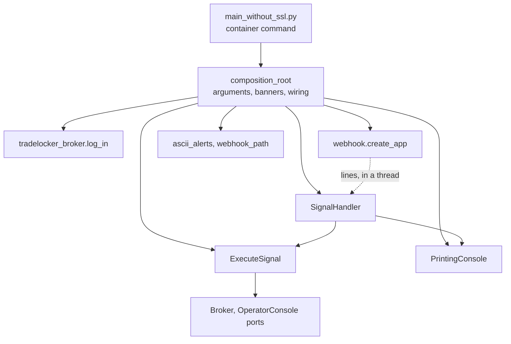

# ADR 0010: Inbound webhook adapter and a composition root

- Status: Accepted
- Date: 2026-11-11

## Context

After step 4b ([ADR 0006](0006-result-at-the-broker-boundary.md)), the use
case, the broker port and the console port were in the `tradelocker_bot`
package. `main_without_ssl.py` still did everything around them:

- it parsed the start arguments and printed the banners;
- it logged in to the broker;
- it built a module-level FastAPI app and registered the webhook route inside
  `main()`;
- it held the process-wide lock;
- it turned the use case's `Result` into what the webhook thread does.

The banners, the colours and the random webhook path lived in a separate
`libs/` package, outside every layer rule.

ADR 0006 made this step wait until no signal and no well-formed broker answer
raises from the use case. Step 3b ([ADR 0009](0009-refuse-what-the-broker-rules-out-before-closing.md))
met that condition. Step 5a then pinned the startup and the HTTP route
through the real entrypoint, so this move can be checked against
characterization tests with unchanged assertions.

## Decision

Split the legacy script by responsibility. One module wires everything, and
each piece of I/O sits in an adapter.

1. **Inbound HTTP adapter** (`adapters/webhook.py`). `create_app(path, handle)`
   builds the app, decodes the body, splits it into lines and starts one
   thread per request with `handle(lines)`. It knows nothing of signals, the
   broker or the lock. The route function keeps the name `process_webhook`,
   because the served OpenAPI document derives its operation id and summary
   from that name.
2. **Signal handler** (`adapters/signal_handler.py`). `SignalHandler.handle`
   parses the lines and refuses an invalid signal before the lock. It then
   runs the use case inside the lock. A refusal becomes one operator line,
   and a broker failure re-raises the client's own exception inside the
   lock, as before. The use case, the console and the lock are injected.
3. **Login** (`adapters/tradelocker_broker.py`). `log_in` holds the broker's
   server address for each `--env` choice and the account-selector rule. It
   lives next to the other code that talks to the `tradelocker` client.
4. **Composition root** (`tradelocker_bot/composition_root.py`). `main()`
   does what the legacy `main()` did, in the same order:
   1. parse the arguments;
   2. the URL banner and the generated path, for `--url generate`;
   3. the greeting;
   4. the account selectors as integers;
   5. the login;
   6. the app, around one lock for the whole process;
   7. `uvicorn.run(app, host="0.0.0.0", port=...)`.

   `build_signal_handler(client, lock)` builds the handler, and both `main()` and
   the characterization harness call it. The tests therefore run the wiring
   the bot serves, not a copy of it.
5. **`libs/` is gone.** The colours and banners moved to
   `adapters/ascii_alerts.py` and the path generator to
   `adapters/webhook_path.py`, both under the adapters' rules.
6. **`main_without_ssl.py` stays as the container's command,** as the frozen
   contract requires. It only imports `main` and calls it.
7. **A fitness rule keeps the root outermost.**
   `tests/test_layer_dependencies.py` lists `composition_root.py` as an outer
   entry. Neither the adapters nor the package's own `__init__` may import
   the root or the entrypoint script, and probe sources prove that this rule
   fires and stays quiet where it should. The domain and application
   allow-lists already exclude both.

## What is the same, and what is not

The characterization suite passes with unchanged assertions. Only the seam
(`tests/characterization/harness.py`) moved:

- the login is patched in the TradeLocker adapter;
- the server start is patched on `uvicorn`;
- the signal handler is reached through `composition_root.build_signal_handler`;
- the path generator is reached through the adapters.

The harness no longer restores a module-level app's routes, because each
startup now builds its own app.

These differences are outside ADR 0001's equivalence rule, and the pull
request declares them:

- **Built once, not per request.** The console, the broker adapter and the
  use case are created at startup rather than for every request. None holds
  any state but its collaborators, so the broker calls, the operator lines
  and the lock are the same.
- **The thread's name.** Python names a thread after its target. A broker
  failure's traceback on stderr now opens with
  `Exception in thread Thread-N (handle)` rather than
  `(handle_position_normal)`. ADR 0006 already left the traceback's frames
  outside the rule.
- **The greeting is a raw string.** The legacy string held backslash
  sequences that are no valid escape. Python kept them as written, but
  warned with a `SyntaxWarning` on stderr when it compiled the module, and a
  future Python makes that an error. The bytes are identical, and the
  startup tests pin them byte for byte. The roadmap's defect row is closed.
- **The environment check moved after the banners.** Legacy raised
  `ValueError("Invalid environment ...")` for an `--env` outside
  `live`/`demo` before printing anything; `log_in` now raises the same error,
  before any credentials are sent. No command line reaches it: argparse's
  `choices` stop such a value first, with exit status 2, as the startup
  tests pin. It stays because `log_in` is a public function, and another
  caller deserves the legacy message rather than a bare `KeyError`; unit
  tests pin it.

## Consequences

- Every module the bot runs is under a layer rule or is the composition
  root. Code outside the package is only the three-line entrypoint.
- The inbound adapter can change how it answers (step 6: the answer before
  handling, the API docs, the trailing-slash redirect) without touching the
  wiring or the use case.
- Reporting a refusal or a broker failure to the caller, as ADR 0006 and
  ADR 0009 anticipated, is now a change to `SignalHandler` and `create_app`
  alone. It is still a behaviour change, so it waits for step 6.

## Alternatives considered

- **Keep the legacy name `handle_position_normal` for the thread target,**
  so the stderr header stays the same. Rejected: the name describes a
  function that no longer exists, and stderr's traceback is not part of the
  pinned behaviour (ADR 0006).
- **Build the console, broker adapter and use case per request,** as legacy
  did. Rejected: it would repeat the wiring on every request for no
  observable difference, and the wiring belongs in the composition root.
- **Move the startup into `tradelocker_bot/__main__.py`** and run
  `python -m tradelocker_bot`. Rejected: the container command
  `main_without_ssl.py` is part of the frozen contract.
- **A `src/` layout with `pip install .` in the image.** Still deferred
  ([ADR 0004](0004-flat-application-package.md)): with the entrypoint name
  frozen, it would change the image build for no gain in this step.
- **Move `libs/` verbatim,** invalid escapes included. Rejected: it would
  copy a known `SyntaxWarning` into the package. The startup pin proves the
  raw string is the same text.
