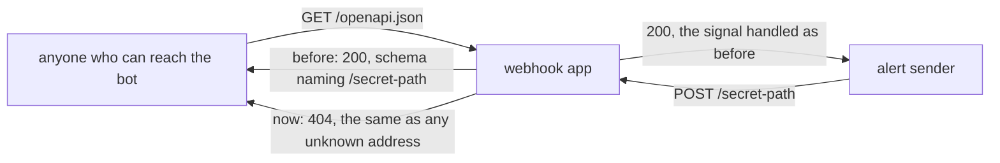

# ADR 0011: Serve no API docs, so no page names the webhook path

- Status: Accepted
- Date: 2026-11-11

## Context

The webhook path is the endpoint's only protection: anyone who knows it can
open and close trades on the account. With `url=generate` it is a random
path, and the README tells operators to keep their own path secret.

The inbound adapter built a bare `FastAPI()` app
([ADR 0010](0010-webhook-adapter-and-composition-root.md)). FastAPI's
defaults serve three more addresses next to the webhook:

- `/openapi.json`, the OpenAPI schema. It lists every route, so it named
  the webhook path in plain text;
- `/docs` (Swagger UI) and its `/docs/oauth2-redirect` helper;
- `/redoc`.

So anyone who could reach the bot could read the secret path with one `GET`
and then send signals. Step 5a pinned this as a known defect
(`test_the_default_api_docs_are_served_and_list_the_webhook_path`). The
README told operators to work around it by letting their reverse proxy
forward only the webhook path.

Nothing uses these addresses. The sender only posts to the webhook, the
Dockerfile has no health check, and no workflow calls the bot over HTTP. A
grep of the whole repository found them only in the README's security
advice, the roadmap's defect row, a sentence in ADR 0010 and the pin
itself.

## Decision

Build the app as `FastAPI(openapi_url=None)`.

- Without a schema URL, FastAPI registers no schema route and none of the
  three docs pages, which all need the schema. One switch turns off all
  four addresses. Turning off only `/docs` and `/redoc` would leave the
  schema, which is the part that leaks.
- Each of the four addresses now answers `404` with the body
  `{"detail":"Not Found"}`, exactly like an address the app never had. A
  scan cannot tell that docs were ever there.
- The webhook route itself is unchanged: the same path, method, answer,
  body decoding and thread per request.

## What changes

- The pin is replaced. `test_no_api_docs_are_served_so_no_page_names_the_webhook_path`
  checks each of the four addresses: `404` with the body
  `{"detail":"Not Found"}`, and the same headers as an unknown address. The
  existing route and startup tests still post signals to the default and to
  a custom path, so the route itself stays pinned.
- The route function's name `process_webhook` no longer shows anywhere. It
  used to be the schema's operation id and summary, which is why
  ADR 0010 kept the legacy name. It is not renamed here: the name is now
  free to change, but a rename belongs to a change that needs one.
- The README's security advice no longer says the bot publishes its path.
  Forwarding only the webhook path from the proxy is still good practice,
  because the trailing-slash redirect is a separate defect.

## What this does not cover

The served pages were one way the path leaked; two more remain, outside the
HTTP answer:

- **uvicorn's access log** writes every request line, the path included, to
  stdout (`"POST /secret-path HTTP/1.1" 200`). Anyone who can read the
  container's log can read the path. This is a separate defect in the
  roadmap: whether to turn the log off or redact the path is a change of
  what operators see, and it needs a decision of its own.

  *Update:* step 6f ([ADR 0016](0016-hide-the-request-line-in-the-access-log.md))
  drops the request line, and with it the path, from the access line.
- **`url=generate` prints the path at startup.** That is intended: the
  operator has to copy it into the alert, and the README tells them to.

## Consequences

- Operators lose the interactive docs page. It never had a use: the webhook
  takes a plain-text body, not a JSON model, so the page showed one route
  with no request schema.
- A later API that needs documented endpoints has to serve its schema
  deliberately, behind authentication or on a separate app, and not on the
  app that carries the secret path.

## Alternatives considered

- **`docs_url=None, redoc_url=None` and keep the schema.** Rejected: the
  schema is what names the path; the pages only render it.
- **Turn off all three explicitly** (`openapi_url`, `docs_url` and
  `redoc_url` set to `None`). Rejected: the last two do nothing once the
  schema is off, so they would read as protection that is not there.
  Mutation testing would also count them as untestable lines.
- **Serve the docs but leave the webhook route out of the schema**
  (`include_in_schema=False`). Rejected: it keeps three public addresses for
  a page with nothing on it, and any route added later is in the schema by
  default.
- **Leave it to the reverse proxy,** as the README advised. Rejected as the
  only defence: a bot reached directly, without a proxy, or behind a proxy
  that forwards everything, still published its path.
