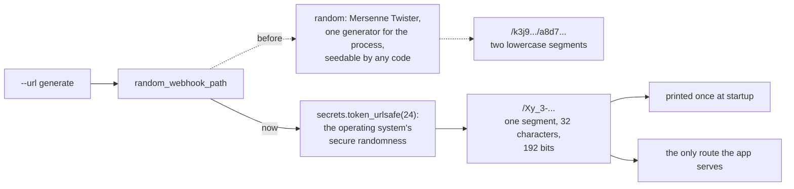

# ADR 0012: Generate the webhook path with `secrets`

- Status: Accepted
- Date: 2026-11-11

## Context

The webhook path is the endpoint's only protection: anyone who knows it can
open and close trades on the account. `url=generate` makes a new path on
every start and prints it once, for the operator to copy into their alerts.

`random_webhook_path` (moved from `libs/` in
[ADR 0010](0010-webhook-adapter-and-composition-root.md)) built that path
with the `random` module: two segments of 10 to 20 lowercase letters and
digits, `/k3j9.../a8d7...`. Python's documentation for `random` warns that
its generators are not for security purposes and points to `secrets`.
Two things made it the wrong source for a secret:

- **It is a simulation generator.** Mersenne Twister is fast and
  reproducible by design. Its output is not meant to be unguessable, so the
  path's strength rested on a property `random` does not promise.
- **Its state is shared.** `random`'s functions use one generator for the
  whole process. Any code that seeds it, such as a library or a test helper
  calling `random.seed`, decides the next path too.

To be precise about the risk: the old path was not practically predictable
in the running bot. `random` seeds itself from the operating system at
import, nothing in the bot seeded it, and an attacker sees none of its
output. With at least 20 characters from 36 symbols, the path already
carried about 100 bits. The defect is the choice of source, not a known
attack.

The README's Quick start already advised `secrets` for a path chosen by
hand: `python3 -c "import secrets; print('/' + secrets.token_urlsafe(24))"`.
The bot's own generator gave a weaker kind of path than the one the README
asked operators to make, and the README had to call `url=generate` "weaker".

Step 5a pinned the old shape as a known defect
(`test_generated_webhook_url_has_two_lowercase_alphanumeric_segments`).

## Decision

`random_webhook_path` returns `"/" + secrets.token_urlsafe(24)`, the same
generator the README advises.

- **24 bytes, 192 bits.** URL-safe base64 turns them into exactly 32
  characters from `A-Z`, `a-z`, `0-9`, `-` and `_`, with no padding. None of
  them needs escaping in a URL path, and FastAPI matches the route by the
  literal text.
- **The parameters are gone.** `min_length` and `max_length` described the
  old segments, and no caller passed them.
- **The name stays `random_webhook_path`.** The path is still random; only
  its source changed. Renaming would touch the composition root and the test
  seam for no change in meaning.

## What changes

This is a behaviour change. Its visible part is the shape of the printed
path:

| | Before | After |
|---|---|---|
| Source | `random` (Mersenne Twister) | `secrets` (operating system) |
| Shape | two segments, 10 to 20 characters each | one segment, 32 characters |
| Characters | `a-z`, `0-9` | `A-Z`, `a-z`, `0-9`, `-`, `_` |
| Strength | at least about 100 bits | 192 bits |

No operator setting breaks. `url=generate` already gives a new path on every
start, so no alert can have kept an old generated path across a restart.
The frozen contract promises a random path for `url=generate`, not its
shape.

The tests changed with it:

- **The shape pin is replaced** in `tests/characterization/test_startup.py`:
  one segment of 32 URL-safe characters, checked on 50 paths. The startup
  test for `--url generate` checks the printed path against the new shape
  and still posts a signal to it.
- **A new unit test pins the source** (`tests/unit/adapters/test_webhook_path.py`),
  because a shape says nothing about where it came from. It replaces the
  public `secrets.token_urlsafe` with a recorder and checks that the path is
  `/` plus its token, asked for with 24 bytes. A generator built on
  `random`, a hex token or a smaller token fails it.

All three, the shape pin, the startup test and the unit test, failed
against the old generator before the fix.

## What this does not cover

- **A new path on every start.** `url=generate` makes one each time the
  bot starts, so after a restart the alerts post to the old path and get
  `404` until the operator updates them. The README says so, and it is the
  frozen contract's meaning of `generate`; an operator who restarts often
  should pass a fixed path made with the README's command.
- **The path is printed at startup.** That is the point of `url=generate`:
  the operator has to copy it. Anyone who can read the container's log can
  read it.
- **uvicorn's access log** writes the path of every request to the same log.
  It is a known defect of its own in the
  [migration roadmap](../migration-roadmap.md#known-defects).
- **A path chosen by hand** is as strong as the operator makes it. The
  README's advice is the generator this ADR adopts.

## Consequences

- A generated path and a path made as the README advises are the same kind
  of secret, and the README no longer calls `url=generate` weaker.
- A generated path is longer and has mixed case, so it is harder to copy by
  hand; it is meant to be pasted.
- Images built before this step still use `random`. Their paths are not
  known to be guessable, but an operator who wants the stronger source can
  pin a path made with the README's command instead of `generate`.

## Alternatives considered

- **Keep the old shape and draw it from `secrets.choice`:** two lowercase
  segments, now from a secure source. Rejected: it keeps a variable length
  and a smaller alphabet for no benefit, and it would be a second generator
  next to the one the README already advises.
- **`secrets.token_hex(16)`:** 32 hex characters, 128 bits. Rejected: the
  same length as the chosen path with two thirds of its strength, and again
  a different generator from the README's.
- **`secrets.token_urlsafe()` with the library's default size.** Rejected:
  the default may change between Python versions, so the path's shape would
  change with the interpreter rather than with a reviewed decision.
- **Drop `url=generate` and require a path.** Rejected: `url=generate` is
  part of the frozen contract, and it is the easiest way to get a strong
  path once the generator is right.
