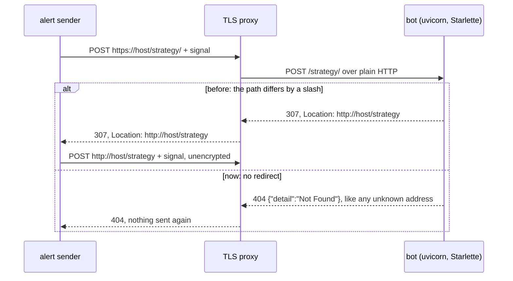

# ADR 0013: No trailing-slash redirect on the webhook

- Status: Accepted
- Date: 2026-11-11

## Context

The webhook path is the endpoint's only protection: anyone who knows it can
open and close trades on the account. The README tells operators to put the
bot behind a reverse proxy that terminates TLS, because the bot serves plain
HTTP.

The inbound adapter builds a FastAPI app
([ADR 0010](0010-webhook-adapter-and-composition-root.md)). Starlette's
router redirects by default: a request whose path differs from a route's
only by a trailing `/` gets a `307 Temporary Redirect` to the other form.
For the default path:

- `POST /strategy/` and `POST /strategy//` got a `307` to `/strategy`;
- with `url=/hook/`, `POST /hook` got a `307` to `/hook/`.

The redirect's `Location` is an absolute URL, and Starlette builds its scheme
from the request as uvicorn saw it. uvicorn 0.54 reads the scheme from
`X-Forwarded-Proto` only when the connection comes from an address it trusts,
by default `127.0.0.1` and `::1`. A proxy in another container or on another
host is not trusted, so for the bot the request was plain HTTP and the
`Location` began with `http://`. A `307` keeps the method and the body, so a
sender that followed it sent the secret path and the signal again,
unencrypted, to a public address.

Step 5a pinned the redirect as a known defect
(`test_a_trailing_slash_is_redirected_to_the_path_without_handling`). The
README advised operators to let the proxy forward only the exact path, so
the bot never saw the other form.

## Decision

Build the app with `redirect_slashes=False`:
`FastAPI(openapi_url=None, redirect_slashes=False)`.

- A path that differs from the webhook path by a slash, added or missing,
  answers `404` with `{"detail":"Not Found"}` and the same headers as any
  address the app does not serve. It starts no thread and makes no broker
  call.
- The webhook path itself is unchanged: the same method, answer, body
  decoding and thread per request.
- The `url` setting already means one exact path: the README's
  troubleshooting says an alert's URL must match it exactly, case included.
  The redirect was the one exception, and it is gone.

## What changes

This is a behaviour change.

| Request | Before | After |
|---|---|---|
| `POST /strategy` | handled, `200` | handled, `200` |
| `POST /strategy/`, `POST /strategy//` | `307` to `http://…/strategy` | `404` |
| `GET /strategy/` | `307` to `http://…/strategy` | `404` |
| `POST /hook` with `url=/hook/` | `307` to `http://…/hook/` | `404` |

An alert whose URL differs from `url` by a slash may have worked until now,
if its sender followed the `307` and the plain-HTTP request reached the bot.
It now gets `404`. The fix on the operator's side is to make the alert's URL
match `url` exactly, which the README already asks for.

The tests changed with it:

- **The pin is replaced** in `tests/characterization/test_webhook_route.py`:
  `POST /strategy/` and `POST /strategy//` answer like an unknown address,
  with no redirect followed, no thread and no broker call. The requests are
  sent by a client that follows redirects, as such a sender does, so a
  redirect back would be handled and fail the test.
- **The other direction is pinned:** with `url=/hook/`, `POST /hook` gets
  `404` and `POST /hook/` is handled.
- **`GET /strategy/`** joins the methods and paths that never reach the
  handler, at `404`.

All four failed against the redirect before the fix.

## What this does not cover

- **uvicorn's access log** still writes the path of every request. It is a
  known defect of its own in the
  [migration roadmap](../migration-roadmap.md#known-defects).

  *Update:* step 6f ([ADR 0016](0016-hide-the-request-line-in-the-access-log.md))
  drops the request line, and with it the path, from the access line.
- **A `url` without a leading `/`** is still accepted at startup and never
  matches a request. It is the next known defect, in the same lines of the
  README, so it gets its own step.

  *Update:* step 6d ([ADR 0014](0014-require-a-leading-slash.md)) refuses
  such a `url` at startup.
- **Plain HTTP between the proxy and the bot** stays as it is. The bot no
  longer tells a sender to use it, but the README's advice to terminate TLS
  in front of the bot, on the same host or network, still holds.

## Consequences

- The bot never sends a sender to another address. A `POST` either matches
  the path exactly or gets the same `404` as any address the app does not
  serve, so a path one slash away no longer confirms that the webhook is
  there.
- Forwarding only the exact webhook path from the proxy is still good
  practice, but no longer needed to stop a redirect.
- Images built before this step still redirect. The README's earlier advice
  applies there: forward only the exact path, and use it in the alerts.

## Alternatives considered

- **Trust the proxy's headers** (`forwarded_allow_ips="*"` in uvicorn), so
  the `Location` says `https://`. Rejected:
  - uvicorn would then believe `X-Forwarded-For` and `X-Forwarded-Proto` from
    anyone who reaches the bot directly;
  - it only helps if the operator's proxy sends the header;
  - it keeps a redirect that sends the signal twice, and the server options
    are part of the pinned startup.
- **Serve both forms of the path.** Rejected: it adds a second address that
  handles signals, one the operator never configured, and breaks the "exact
  path" rule the README states.
- **Keep the redirect with a relative `Location`.** Rejected: Starlette has
  no option for it, so it needs custom code to keep a convenience that the
  contract never promised.
- **Leave it to the reverse proxy**, as the README advised. Rejected as the
  only defence: a bot reached directly, or behind a proxy that forwards every
  path, still redirected.
