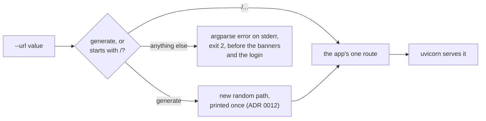

# ADR 0014: Refuse a webhook path without a leading slash

- Status: Accepted
- Date: 2026-11-11

## Context

The `url` setting names the webhook path, the endpoint's only protection.
The composition root hands it to the inbound adapter, which registers it as
the app's one route
([ADR 0010](0010-webhook-adapter-and-composition-root.md)).

A request path always starts with `/`. Starlette's own `Route` refuses a
path without one, but FastAPI's `@app.post` accepts it, so a `url` such as
`strategy`, `hook/secret` or a whole address like
`https://host/strategy` registered a route that no request could match:

- the bot printed its banners, logged in and served as usual;
- every alert got `404 Not Found`, the same answer as a wrong address;
- nothing in the bot's output said why.

An operator saw a healthy bot and no trades. The README warned about it in
the `url` row and in troubleshooting, but nothing stopped it.

Step 5a pinned it as a known defect
(`test_a_path_without_a_leading_slash_starts_but_is_never_reachable`).

## Decision

`--url` is checked when the arguments are read. Its value must be
`generate` or start with `/`; anything else stops the bot like any other
invalid argument.

- **Where:** an argparse `type`, `webhook_url`, in the composition root,
  next to the other start arguments. A bad value exits with status `2`
  before any output, the login and the server, exactly like an unknown
  environment or a port that is not a number.
- **The message leaves the value out:**
  `argument --url: must start with / or be generate`. The value is the
  operator's secret path, give or take a slash, and stderr goes to the same
  container log as everything else. argparse echoes a value rejected with a
  `ValueError`, so the check raises `ArgumentTypeError`, which it prints as
  given.
- **`generate` passes untouched.** It has no leading slash, and it is part
  of the frozen contract.
- **The empty value is refused too.** It starts with no slash, and its route
  matched nothing either. Through the image it never reaches the check:
  the start command expands `url` unquoted, so an empty `url` drops out of
  the command line and argparse stops one step earlier, with
  `argument --url: expected one argument` and the same status `2`.

## What changes

This is a behaviour change.

| `url` | Before | After |
|---|---|---|
| `/strategy`, `/hook/secret`, `/hook/` | served | served |
| `generate` | a new random path, served | the same |
| `strategy`, `hook/secret`, `https://host/strategy` | starts, every alert gets `404` | exit `2`, `argument --url: must start with / or be generate` |
| empty, through the image | `argument --url: expected one argument`, exit `2` | the same |
| empty, passed to the script directly | starts, every alert gets `404` | exit `2`, `argument --url: must start with / or be generate` |

A bot started with such a `url` never handled a signal, so no working setup
breaks. What the operator sees changes: the container stops at once, with
the reason on stderr, instead of looking healthy. With the README's
`--restart unless-stopped`, Docker restarts it over and over, and
`docker logs` shows the same line each time until the setting is fixed.

The tests changed with it:

- **The pin is replaced** in `tests/characterization/test_startup.py`:
  `strategy`, `hook/secret`, `https://host/strategy` and an empty value
  exit with status `2`, print nothing on stdout, never log in or serve,
  and end stderr with the exact message, with no part of the value
  anywhere in it.
- `generate` and a path chosen by hand keep their own startup tests.

All four cases failed before the fix: the bot started and served.

## What this does not cover

- **A `url` with braces** is a pattern, not a path: FastAPI reads `{name}`
  as a path parameter, so the bot handles signals on paths the operator
  never set, and a pattern Starlette cannot compile, such as `/{x:foo}`,
  stops the bot with a traceback after the login. It starts with `/`, so
  this check lets it through. It is a known defect of its own in the
  [migration roadmap](../migration-roadmap.md#known-defects).

  *Update:* step 6e ([ADR 0015](0015-refuse-braces-in-the-webhook-path.md))
  refuses any `{` or `}` in `url` at startup, with the same exit status.
- **uvicorn's access log** still writes the path of every request.

  *Update:* step 6f ([ADR 0016](0016-hide-the-request-line-in-the-access-log.md))
  drops the request line, and with it the path, from the access line.
- **The image's `sh -c` command** expands `url` unquoted, like the
  credentials. A path with spaces or shell characters is split before the
  check sees it.

## Consequences

- A `url` that cannot be served is caught at startup, where the operator
  is looking, instead of as `404`s on the alert sender's side.
- The README's `url` row and the troubleshooting row no longer need to
  explain the silent case.
- Images built before this step still start with such a `url`; there, the
  README's earlier advice applies: start the path with `/`.

## Alternatives considered

- **Prepend the missing slash.** Rejected: it guesses. `strategy` would
  become `/strategy`, but `https://host/strategy` would become
  `/https://host/strategy`, a route that still matches nothing, and the bot
  would again look healthy. Refusing tells the operator what is wrong, and
  the fix is one character.
- **Check in the adapter, in `create_app`.** Rejected as the only check:
  by then the banners have been printed and the login made, so the bot
  would stop after logging in to the account, and with a traceback rather
  than the argument error every other bad setting gets.
- **Log a warning and serve anyway.** Rejected: the route still matches
  nothing, so it is the same silent failure with one more line in the log.
