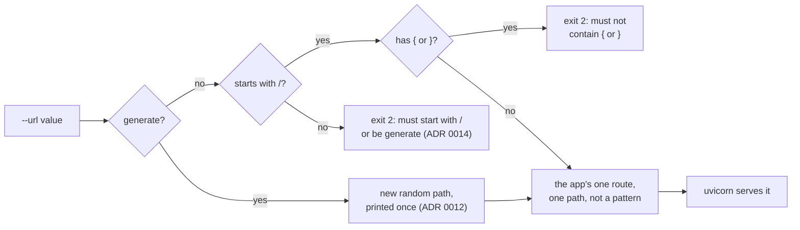

# ADR 0015: Refuse braces in the webhook path

- Status: Accepted
- Date: 2026-11-11

## Context

The `url` setting names the webhook path, the endpoint's only protection.
The inbound adapter registers it as the app's one route
([ADR 0010](0010-webhook-adapter-and-composition-root.md)), and since
step 6d it must start with `/`
([ADR 0014](0014-require-a-leading-slash.md)).

FastAPI hands the route to Starlette, which compiles it into a regular
expression. In the installed Starlette, `{name}` and `{name:convertor}` are
the only pattern syntax; every other character is escaped and matched as
written. So a `url` with such a brace form was a pattern, not a path:

- `/{x}` matched any one-segment path, `/hook/{x}` any path under `/hook/`,
  `/{x:int}` any number, and `/{x:path}` every path there is. A signal
  posted to any of them opened trades, so a path the operator never chose
  was as good as the secret one.
- A pattern Starlette cannot compile, such as `/{x:foo}` (an unknown
  convertor) or `/{x}/{x}` (a repeated name), stopped the bot with a
  traceback, after the banners and after it had logged in to the account.
- Braces that do not form a name, as in `/a{b`, `/a}b` or `/{1}`, stayed
  literal and were served as written.

The README told operators to keep `{` and `}` out of `url`, but nothing
stopped them. #41 pinned it as a known defect
(`test_a_path_with_braces_handles_signals_on_paths_the_operator_never_set`,
`test_a_brace_pattern_starlette_cannot_compile_stops_after_the_login`).

## Decision

`--url` is refused if it contains a `{` or a `}`, anywhere, by the same
argparse `type` that checks the leading slash.

- **Where:** `webhook_url` in the composition root, after the leading-slash
  check. A refused value exits with status `2` before any output, the login
  and the server, like every other bad argument.
- **The message leaves the value out:**
  `argument --url: must not contain { or }`, raised as `ArgumentTypeError`
  for the reason ADR 0014 gives: argparse echoes a value rejected with a
  `ValueError`, and stderr goes to the container's log.
- **One message per value.** The leading slash is checked first, so a value
  with both faults, such as `{x}`, gets
  `argument --url: must start with / or be generate`.
- **Any brace, not only the forms Starlette reads as a parameter.** The
  rule is one sentence an operator can apply without knowing Starlette's
  syntax. Mirroring that syntax here would tie the check to one version: a
  later Starlette with a wider syntax could turn a path that passed it into
  a pattern.
- **Nothing else is refused.** With braces gone, every accepted `url` is
  one path, not a pattern, which is what the rest of this decision relies
  on.
- **`generate` cannot produce a brace.** Its path comes from
  `secrets.token_urlsafe`, whose alphabet is letters, digits, `-` and `_`.

## What changes

This is a behaviour change, and unlike step 6d it can stop a bot that ran.

| `url` | Before | After |
|---|---|---|
| `/strategy`, `/hook/secret`, `generate` | served | the same |
| `/{x}`, `/hook/{x}`, `/{x:int}`, `/{x:path}` | served, and every path the pattern matches opens trades | exit `2`, `argument --url: must not contain { or }` |
| `/{x:foo}`, `/{x}/{x}` | logs in, then stops with a traceback | exit `2`, the same message, before the login |
| `/a{b`, `/a}b`, `/{1}` | served as written | exit `2`, the same message |
| `{x}` | exit `2`, `argument --url: must start with / or be generate` | the same |

- **A pattern that worked** was working insecurely: it handled signals on
  paths the operator never set. It now stops at startup.
- **A literal brace that worked**, such as `/a{b`, stops too. This is the
  price of a rule that needs no knowledge of Starlette. A `url` with a
  brace is unlikely: the README's command and `generate` never produce
  one, and an alert sender has to percent-encode it.

In both cases the container stops at once with the reason on stderr. With
the README's `--restart unless-stopped`, Docker restarts it over and over,
and `docker logs` shows the same line each time until `url` is changed.

The tests changed with it:

- **Both #41 pins are replaced** by
  `test_a_path_with_a_brace_stops_before_any_output_and_is_not_echoed` in
  `tests/characterization/test_startup.py`. It covers each pattern above,
  `/{987}`, and a lone `{` and a lone `}` (`/hook{zq7`, `/hook}zq7`). Each
  exits with status `2`, prints nothing on stdout, never logs in or
  serves, and ends stderr with the exact message, with no part of the
  value anywhere in it.
- **A new pin**, `test_a_value_with_a_brace_and_no_leading_slash_gets_the_slash_message`,
  fixes the order of the two checks.
- **A new route pin**, `test_a_path_set_by_hand_handles_no_other_path` in
  `tests/characterization/test_webhook_route.py`, takes over the half of
  the removed route pin that still holds: with `url` set to `/hook`, a
  path under it, next to it, the default and `/` answer `404` and open
  no trade.

All nine brace cases failed before the fix: the bot started and served, or
logged in and raised.

## What this does not cover

- **`?`, `#` and `%` in `url`.** A request path never contains `?` or `#`,
  and Starlette matches the decoded path, so a route with any of them can
  match nothing or something other than what the operator typed. That is
  the silent-`404` class of ADR 0014, not a pattern, and it is not pinned
  yet.

  *Update:* step 6h ([ADR 0020](0020-refuse-query-fragment-and-escape-characters-in-the-webhook-path.md))
  refuses all three at startup.
- **uvicorn's access log** still writes the path of every request.

  *Update:* step 6f ([ADR 0016](0016-hide-the-request-line-in-the-access-log.md))
  drops the request line, and with it the path, from the access line.
- **The image's `sh -c` command** expands `url` unquoted, like the
  credentials.

## Consequences

- Every `url` the bot accepts is one path, not a pattern: the bot handles
  signals on that path and on no other. Starlette compares it with the
  decoded request path, so a `url` with `%`, `?` or `#` can still name a
  path no sender reaches (see "What this does not cover"). *Update:* step
  6h refuses them too ([ADR 0020](0020-refuse-query-fragment-and-escape-characters-in-the-webhook-path.md)).
- A broken pattern no longer stops the bot after it has logged in.
- The README's `url` row and security notes no longer need to explain
  braces.
- Images built before this step still treat `{name}` as a pattern; there,
  the README's earlier advice applies: keep `{` and `}` out of `url`.

## Alternatives considered

- **Match the path literally.** Escape the braces, or register a route that
  compares the path itself, so `/{x}` is served only at `/{x}`. Rejected:
  it works around Starlette's path compiler in the adapter, a second place
  that decides what a path is, and it keeps a `url` that alert senders must
  percent-encode.
- **Refuse only the forms Starlette reads as a parameter.** Rejected: see
  "Any brace" above. `/a{b` would stay valid today and could stop being
  literal after an upgrade.
- **Refuse everything outside a character allow-list.** Rejected for this
  step: it would also catch `?`, `#` and `%`, a different defect that is
  not pinned, and it could refuse paths that work today for no gain against
  this defect. *Update:* step 6h refuses `?`, `#` and `%` by name, not by
  an allow-list ([ADR 0020](0020-refuse-query-fragment-and-escape-characters-in-the-webhook-path.md)).
- **Check in the adapter, in `create_app`.** Rejected for the reason
  ADR 0014 gives: by then the bot has logged in.
