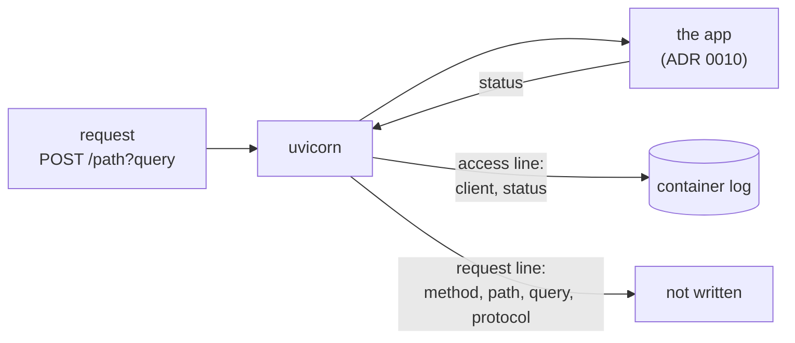

# ADR 0016: Hide the request line in the access log

- Status: Accepted
- Date: 2026-11-11

## Context

The webhook path is the endpoint's only protection: anyone who knows it can
open and close trades on the account. Earlier steps stopped the app from
naming it ([ADR 0011](0011-serve-no-api-docs.md)) and from redirecting it
to plain `http://` ([ADR 0013](0013-no-trailing-slash-redirect.md)).

uvicorn, which serves the app, writes one access line per request to stdout
with its default log settings:

```text
INFO:     203.0.113.7:52403 - "POST /the-secret-path HTTP/1.1" 200 OK
```

So the path was in the container's log on every alert, query string
included. A request one character away (`404`) or with the wrong method
(`405`) wrote a near copy of it. Anyone who could read the log could read
the path. The log is often easier to reach than the container itself: it
is shipped to log collectors, pasted into issues and shown in dashboards.

The roadmap listed this as a known defect. It was not pinned, because every
startup test replaced uvicorn's `run`, so no test ever saw what the real
server writes.

## Decision

The access line keeps the client and the status and drops the request line.
The method, the path, the query string and the protocol are all left out:

```text
INFO:     203.0.113.7:52403 - "<request line hidden>" 200 OK
```



- **How:** the composition root passes uvicorn a `log_config`, built by
  `server_log_config()` in an adapter module of its own, `server_log`,
  next to the webhook adapter rather than in it: the app does not know
  which server runs it. The settings are uvicorn's own defaults with one
  change: the access formatter's `fmt` no
  longer contains `%(request_line)s`. Everything else stays as uvicorn ships
  it, including the server's start and stop lines and the error log.
- **Only the format changes.** `fmt` and the fields it can name
  (`client_addr`, `request_line`, `status_code`) are uvicorn's documented
  access log settings. A logging filter that rewrites the record would need
  uvicorn's internal argument layout, and a filter that misread it after an
  upgrade would let the path through.
- **The whole request line, not only the path.** The method only ever tells
  `POST` from a probe, which the status already shows (`405`), and the
  protocol tells the operator nothing. Hiding the path but keeping a near
  miss such as `/the-secret-pathx` would still leak most of the secret, and
  telling a near miss from a scan needs the path itself.
- **The status stays.** Without it, an alert sent to the wrong path would
  leave no trace in `docker logs`: the bot prints its own lines only for a
  signal it handles. With it, `404 Not Found` lines show that alerts arrive
  at the wrong address.
- **The settings are a copy.** uvicorn writes into the dictionary it is
  given, and its default is a module-level one.
- **The marker names what is missing**, so an operator comparing the log
  with an older one sees that the line was shortened on purpose.

## What changes

This is a behaviour change: the access line has a new shape.

| Request | Before | After |
|---|---|---|
| alert to the webhook path | `"POST /path HTTP/1.1" 200 OK` | `"<request line hidden>" 200 OK` |
| the path with a query string | `"POST /path?a=1 HTTP/1.1" 200 OK` | `"<request line hidden>" 200 OK` |
| a path one character off | `"POST /pathx HTTP/1.1" 404 Not Found` | `"<request line hidden>" 404 Not Found` |
| `GET` on the path, as in a browser | `"GET /path HTTP/1.1" 405 Method Not Allowed` | `"<request line hidden>" 405 Method Not Allowed` |
| a body that is not UTF-8 | `"POST /path HTTP/1.1" 500 ...` and a traceback | `"<request line hidden>" 500 ...` and the same traceback |

The client address stays at the start of each line. The traceback after a
`500` never named the path, and still does not.

The tests changed with it:

- **A new pin against a real server**,
  `test_each_request_logs_its_client_and_status_but_never_the_path` in
  `tests/characterization/test_server_log.py`. It starts the bot through
  its entrypoint, then hands the app and the uvicorn options the bot passed
  to a real uvicorn server on a loopback port, so it sees the very settings
  the container uses. It runs twice, without and with colours, because
  uvicorn colours its lines when stdout is a terminal, as with the
  README's `docker run -t`. It sends the five requests above and checks:
  - one access line each, with the client and the exact status;
  - that a `500` is still logged with its traceback;
  - that nothing written to stdout or stderr contains the path.
- **The startup pin** in `tests/characterization/test_startup.py` now
  expects `log_config` among the options passed to uvicorn: uvicorn's
  defaults with the access format spelled out in the test, so a change to
  the format fails there too.
- **Two unit tests** in `tests/unit/adapters/test_server_log_config.py`
  check that building the settings leaves uvicorn's default as shipped and
  that each call returns its own copy.

The new pin failed before the fix: every access line held the path, query
string included.

## What this does not cover

- **`url=generate` prints the path at startup.** That is intended: the
  operator has to copy it into the alert
  ([ADR 0012](0012-generate-the-webhook-path-with-secrets.md)).
- **The password in the command line and the image's `sh -c`.** The start
  command passes the credentials and `url` as arguments, expanded unquoted,
  so they show in the process list. That is a known defect of its own.

  *Update (step 6g, [ADR 0018](0018-read-the-settings-from-the-environment.md)):*
  fixed. The image now starts the bot with no shell and no arguments, and
  the bot reads its settings from the environment.
- **A reverse proxy's own log.** Nginx, Caddy and the like log the request
  line by default. The README tells operators to put one in front of the
  bot, so it now also tells them to keep the path out of that log.
- **The client address** is still logged. It is the alert sender's or the
  proxy's address, which the operator needs to tell alerts from scans.

## Consequences

- Requests no longer write the webhook path to the container's log, so a
  log collector or a pasted log no longer leaks it with every alert. With
  `url=generate`, the startup output still holds it once.
- Every request still leaves one line, so `docker logs` still shows that
  alerts arrive and how each was answered.
- The log no longer shows which path a `404` asked for. To find out what
  address an alert sender uses, look at the sender's settings, or at the
  proxy's log if you keep the path in it.
- A uvicorn upgrade that renames the access formatter or its fields fails
  the new pin, because it checks the lines a real server writes. The lock
  ([ADR 0007](0007-locked-runtime-dependencies.md)) keeps such an upgrade
  in a reviewed pull request.
- Images built before this step still write the path; there, treat the log
  as secret.

## Alternatives considered

- **Turn the access log off** (`access_log=False`). Rejected: it is one
  argument, but an alert sent to the wrong path would then leave no trace
  in `docker logs`, since the bot prints nothing for a request it does not
  handle. The README's "every alert gets `404`" case could only be seen
  from the sender's side.
- **A logging filter that replaces only the path.** Rejected: it keeps the
  method and the protocol, which tell the operator little, and it has to
  read uvicorn's internal record arguments, which an upgrade can change.
- **Replace only the webhook path, and log every other path.** Rejected: a
  near miss is most of the secret, and the filter would need the path,
  tying the log settings to the route.
- **Leave it to the operator** (`--log-config`, `--no-access-log`).
  Rejected: the image's start command fixes uvicorn's options, and a safe
  default should not depend on every operator knowing about the leak.
