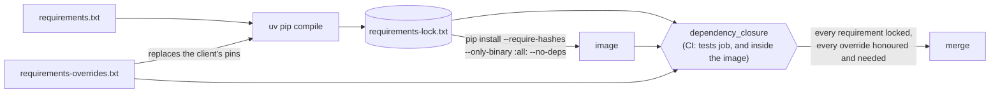

# ADR 0017: Override the broker client's pins on vulnerable packages

- Status: Accepted
- Date: 2026-11-12
- Amends: [ADR 0007](0007-locked-runtime-dependencies.md) (how the image
  installs the lock, and what CI checks in its place)

## Context

The `tradelocker` client, the bot's only way to reach the broker, declares
three of its requirements as exact pins: `PyJWT==2.8.0`, `requests==2.32.2`
and `python-dotenv==1.0.0`. Its newest release, 0.56.2, is the one the bot
pins ([ADR 0007](0007-locked-runtime-dependencies.md)), so no client upgrade
moves them.

Each of those versions has published advisories, and GitHub's Dependabot
raised 17 open alerts on `requirements-lock.txt`:

| Package | Locked | Alerts | Worst | First version that fixes all |
|---|---|---|---|---|
| PyJWT | 2.8.0 | 14 | critical: asymmetric-PEM detection bypass ([GHSA-ffc3-869f-jxw9](https://github.com/advisories/GHSA-ffc3-869f-jxw9)) | 2.15.0 |
| requests | 2.32.2 | 2 | medium: `.netrc` credentials leak ([GHSA-9hjg-9r4m-mvj7](https://github.com/advisories/GHSA-9hjg-9r4m-mvj7)) | 2.33.0 |
| python-dotenv | 1.0.0 | 1 | medium: symlink following in `set_key` ([GHSA-mf9w-mj56-hr94](https://github.com/advisories/GHSA-mf9w-mj56-hr94)) | 1.2.2 |

How much of this the bot reaches:

- **PyJWT.** The client never verifies a token. It decodes the access token
  the broker returns, with `verify_signature: False`, to read its expiry and
  subject. That is the call shape of one advisory
  ([GHSA-42vr-xj54-vc7v](https://github.com/advisories/GHSA-42vr-xj54-vc7v)):
  a deeply nested payload raises `RecursionError` and crashes the caller.
  Here the token comes from the broker over HTTPS, so sending one would
  take the broker itself or someone who breaks TLS. The other advisories
  concern verification, key handling and `PyJWKClient`, which the client
  does not use.
- **requests.** For the `.netrc` leak: every URL the client builds starts
  with the base URL of the environment the operator picks (`demo` or
  `live`), and the image holds no `.netrc`. The temp-file advisory affects
  only code that calls `extract_zipped_paths()` directly, which neither the
  client nor the bot does.
- **python-dotenv.** The client imports only `dotenv_values`, inside
  `load_env_config`, a helper that neither the client nor the bot calls;
  `set_key` is never used.

None of this was shown to be exploitable. The alerts still stand, though,
and an image that ships known-vulnerable code is harder to vouch for. Each
reachability claim also holds only as long as the client's code stays the
same.

A plain re-lock cannot fix them: `uv pip compile` honours the client's
exact pins, and pip refuses a lock that contradicts them. The pip install
used by the image stops with `ResolutionImpossible`.

## Decision

The lock overrides the client's pins on these three packages, and the image
installs the lock without dependency resolution:

- **`requirements-overrides.txt`** names each package with a range:
  `pyjwt>=2.15.0,<3`, `requests>=2.33.0,<3`, `python-dotenv>=1.2.2,<2`.
  - **The floor** is the first release that fixes every advisory against
    the pinned version.
  - **The ceiling** keeps the major version the client was written for.
  - **Ranges, not exact versions:** the lock already fixes one version.
    A range lets `--upgrade` move within it and still says why the floor is
    there.
  - **One line per package, with no markers, extras or pip options.**
    `read_overrides` refuses anything else. A marker or an extra would apply
    the override to only part of what the lock is resolved for, and a second
    line or an option is something uv would read but the check below would
    not.
- **The lock** is compiled with `--override requirements-overrides.txt`; the
  command in its header says so. uv applies each override in place of every
  other requirement on that package. The new lock holds PyJWT 2.15.1,
  requests 2.34.2 and python-dotenv 1.2.4. No other package moved.
- **The image and CI install with `--no-deps`.** pip then checks the hashes
  of what the lock names and installs nothing else. It no longer checks
  that each package's own requirements are met.
- **`tests/dependency_closure.py` takes over that check.** It runs in two
  new CI steps: in the `tests` job on Python 3.11 and 3.12, and in the
  `docker-build` job inside the built image.
  - It runs after the lock is installed. It first refuses an environment
    whose versions are not the locked ones, then reads each locked package's
    requirements from the installed metadata.
  - It evaluates markers with the interpreter that runs it. Inside the image
    that is the image's own Python, whatever 3.11 patch release the base
    tag holds, which is the one that matters. On the 3.12 runner it also
    catches a requirement only 3.12 needs, which the 3.11 lock would lack.
    The image's run uses the base image's own `packaging`, so the check adds
    nothing to the image.
  - **Every applicable requirement must be locked, at a version it
    allows.** The one exception is a `tradelocker` requirement on an
    overridden package: that is the pin the override lifts, and the package
    is held to its override instead. uv applies an override to every
    requirement on the package, so this limit is what stops a needed
    override from also hiding another package's requirement that the
    locked version breaks.
  - **Every override must be honoured:** the lock holds the package at a
    version the override allows.
  - **Every override must still be needed:** some applicable `tradelocker`
    requirement excludes the locked version. When a client release allows a fixed
    version, the check fails until the override is removed. Otherwise a
    leftover override would silently mask a later pin that matters.
  - **A requirement with extras fails** rather than being half-checked, as
    the lock tests already refuse extras in `requirements.txt`.
  - It is a module of its own because it needs `packaging`.
    `tests/dependency_lock.py` stays standard library only, for the image
    check on the runner's bare Python.
- **`requirements-dev.txt` no longer includes `requirements.txt`.**
  Resolving it after the lock would pull the client's pins back and
  downgrade the three packages. The CI step that checks the locked versions
  survived the dev install would catch that, but only by failing every run.
  For local development the README installs `requirements.txt` and the dev
  tools, then the overrides with `--no-deps`.

## What changes

| | Before | After |
|---|---|---|
| PyJWT in the image | 2.8.0 | 2.15.1 |
| requests in the image | 2.32.2 | 2.34.2 |
| python-dotenv in the image | 1.0.0 | 1.2.4 |
| image and CI install | resolves dependencies | `--no-deps` |
| lock completeness | checked by pip while installing | checked by `python -m tests.dependency_closure` in CI and inside the image |
| `requirements-dev.txt` | includes `requirements.txt` | dev tools only |
| local setup | one `pip install` | three commands, in the README |

The tests changed with it:

- **`tests/test_dependency_closure.py`** checks that the lock holds every
  override at a version it allows. That test failed first, against the old
  lock's `pyjwt==2.8.0`. It also pins the rules the CI check applies:
  - requirements met, missing or outside their range;
  - markers read for the interpreter given;
  - extras refused;
  - only the client's pins lifted, so another package's requirement on an
    overridden package still counts;
  - overrides honoured and needed, and an override the lock does not hold
    reported as missing, not as stale;
  - override lines limited to one name and a range per package, with no
    pip options;
  - a package not installed at its locked version reported.
- **Each failure was checked against the real files:** each one below makes
  `python -m tests.dependency_closure` fail with a line naming it.
  - dropping the PyJWT override (`tradelocker needs PyJWT (==2.8.0)`);
  - adding an override nothing needs (`override click lifts none of
    tradelocker's requirements`);
  - deleting `urllib3` from the lock (`requests needs urllib3`);
  - raising an override's floor above the locked version.
- **The suite** passes against the new versions: 446 tests on Python 3.11
  after the CI install order, and on Python 3.12 after the README's local
  setup.
- **The client's calls into the upgraded packages** were run with warnings
  as errors:
  - `time_to_token_expiry` and the same unverified `jwt.decode` on a
    hand-made, unsigned token;
  - a `TLAPI` login attempt against a closed port. It failed inside
    `requests`, as the client expects, so `requests` sent nothing and
    parsed no answer.

## What this does not cover

- **A live login.** No test logs in to TradeLocker, before or after this
  step. PyJWT 2.15.1 decoded only a hand-made token, and requests 2.34.2
  was never answered, inside the client, by the broker or anything else.
  If a login fails after this change, look here first.
- **The client's own declared requirements.** `pip check` in the image now
  reports that `tradelocker` wants PyJWT 2.8.0, requests 2.32.2 and
  python-dotenv 1.0.0. That is expected, and nothing runs it.
- **Future advisories.** The lock still changes only in a reviewed pull
  request; a new advisory needs a new lock, as before
  ([ADR 0007](0007-locked-runtime-dependencies.md)).

## Consequences

- The image no longer ships the versions behind the 17 alerts. GitHub
  closes them when it scans the merged lock.
- The client now runs against versions its authors did not declare. Its
  test suite is not the bot's, so the bot's tests and the smoke run above
  are the evidence that it works.
- Every client upgrade must revisit the overrides. The closure check fails
  on an override that a new client release makes unnecessary, and on a new
  requirement the lock does not meet.
- Local setup takes three commands instead of one.

## Alternatives considered

- **Keep the pins, document why the alerts do not apply, and dismiss
  them.** Rejected: the reachability argument holds only for the client's
  current code and the broker's honesty, and each new advisory would need
  the same analysis again.
- **Install the overridden packages on top, in a second `pip install`.**
  Rejected: the first install would still resolve and fetch the vulnerable
  versions, and the image would hold whatever the second command left, not
  one reviewed set.
- **Vendor or fork the client with relaxed pins.** Rejected for now: it
  moves the bot off the published client that the broker fake mirrors, and
  it would need maintaining. Asking the client's authors to relax the pins
  remains open; once they do, the closure check says which overrides to
  drop.
- **Constraints (`-c`) instead of overrides.** Rejected: a constraint can
  only narrow a requirement. It cannot lift an exact pin, so pip and uv
  both still refuse.
