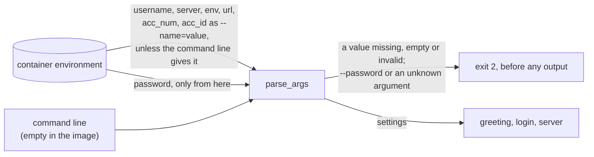

# ADR 0018: Read the settings from the environment, not the command line

- Status: Accepted
- Date: 2026-11-12

## Context

The operator sets the bot's settings as the container's environment
variables (`username`, `password`, `server`, `env`, `url`, `acc_num`,
`acc_id`), which the roadmap's frozen contract names. The image turned
them into command-line options with a shell:

```dockerfile
CMD ["sh", "-c", "python main_without_ssl.py --username $username --password $password --server $server --env $env --url $url --acc_num $acc_num --acc_id $acc_id"]
```

The roadmap listed two known defects in that line.

- **Every value was in the command line.** Linux lets every user of a host
  read every process's command line, a container's processes included, so
  `ps` on the host showed the account password, the username and the
  webhook path. The webhook path is the endpoint's only protection
  ([ADR 0016](0016-hide-the-request-line-in-the-access-log.md) listed this
  as not covered).
- **The shell expanded each value unquoted.**
  - A password with a space became two arguments.
  - A `*`, `?` or `[` was matched against the files in `/app`.
  - A value that started with `-` read as an option.
  - An empty value disappeared, which left its option without a value.

  Most cases stopped the bot at its argument checks. For a split password,
  argparse's `unrecognized arguments` error printed the pieces after the
  first, which put part of the password in the container's log. A pattern
  that matched exactly one file sent the login that file's name. The README
  told operators to avoid such passwords.

No test saw any of it. The tests called the entrypoint with argument lists
they built themselves, and nothing read the Dockerfile.

## Decision

The image starts the bot with no shell and no arguments, and the bot reads
its settings from the environment:

```dockerfile
CMD ["python", "main_without_ssl.py"]
```



- **The JSON form of `CMD`.** Docker runs the command as written, with no
  shell between the environment and the bot. The command line is
  `python main_without_ssl.py`, whatever the settings are.
- **One parser for both sources.**
  - Each variable that is set becomes the option of the same name, in the
    `--name=value` form, placed before the real command line. The `=`
    keeps a value that starts with `-` from reading as an option.
  - A variable whose option the command line gives is left out, not
    overridden, so a bad value in it cannot stop the bot. `--acc_num` or
    `--acc_id` on the command line leaves out both variables, because the
    two exclude each other. With `--help`, every variable is left out, so a
    bad one cannot hide the help. That keeps the options usable when
    running the bot outside the image, and `--port` stays an option only.
  - A value from either source gets the same checks and the same message:
    `argument --url: must start with / or be generate` stays as the README
    documents it. Messages therefore name the option, `--server`, for a
    value that came from the variable `server`; the README's
    troubleshooting table says so.
- **The password only from the environment.**
  - `parse_args` reads `password` itself. When it is unset or empty, the bot
    stops with exit status `2` and
    `error: the password environment variable is not set or is empty`.
  - `--password` stays registered so that it can be refused:
    `argument --password: set the password environment variable instead`.
  - argparse prints an unrecognized or ambiguous argument in full, so a
    misspelt `--passwd ...` or a shortened `--p=...` would put the password
    in the container's log. Options cannot be shortened, and any argument
    the parser does not know stops the bot with
    `unrecognized arguments, not shown: one may be the password`.
  - `--help` does not list the option, and its description says where the
    password comes from.
- **No value is trimmed or dropped.** The shell no longer splits values,
  so `env=demo ` with a trailing space is refused as an invalid choice
  rather than read as `demo`. An empty `username` or `server` stops the bot
  with `must not be empty` instead of reaching the login.
- **The image sets no variable.** `ENV url=/strategy`, `ENV acc_num=0` and
  `ENV acc_id=0` existed only to feed the shell command. The bot's defaults
  are the same values, so they now live in one place.

## What changes

| Case                                          | Before                                                  | After |
|-----------------------------------------------|---------------------------------------------------------|-------|
| The bot's command line                        | Every setting, password and webhook path included       | `python main_without_ssl.py` |
| A password with spaces or `*`, `?`, `[`       | Split or globbed; argument error or a wrong login       | Reaches the login exactly as set |
| A value that starts with `-`                  | Read as an option                                       | Read as the value |
| `--password` on the command line              | Read                                                    | Exit `2`, value not printed |
| An unknown or shortened argument (`--passwd`, `--p=`) | Printed in full in the error                   | Exit `2`, not printed |
| `password` unset or empty                     | Exit `2`, a message about `--password`                  | Exit `2`, `the password environment variable is not set or is empty` |
| `url` empty                                   | `argument --url: expected one argument`                 | `argument --url: must start with / or be generate` |
| `env=demo ` (trailing space)                  | Trimmed to `demo`                                       | Exit `2`, invalid choice |
| `username` or `server` empty                  | An option without a value, exit `2`                     | Exit `2`, `must not be empty` |
| The image's `url`, `acc_num`, `acc_id`        | Set by `ENV` to the defaults                            | Unset; the bot's defaults apply |

### Tests

- **The startup pins give the settings as an environment.**
  - The harness runs the entrypoint with exactly the environment a test
    gives it. On Windows, variable names ignore case, so the machine's own
    `USERNAME` would otherwise reach the bot as `username`.
  - The pins on the account selectors, the path and `generate` now set
    them as variables, as the image does. `--port` stays an option.
- **The replaced pins.**
  - The usage line no longer lists `--password`.
  - The invalid-arguments pin became an invalid-settings pin. It adds a
    trailing space in `env`, a missing `server` or `env`, and an empty
    `username` or `server`.
- **New pins in `tests/characterization/test_startup_settings.py`.**
  - Thirteen credentials reach the login exactly as set: spaces, `$`, `*`,
    `;`, quotes, a leading `-` and an embedded `--env=live`.
  - An option on the command line wins over its variable, and a bad value
    in a variable it replaces stops nothing.
  - An account selector on the command line replaces both selector
    variables.
  - `--help` works whatever the variables hold.
  - A missing or empty password stops the bot before any output.
  - `--password`, `--password=`, `--pass`, `--p=`, `--passwd` and a stray
    value are refused without the value appearing anywhere.
- **`tests/test_image_command.py`** checks that the image's `CMD` is
  exactly `["python", "main_without_ssl.py"]` and that there is no
  `ENTRYPOINT`. It reads instructions as Docker does, in any case and
  across `\` continuations, and a second test pins that reading.
- **Two CI steps run the built image's own start command**, with no network.
  - Without a password, it must exit with status `2`, print nothing to
    stdout, and name the variable.
  - With `password=p a $HOME *`, it must get past the settings: the
    greeting is printed, and the login then fails for want of a network.
    The old image stopped at the settings with status `2`.

Before the fix, 81 of the changed and new tests failed and 2 errored: the
bot read no variable, and the image command was `sh -c`. The pins added
after review failed too, before their fixes: the shortened and misspelt
options, the replaced bad variable, the account selectors, `--help` with a
bad variable, and the Dockerfile reader, which missed an instruction in
lower case or split over lines. Each of these mutations of the new code
fails at least one test:

- dropping the empty check;
- unregistering `--password`;
- passing values without the `=` form;
- accepting an empty password;
- trimming the password;
- reading the variables with `--help`;
- not pairing the account selectors;
- allowing shortened options;
- accepting unknown arguments;
- passing a variable the command line replaces.

## What this does not cover

- **The environment is still readable**, though by far fewer people than
  the command line:
  - `docker inspect` shows it to anyone who can use Docker on the host,
    and Docker access gives root on the host anyway.
  - `/proc/<pid>/environ` shows it only to the process's own user and to
    root.
  - A secret file, such as a Docker secret, would avoid both. It would be a
    new setting and a new step for the operator, so it is left for later.
- **The `docker run` command on the host.** `-e password=...` typed in a
  shell lands in its history. The README now recommends `--env-file` with
  a file only the operator can read.
- **Images built before this change** still pass every setting through
  the shell and the command line. Pull the new image.
- **A custom command that passes `--password`** now stops with exit status
  `2`. Move the password into the `password` variable.
- **Windows, outside the image.** Environment variable names ignore case
  there, so `USERNAME`, the Windows login, is read as `username` unless
  `--username` is given. The image runs on Linux, where names keep their
  case; the README tells Windows users to pass `--username`. The test
  harness gives the bot its whole environment for the same reason.

## Consequences

- The frozen contract is unchanged: the same variable names, defaults and
  container command. Only the way the image hands the variables to the bot
  changes.
- A password may contain any character.
- The `docker run` example in the README works as before.

## Alternatives considered

- **Quote the expansions in `sh -c`** (`"$password"`). This fixes the
  splitting and globbing, but every value stays in the process list.
- **Read only the password from the environment** and keep the other
  options in a shell command. The webhook path would stay in the process
  list, and the shell would stay with it.
- **Read the environment only and drop the options.** That would break
  running the bot outside the image and `--port`. An old `--password`
  would also become an unknown argument, which argparse prints in full.
- **Use argparse defaults from `os.environ`**
  (`default=environ.get("env")`). argparse does not check `choices` against
  a default, and `required` ignores one, so `env=paper` would pass. A
  second set of checks would be needed to make up for it.
- **A secret file** such as `password_file`. It is the strongest option,
  but it needs a new setting and a new step for the operator, so it is
  left for a later step.
