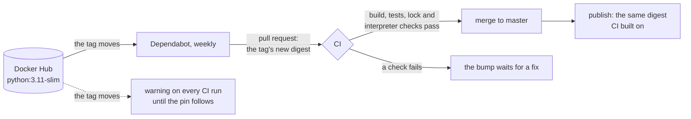

# ADR 0019: Pin the base image by digest

- Status: Accepted
- Date: 2026-11-12
- Completes: [ADR 0007](0007-locked-runtime-dependencies.md) (the last
  input of the image that moved without a commit)

## Context

The image is built from `FROM python:3.11-slim`. A tag is a name the
publisher moves: Docker's official images rebuild `3.11-slim` for every
Python patch release and every Debian update, so the same name serves a
different image from one week to the next.

Every other input of the image is fixed by a commit. The Python packages
come from a hashed lock ([ADR 0007](0007-locked-runtime-dependencies.md)),
the source from the commit CI checked. The base image was the exception, and
it holds the interpreter and every system library the bot runs on. That had
three effects:

- **The published image was not the image CI tested.** CI builds the image
  when the pull request runs, the publish workflow builds it again after the
  merge ([ADR 0002](0002-ci-quality-gates.md)). If the tag moved between the
  two, users got an interpreter or libraries no test ran against.
- **A rebuild of an unchanged commit could change the image.** Re-running
  the publish for a commit already on `master` pulled whatever the tag
  pointed to then, unreviewed.
- **No record.** Nothing in the repository says which Python patch or which
  Debian packages an image held, so a regression could not be traced to a
  base-image change.

The upside of the moving tag was that security fixes in the base image
arrived with the next rebuild, without anyone acting.

## Decision

- **The Dockerfile names the base image by tag and digest:**
  `FROM python:3.11-slim@sha256:07d48…b535`. Docker reads only the digest,
  which names one image for good, so CI and the publish build on the same
  bytes, and a rebuild of a commit gives the same base. The pinned image is
  Python 3.11.18, built on 2026-11-05.
- **The digest is the multi-platform index's**, not the `linux/amd64`
  image's. Docker picks the platform's own image from it, so a build on
  an ARM host still works.
- **The tag stays as the update channel.** Dependabot reads it next to the
  digest and proposes the tag's new digest as a pull request
  (`.github/dependabot.yml`, weekly, Docker only). The bump goes through CI
  like any change: the image is built on the new base, the tests run, and
  the image's packages and interpreter are checked against the lock.
- **Only the same tag's digest is proposed.** The configuration ignores
  minor and major versions of `python`: a move to Python 3.12 needs a lock
  compiled for 3.12, which Dependabot cannot write.
- **CI warns when the tag has moved past the pin.** The `docker-build` job
  reads the tag's current digest and, if it differs from the pinned one,
  writes a warning on the run. It warns rather than fails: the tag moves
  with no commit here, so a failure would block every pull request, the
  bump included, until someone fixed it by hand.
- **The interpreter is checked, not only the label.** Docker ignores the
  tag once a digest is given, so `3.11` in the tag proves nothing about the
  image. A unit test ties the tag to the lock's `--python-version`, and a
  CI step checks that the built image runs that Python.

## What changes

| Before | After |
|--------|-------|
| `FROM python:3.11-slim` | `FROM python:3.11-slim@sha256:07d48…b535` |
| A base-image fix arrived with the next rebuild, unreviewed | A base-image fix arrives as a Dependabot pull request, checked by CI |
| CI and the publish could build on different bases | Both build on the pinned digest |
| `workflow_dispatch` rebuilt the image on the tag's newest base | It republishes the same image, for a failed publish |

### Tests

- `tests/test_image_command.py`, which already read the Dockerfile for the
  start command, now checks the base image too:
  - every `FROM` names its image with a tag and a full `sha256` digest,
    read past `--platform=` and `AS name`;
  - the last `FROM`, the image the bot runs on, is
    `python:<the lock's Python>-slim`;
  - two tests pin the reading itself: what a pinned reference is, and
    where the image is in a `FROM`.
- Before the fix, the two Dockerfile tests failed on the unpinned
  `python:3.11-slim`. Each of these changes to the Dockerfile fails at
  least one test: dropping the digest, shortening it by one character,
  dropping the tag, moving the tag to `3.12-slim`, dropping `-slim`, and
  adding an unpinned second stage.
- Two new CI steps in `docker-build`: "Check the image runs the Python
  the lock was compiled for" fails the build, and "Warn when the base
  image's tag has moved past the pin" only warns. The warning step's three
  outcomes (same digest, moved, registry unreachable) were run locally
  against a stand-in for `docker`.

## What this does not cover

- **Dependabot's behaviour is expected, not observed.** It was read from
  Dependabot's source: for a tag with a digest it compares the pinned
  digest with the tag's current one and proposes the new one. The first
  real pull request will come when the tag next moves. Two things could
  stop it:
  - Dependabot has an experiment, `docker_digest_only_update_suppression`,
    that skips digest-only updates of versioned tags. Whether GitHub turns
    it on is not visible from here.
  - The `ignore` rule on minor and major versions is applied to the
    candidate tags, not to the digest, in the source read. A bug there
    would hide digest bumps too.

  The CI warning covers both: it appears once the tag has moved and stays
  until the pin follows.
- **Bumping by hand.** If no pull request comes, read the tag's digest
  with `docker buildx imagetools inspect python:3.11-slim` and put the
  `Digest:` it prints into the `FROM` line. Take the index digest, the
  first one printed, not a platform's.
- **Images already published** were built on whatever the tag was at the
  time. Nothing records which.
- **The operating system packages inside the base image** are not listed or
  checked; the digest fixes them, and the publisher chooses them.

## Consequences

- An image rebuild is reproducible: the base, the packages and the source
  are all fixed by the commit.
- Security fixes in the base image no longer arrive by themselves. They
  arrive as a pull request that someone has to merge. The pull request
  should come within a week of the tag moving, and the CI warning shows on
  every run until the pin follows.
- Dependabot opens pull requests in this repository. They need the same
  review and green CI as any other.
- Moving to a newer Python is one deliberate change: the tag, the digest and
  a lock compiled for that Python, together. The unit test fails if the tag
  and the lock disagree.

## Alternatives considered

- **Keep the tag and promote the CI image instead of rebuilding.** Rejected
  for the reasons in [ADR 0002](0002-ci-quality-gates.md): it hides the
  drift until the next rebuild rather than removing it, and a rebuild of
  the same commit would still differ.
- **Pin the `linux/amd64` image's digest.** Rejected: a build on any
  other platform would fail, and the published image gains nothing, since
  the index already resolves to that image on amd64.
- **Pin by a more specific tag, such as `3.11.18-slim-trixie`.** Rejected:
  a tag the publisher can still move pins nothing.
- **Fail CI when the tag has moved.** Rejected: the failure would come with
  no change in this repository and block every pull request until the bump
  is merged, including unrelated fixes.
- **A scheduled workflow that opens the bump itself.** Rejected for now:
  Dependabot already does this and keeps the pull request up to date; the
  CI warning covers the case where it does not.
