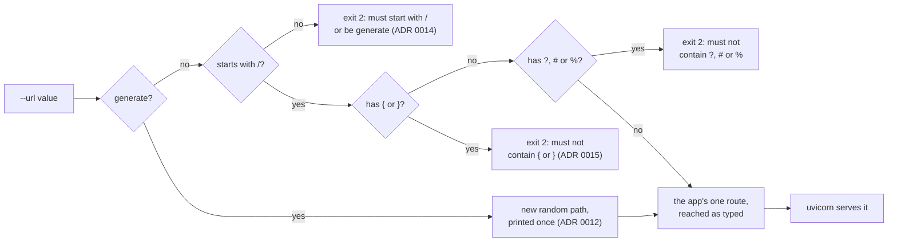

# ADR 0020: Refuse `?`, `#` and `%` in the webhook path

- Status: Accepted
- Date: 2026-11-12

## Context

The `url` setting names the webhook path, the endpoint's only protection.
Since step 6d it must start with `/`
([ADR 0014](0014-require-a-leading-slash.md)), and since step 6e it must
not contain `{` or `}`
([ADR 0015](0015-refuse-braces-in-the-webhook-path.md)), so the route is
one path, not a pattern.

ADR 0015 left three characters open. In a URL, `?`, `#` and `%` are syntax,
not part of the path:

- `?` starts the query string. A sender that is given
  `https://host/a?b` requests the path `/a`, with the query `b`.
- `#` starts the fragment, which a client that parses the URL never sends.
- `%` starts an escape. uvicorn decodes the request path before Starlette
  matches it, so a request for `/a%41b` is matched as `/aAb`.

The route compares the operator's `url` with the decoded path as written,
so a route with any of the three is reached only percent-encoded. The
bot starts and looks up, and every alert sent to the URL the operator
typed gets `404 Not Found`: the silent failure ADR 0014 removed for a
missing slash.

This was observed against the bot's own app on a real uvicorn server, with
`http.client`, which sends the path exactly as given:

| `url` | Path sent | Answer |
|---|---|---|
| `/a?b` | `/a?b` | `404`: the server reads the path `/a` |
| `/a?b` | `/a%3Fb` | `200`, handled |
| `/a#b` | `/a%23b` | `200`, handled |
| `/a%41b` | `/a%41b` | `404`: the server reads `/aAb` |
| `/a%41b` | `/a%2541b` | `200`, handled |
| `/a%zzb` | `/a%zzb` | `200`, handled: `%zz` is no escape, so it is not decoded |

`http.client` sends `/a#b` as it is, and the server reads `#b` as part of
the path. A sender that parses the URL, as a browser or Node's `URL` does,
drops it. What TradingView's client does was not observed.

## Decision

`--url` is refused if it contains a `?`, a `#` or a `%`, anywhere, by the
same argparse `type` that checks the leading slash and the braces.

- **Where:** `webhook_url` in the composition root, after the brace check.
  A refused value exits with status `2` before any output, the login and
  the server, like every other bad argument.
- **The message leaves the value out:**
  `argument --url: must not contain ?, # or %`, raised as
  `ArgumentTypeError` for the reason ADR 0014 gives: argparse echoes a
  value rejected with a `ValueError`, and stderr goes to the container's
  log.
- **One message per value.** The leading slash is checked first, then the
  braces, then these three, so `zq7?` gets the slash message and `/{zq7}?`
  the brace message.
- **Every `%`, not only one that starts a valid escape.** `%zz` is not
  decoded, so `/a%zzb` reaches its route today. Refusing only `%` before
  two hex digits would mean an operator has to know the decoding rules to
  check their path by eye.
- **`generate` cannot produce any of them.** Its path comes from
  `secrets.token_urlsafe`, whose alphabet is letters, digits, `-` and `_`.

## What changes

This is a behaviour change, and it can stop a bot that ran.

| `url` | Before | After |
|---|---|---|
| `/strategy`, `/hook/secret`, `generate` | served | the same |
| `/hook?x`, `/hook#x`, `/hook%41x` | served, reached only percent-encoded; an alert sent to the URL as typed gets `404` | exit `2`, `argument --url: must not contain ?, # or %` |
| `/hook%zzx`, `/hook/%` | served, reached as typed | exit `2`, the same message |

- **A path that worked only percent-encoded** stops at startup. An
  operator whose alerts carried the encoded form has to choose a new path.
- **A `%` that is no escape**, such as in `/hook%zzx`, worked and now stops
  too. This is the price of a rule that needs no knowledge of URL decoding.
  Such a `url` is unlikely: the README's command and `generate` never
  produce one.

In both cases the container stops at once with the reason on stderr. With
the README's `--restart unless-stopped`, Docker restarts it over and over,
and `docker logs` shows the same line each time until `url` is changed.

The tests changed with it, in `tests/characterization/test_startup.py`:

- **A new pin**,
  `test_a_path_with_a_query_fragment_or_escape_character_stops_and_is_not_echoed`,
  covers `/hook?zq7`, `/hook#zq7`, `/hook%41zq7`, `/hook%zq7` and
  `/hook/%`. Each exits with status `2`, prints nothing on stdout, never
  logs in or serves, and ends stderr with the exact message, with no part
  of the value anywhere in it. All five failed before the fix: the bot
  logged in and served.
- **A new pin**,
  `test_a_value_with_several_faults_gets_the_message_of_the_first_check`,
  fixes the order of the three checks.
- Each of these changes to the check fails at least one test: dropping any
  one of the three characters, refusing `%` only before two hex digits,
  raising `ValueError`, which echoes the value, and moving the check before
  the slash check or before the brace check.

## What this does not cover

- **Other characters a sender may rewrite.** A model of a sender that
  parses the URL, Node's `URL` followed by the decoding uvicorn does,
  also changes:
  - `\`, which it turns into `/`;
  - `.` and `..` segments, which it resolves, as in `/a/../b` to `/b`;
  - tabs and line breaks, which it drops.

  Whether a given sender does the same depends on its client: `curl` and
  `http.client` send them as they are. They are not refused, since the
  rewrite was not observed for any sender of alerts; the README's command
  and `generate` produce none of them.
- **Case.** `/Hook` is not `/hook`; the README says the path must match
  exactly.

## Consequences

- Every `url` the bot accepts is one path that a sender reaches by putting
  it in a URL as it is, with no encoding.
- The README's `url` row and troubleshooting table name the new message.
- Images built before this step still start with such a `url`; there,
  keep `?`, `#` and `%` out of it.

## Alternatives considered

- **Percent-encode the route.** Register `quote(url)` so that the decoded
  request path matches the typed one. Rejected: the operator would still
  have to send the encoded form, and `?` and `#` in the URL as typed would
  still cut the path.
- **Refuse everything outside a character allow-list**, such as the
  characters RFC 3986 allows unescaped in a path. Rejected: it would also
  refuse spaces and letters outside ASCII, which a sender encodes and
  uvicorn decodes back, so they work today, for no gain against this
  defect.
- **Also refuse `\`, `.` and `..` segments and control characters.**
  Rejected for this step: their rewrite depends on the client and was not
  observed for any sender of alerts (see "What this does not cover").
- **Check in the adapter, in `create_app`.** Rejected for the reason
  ADR 0014 gives: by then the bot has logged in.
