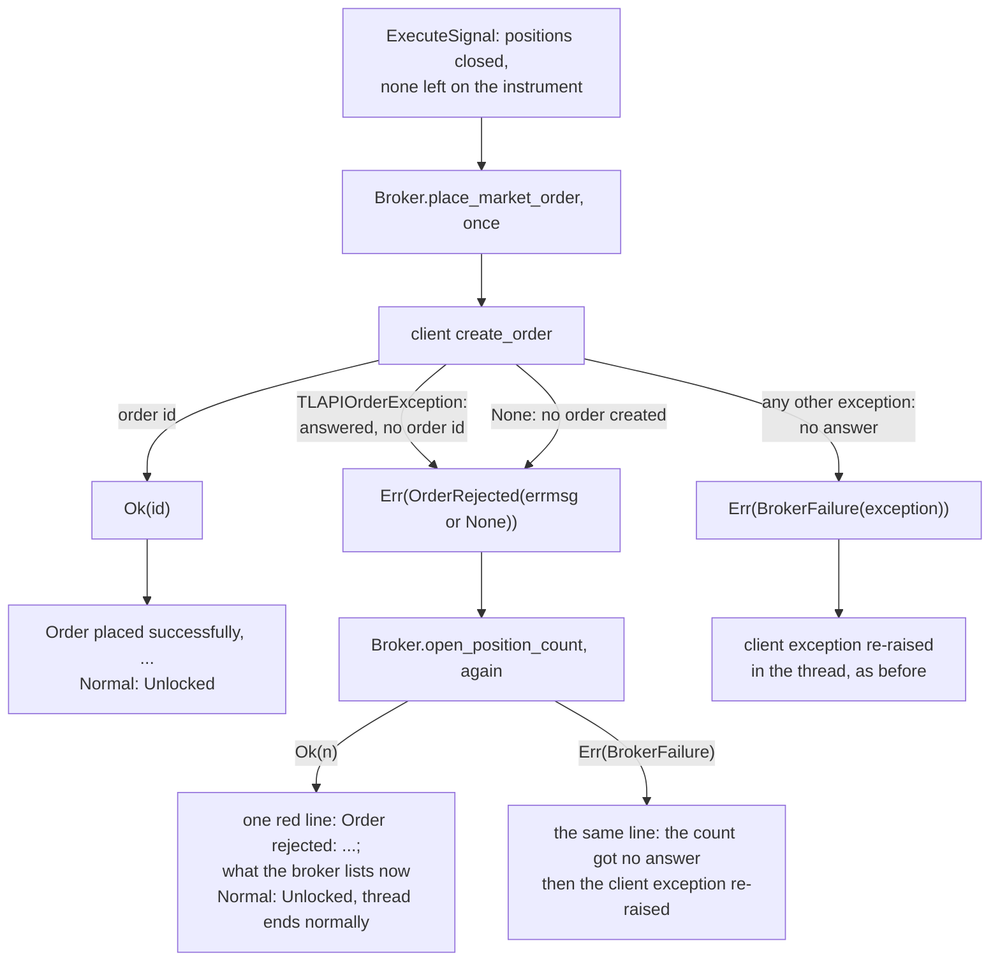

# ADR 0021: Report a rejected order in one line and place it once

- Status: Accepted
- Date: 2026-11-12

## Context

An `open` signal closes the instrument's positions, then places a market
order. Since step 3b
([ADR 0009](0009-refuse-what-the-broker-rules-out-before-closing.md)),
everything the bot can check before the close is checked there: a missing
balance, a quantity that rounds to zero, an unknown symbol. The broker can
still refuse the order itself. By then the close has been carried out.
Below its minimum lot, without enough margin and with the market closed
are the likely causes; which of them TradeLocker answers in the way the
table below calls a rejection was not observed. The only observed fact is
the client's code path.

The `tradelocker` client (0.56.2, the version the bot pins) reports an order
in four ways:

| What happened | What `create_order` does |
|---|---|
| The broker created the order | returns its id, an `int` |
| The broker answered, but with no order id | raises `TLAPIOrderException`, holding the answer; the broker's `errmsg` is its reason |
| The request failed: no connection, a timeout, an error status (400 or above), an answer that is not JSON | raises `TLAPIException` |
| Netting, which the bot never enables, left nothing to order | returns `None` |

The client also resends a request whose connection failed. Its `retry`
wrapper tries up to four times on a `requests` exception, the order
included. An order whose answer was lost can therefore fill, and the resend
be rejected, for example for the margin the fill used. A rejection does not
prove that the account holds nothing.

Before this step, the use case returned every client exception as a
`BrokerFailure`, and the signal handler raised its cause in the webhook
thread. A rejected order therefore ended in a traceback in the log, after
`Closing: XAUUSD`, and no line said what the account held.

The use case also placed the order again, with no pause and no end, for as
long as the broker answered with an id that was falsy. `None` never comes
back with netting off, so the loop did not run in practice. An order id of
`0` would have run it, placing the same order again and again while holding
the lock every other signal waits for.

## Decision

A rejection is an answer, so it becomes its own outcome, `OrderRejected`,
next to `BrokerFailure` in the ports. The order is placed once, and the
rejection is reported with the positions the broker lists afterwards.



- **The adapter decides what a rejection is.** `TradeLockerBroker`
  returns `Err(OrderRejected(reason))` for a `TLAPIOrderException` and for
  `None`. Every other exception stays a `BrokerFailure`. The port now
  promises an id for every `Ok`:
  `place_market_order -> Result[int, BrokerFailure | OrderRejected]`.
- **The reason is the broker's `errmsg` and nothing else.** It is used only
  when it is a non-empty string; otherwise the reason is `None`. The
  exception's own text is not used: it falls back to printing the whole
  answer, and it raises a `TypeError` for an answer that is a bare string.
- **The order is placed once.** An id of `0` is a placed order.
- **The positions are counted again after the rejection.** The close loop
  ended with none on the instrument, but a resent order may have filled,
  and a position may have been opened by hand. The operator acts on what
  the line says, so the line reports this count, not an assumption.
- **The use case prints the line, between `Normal: Locked` and
  `Normal: Unlocked`,** through a new `OperatorConsole.order_rejected`. It
  belongs to the same sequence as `Closing:` and `Order placed`, and the
  use case holds the symbol, the side and the count. It then prints
  `Normal: Unlocked`, because the handling ended there, and returns
  `Err(OrderRejected)`. The handler only ends the thread normally. If the
  recount gets no answer, the line says so, and the recount's
  `BrokerFailure` is returned and raised like any other, with no
  `Normal: Unlocked`.
- **The line is red, in one `print` with the colour reset inside,** like
  `Signal rejected:`:

  ```text
  Order rejected: the broker refused to buy XAUUSD ('Not enough margin'); no XAUUSD position is open
  Order rejected: the broker refused to sell XAUUSD (no reason given); no XAUUSD position is open
  Order rejected: the broker refused to buy XAUUSD ('Not enough margin'); the broker lists 1 open XAUUSD position, check it in TradeLocker
  Order rejected: the broker refused to buy XAUUSD ('Not enough margin'); the position count got no answer, check XAUUSD in TradeLocker
  ```

  The reason comes from the broker, so it is escaped with `repr`, like
  webhook text, and cut after 160 characters, where a payload value is cut
  after 40: a reason is a sentence, not a field. The symbol is shown as it
  is, as in `Closing:`: it is exactly a name the broker lists.
- **Not "Signal rejected".** That line means nothing was closed; here the
  close was carried out.
- **The closed position is not reopened.** A reopen would be a second
  order that no alert asked for. It could be rejected for the same reason,
  and the use case knows only how many rows it closed, not their side or
  size.

## What changes

| Order answer | Before | After |
|---|---|---|
| an id | `Order placed successfully, order ID: <id>`, `Normal: Unlocked` | the same |
| an id of `0` | placed again and again, with no pause or end | placed: `order ID: 0`, `Normal: Unlocked` |
| `TLAPIOrderException` | traceback in the webhook thread | positions counted again, one red `Order rejected: ...` line, `Normal: Unlocked`; the thread ends normally |
| `None` (unreachable with netting off) | placed again and again, with no pause or end | the same as a rejection, with `(no reason given)` |
| any other exception | traceback in the webhook thread | the same |

A rejection costs one more broker call, the recount. The position on the
instrument is closed in every row, as before: the close comes first.

The tests changed with it:

- **Flipped pins.**
  - `test_a_rejected_order_after_the_close_leaves_no_position_and_raises_nothing`
    in `test_position_handling.py`.
  - `test_an_order_is_placed_once_even_when_the_broker_creates_none` in
    `test_call_sequences.py`, for a rejection and for `None`, with and
    without a position to close, each ending with the recount.
  - The operator-line table in `test_call_sequences.py`, which pins the
    exact line followed by `Normal: Unlocked`.
- **Kept raising.** `test_raising_paths.py` and the lock-release table now
  pin an order request that gets no answer as raising the client's own
  exception type. The `order placed again` rows are gone from
  `test_broker_failures.py` and the use case's unit tests.
- **New pins.**
  - `test_a_rejected_order_ends_the_handler_thread_without_an_exception`, on
    the served app.
  - A row in `test_broker_failures.py` for the recount failing: the line
    says the count got no answer, then the client's exception is raised.
  - Adapter tests that map `TLAPIOrderException` and `None` to
    `OrderRejected`, take only a non-empty string `errmsg`, and keep an id
    of `0`.
  - Console tests for the exact bytes, the escaping, the cut, and each
    state: none open, one, several, and a count that got no answer.
  - Use-case tests:
    - a rejection is reported with a fresh count, with and without a close;
    - a position that appeared meanwhile is reported;
    - a failed recount is reported and then returned as the failure.
- **Mutations.** Each of these changes fails at least one test:
  - keeping the rejection a `BrokerFailure`;
  - treating every client exception as a rejection;
  - letting `None` through as an id;
  - taking the exception's text as the reason;
  - keeping an empty `errmsg`;
  - passing the rejection to the refusal line;
  - assuming no position instead of counting;
  - swallowing a failed recount;
  - dropping `Normal: Unlocked`;
  - placing the order a second time;
  - reporting an unknown count or one position as none;
  - cutting the reason at 40 characters;
  - printing it unescaped.

## What this does not cover

- **An order request that gets no answer still raises.** After a timeout
  nobody knows whether the order was placed. It stays a traceback until
  broker failures are reported in a step of their own. This includes a
  rejection the broker might send with an error status: the client wraps
  that in the same `TLAPIException` as a timeout. Which status TradeLocker
  uses for a rejection was not observed.
- **The client's resend is not changed.** It is inside the client. The
  recount makes the line true about the instrument afterwards, but the
  resend can still place an order twice when an answer is lost.
- **The count is of rows on the instrument.** It does not say which side
  they are or who opened them.
- **An order that gets an id but opens no position** still prints
  `Order placed successfully` and `Normal: Unlocked`. If the broker accepts
  an order and cancels it afterwards, the account is left without a
  position and no line says so. Whether TradeLocker does this for any cause
  was not observed.
- **The webhook still answers `200` before the signal is handled**, so the
  sender never learns of the rejection. That is the next decision on the
  roadmap.
- **Nothing outside the log is told.** An operator who does not read the
  log does not see the line.

## Consequences

- A rejected order no longer ends the handler thread with a traceback. The
  log says in one line what was refused, why, and what the broker lists on
  the instrument afterwards.
- `OperatorConsole` gains `order_rejected` and loses `order_retry`, and
  `PrintingConsole` loses its line,
  `Buy order was not successful, trying again...`.
- `Normal: Unlocked` now follows one `Err`: a rejected order, whose
  handling ends normally. A refusal and a broker failure still leave
  without it ([ADR 0006](0006-result-at-the-broker-boundary.md)).
- Images built before this step still raise on a rejected order; there,
  read the client's exception message in the traceback for the reason.

## Alternatives considered

- **Reopen the closed position.** Rejected: an order nobody signalled,
  which the broker may refuse for the same reason, from a use case that
  does not know the closed position's side or size.
- **Retry the order a few times with a pause.** Rejected: a rejection is an
  answer. Margin, lot size and market hours do not change within seconds,
  and every retry holds the lock that later signals wait for.
- **Say "no position is open" without counting.** Rejected after review:
  a resent order can fill before the rejection, and the operator would be
  told the account is flat while a position is open.
- **Print the line in the handler, from the returned rejection.** Rejected:
  the handler would need the side from the signal union, which a close
  signal lacks, and the line would come after the lock's sequence of lines
  rather than in it.
- **Check the broker's minimum lot before the close.** It would prevent one
  cause of rejection, not margin or a closed market, so the line would
  still be needed. It stays an alternative for later, as ADR 0009 lists it.
- **Treat every exception from the order as a rejection.** Rejected: after
  a timeout the order may exist.
- **Make it a `Refusal`.** Rejected: a refusal comes before any close
  request (ADR 0009) and is reported as `Signal rejected:`.
