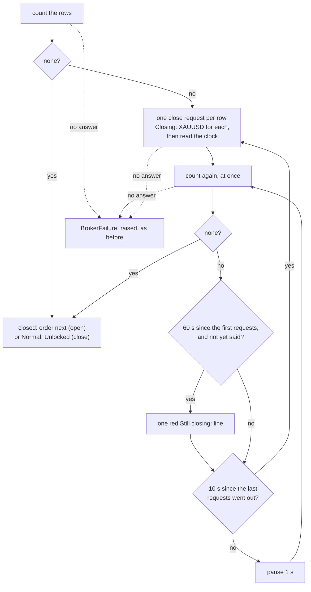

# ADR 0022: Pace the close loop on a clock and say when a close takes a minute

- Status: Accepted
- Date: 2026-11-12

## Context

Both signals close the instrument's positions first: `close` does nothing
else, and `open` places its order only once the broker lists none. The
close loop came over unchanged from the legacy handler
([ADR 0005](0005-execute-signal-use-case-and-ports.md)):

1. count the instrument's position rows;
2. if there are none, stop;
3. send one close request per row, printing `Closing: XAUUSD` for each;
4. go back to 1.

The bot's code had no pause and no limit, and the whole loop runs inside
the lock every other signal waits for.

The `tradelocker` client (0.56.2) sets the real pace:

- **It waits a second before every request.** Its `retry` wrapper sleeps
  for one second before each attempt, the first one included, and makes up
  to four attempts when the connection fails. With its timeouts of 10
  seconds to connect and 30 to read, one call takes a second when the broker
  answers, and up to about two and a half minutes when it does not.
- **A close request is not a close.** `close_all_positions` asks the broker
  to close every position on the instrument. The client's own
  documentation says the broker places an immediate-or-cancel closing order,
  then a good-till-cancelled one, so the fill can come later, or, with the
  market closed, not until it opens.

So the legacy loop was not a busy loop: one row took about two seconds per
round. But it sent a fresh close request, and with it fresh closing orders,
every other second for as long as the position stayed open. With the
market closed for a weekend, that is up to 43,200 requests and as many
`Closing:` lines a day, and nothing in the log said why the bot had gone
quiet on every other signal.

## Decision

The loop keeps its shape, one close request per row, and no upper limit.
It is paced by a clock instead of by the client's delays:



- **A `Clock` port, `now()` and `sleep(seconds)`.** The clock is a process
  boundary, so the application gets it through a port, and the tests
  replace it. `SystemClock` reads `time.monotonic`, not the wall clock: the
  wall clock can step back or forward after an NTP correction or a manual
  change, and the loop would then ask again at once or not for an hour.
- **The positions are counted again at once after a request.** A close
  usually fills before that answer comes back, so the common case orders
  with no pause of the bot's own, as before.
- **Otherwise the bot pauses one second between counts.** With the
  client's own second, that is a count about every two seconds.
- **A close is requested again only once 10 seconds have passed** since
  the last requests went out, on the clock. Seconds are measured, not
  polls counted: a poll takes a second when the broker answers and minutes
  when it does not, so ten polls could be twenty seconds or half an hour.
  The clock is read once the requests are sent, not before: each takes a
  second or more in the client, so with several rows a reading taken
  before would make the next round due at once.
- **One red line a minute after the first request, once:**

  ```text
  Still closing: the broker lists 1 open XAUUSD position 60 seconds after the first close request; later signals wait until it closes, check it in TradeLocker
  ```

  It says how long, in whole seconds, and that later signals wait, because
  that is what the operator cannot see otherwise. Once, not every minute:
  over a weekend a line a minute would bury every other line.
- **No upper limit, by the owner's decision.** Placing the order while the
  old position may still be open could leave two positions, and giving up
  on a `close` signal would leave a position the alert meant to close. The
  loop ends when the broker lists none, or when a call gets no answer.
- **The clock has no default in `build_signal_handler`.** A test that
  leaves it out fails rather than sleeping for real.

## What changes

| | Before | After |
|---|---|---|
| Count after a close request | at once | the same |
| Count while a position stays open | about every 2 s, the client's own second per request | about every 2 s: 1 s of the bot's own plus the client's |
| Close request while a position stays open | one per row on every round, about every 2 s | one per row once 10 s have passed on the clock |
| `Closing: XAUUSD` for one row over a weekend's closed market | up to 43,200 a day | up to 8,640 a day |
| Still open a minute after the first request | nothing beyond more `Closing:` lines | one red `Still closing: ...` line, once |
| A count or close request that gets no answer | ends the loop, raises | the same |
| A close that fills on the first request | `Closing:`, then the order or `Normal: Unlocked` | the same, with no pause |

The tests changed with it:

- **Flipped pins.**
  - `test_close_request_is_resent_on_every_poll_until_the_broker_fills_it`
    became
    `test_a_close_is_requested_again_every_10_seconds_until_the_broker_fills_it`
    in `test_position_handling.py`: three requests, twenty one-second
    pauses.
  - In `test_call_sequences.py`, the exact call sequence of a close that
    fills on the second request: a count at once, ten pauses each followed
    by a count, then the second request. The characterization harness
    records each pause among the broker calls, so the pins show where they
    fall.
  - A new row in the operator-line table: a close that takes eight
    requests prints six `Closing:` lines, the `Still closing:` line, then
    two more.
- **New unit tests.**
  - The use case's close loop, in `test_close_loop.py`:
    - the pause comes after the immediate recount;
    - the request again comes only after 10 s;
    - the 10 s are the clock's, with counts that take 4 s each;
    - they run from when the requests were sent, with requests that take
      4 s each;
    - the warning comes once, at the first count a minute in, ahead of that
      count's request, with one row and with two;
    - it gives the time since the first request, with counts that take 6 s,
      not the threshold.
  - Two failure rows: a count that gets no answer after a pause, and a
    request again that gets none.
  - `SystemClock` reads `time.monotonic` and sleeps through `time.sleep`.
  - The console's exact bytes for one position and for several, with the
    seconds cut to whole ones.
- **No hang in the suite.** One fake clock, `tests/fake_clock.py`, serves
  both suites. It fails a test that sleeps beyond an hour, or reads the
  clock 10,000 times without sleeping.
- **Mutations.** Each of these changes fails at least one test:
  - dropping the pause;
  - requesting again on every poll;
  - requesting again after 11 s, or strictly after 10;
  - counting polls instead of seconds;
  - reading the clock before the first requests are sent, or before a
    request again;
  - pausing before the first recount;
  - sending one request a round instead of one per row;
  - warning on every poll;
  - warning strictly after 60 s;
  - giving the threshold instead of the time;
  - giving one row instead of the count;
  - restarting the minute at every request;
  - ignoring a failed count after a pause;
  - reading the wall clock;
  - not sleeping;
  - rounding the seconds rather than cutting them;
  - wording one position as several, in the count or in "until it
    closes".

## Residual risk

Recorded at the owner's decision to keep no upper limit.

- **A close that cannot fill holds the lock until it can.** With the
  market closed, a weekend for example, the loop waits until it opens.
  Every signal that arrives meanwhile waits on the lock. When the close
  fills, they run one after another, on prices and alerts that may be days
  old. Python's lock does not promise to wake them in the order they came,
  so they may also run out of order.
- **Each waiting signal holds a thread.** One per alert, for as long as
  the close takes.

## What this does not cover

- **One request per row is kept.** One request names the whole
  instrument, so a single request a round may be enough. Whether the broker
  closes every row on one request was not observed, and the fake closes
  them all, so no test could tell. If it does not, merging them would
  stretch a close of several rows to one row every 10 s.
- **A call that gets no answer still ends the loop.** "No upper limit"
  holds only while the broker answers. A count or close request that fails
  raises the client's exception and leaves the position as it is, as
  before.
- **What each close request leaves with the broker.** The client's
  documentation says the broker places an immediate-or-cancel closing
  order, then a good-till-cancelled one. Whether a request sent while an
  earlier one's order is still pending adds another, and whether those are
  cancelled once the position closes, was not observed. Asking again every
  10 seconds rather than every other second sends a fifth as many; asking
  only when the broker shows no pending closing order would need a port
  for pending orders, which no test or observation backs yet.
- **Nothing says when a close that took a minute ended.** After the one
  `Still closing:` line, the next lines are the order or
  `Normal: Unlocked`, with no time.
- **A restart drops the waiting signals and the close.** The handler
  threads are not daemons, so a plain stop waits for the loop until Docker
  kills the process, as before. The bot then stops asking, and an `open`
  whose close was waiting never places its order.
- **The broker's answer to a close request is not read.** The client
  returns whether the broker said `ok`; the adapter drops it, as legacy
  did. A refused request is noticed only through the count, and asked
  again 10 s later.
- **Nothing outside the log is told.** An operator who does not read the
  log does not see the `Still closing:` line.

## Consequences

- The operator learns within a minute that a close is stuck and that
  signals are waiting.
- A close that fills at once costs nothing more.
- The broker gets at most a fifth of the close requests it got while a
  close waits.
- The application has a third port, `Clock`, and every way of building
  the handler names it.

## Alternatives considered

- **An upper limit, then give up.** Rejected by the owner: an order placed
  over a position that did not close may leave two, and a `close` that
  gives up leaves the position the alert meant to close.
- **Count polls instead of reading a clock.** Rejected: a poll takes from
  one second to minutes, so the 10 s and the minute would mean nothing.
- **`time.sleep` and `time.monotonic` in the use case.** Rejected: the
  application imports no clock (`tests/test_layer_dependencies.py`), and
  the tests could not run a weekend in a second.
- **The warning every minute.** Rejected: over a weekend it is 2,880
  lines.
- **One close request a round.** Deferred: see above.
