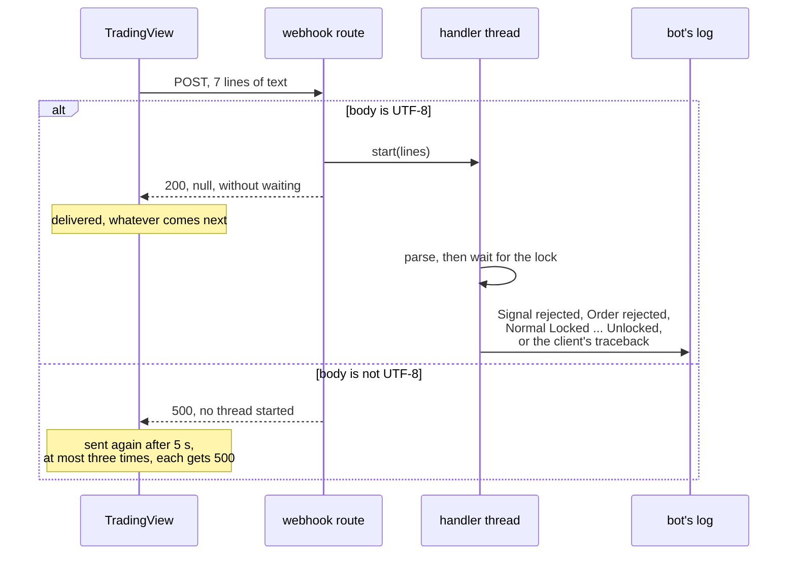

# ADR 0023: The webhook's answer acknowledges receipt, not the outcome

- Status: Accepted
- Date: 2026-11-12

## Context

The roadmap listed one known defect left from step 5a: the webhook answers
`200` before the signal is handled. A payload the bot rejects, a signal the
broker's answer rules out, a rejected order and a broker failure are each
reported only in the bot's log, and the sender never learns of them.

The route does four things, in this order
([ADR 0010](0010-webhook-adapter-and-composition-root.md)):

1. read the body;
2. decode it as UTF-8, which fails the request with `500` if it is not;
3. split it into lines;
4. start one thread that runs the handler on them, and answer `200` with
   the body `null`, without waiting for the thread.

Two things decide what the answer can say: what the sender does with it,
and how long handling takes.

**The sender.** TradingView's own help pages say this. It was not observed
against this bot.

- [About webhooks](https://www.tradingview.com/support/solutions/43000529348-about-webhooks/):
  "If a remote server takes longer than three seconds to process a request,
  the request will be cancelled." Delivery shows in a "Webhook status"
  column of the alert log.
- [Webhook resubmission](https://www.tradingview.com/support/solutions/43000735201-webhook-resubmission/):
  after "an HTTP response status code between 500 and 599 (except for status
  code 504)", the alert "will be sent again after 5 seconds", at most three
  times, so up to four sends per alert.
- [What do errors mean when sending webhooks](https://www.tradingview.com/support/solutions/43000776894-what-do-errors-mean-when-sending-webhooks/)
  lists 3xx, 4xx, 5xx, a timeout and connection errors. None of the three
  pages says whether a timeout, a `4xx` or a dropped connection is sent
  again, or whether the alert log shows the status code or the body.

**Handling.** The `tradelocker` client (0.56.2) waits one second before
every request ([ADR 0022](0022-pace-the-close-loop-on-a-clock.md)), and
keeps the instrument list in memory after the first lookup, so later
lookups send nothing.

- An `open` sends at least three requests: balance, count, order. It sends
  five when it replaces a position: balance, count, close, count, order.
- A `close` with a position to close sends at least three: count, close,
  count.

So a signal that trades takes three seconds or more before it has waited
for anything. A signal that waits on the lock behind another also waits
as long as that one takes, and a close that cannot fill has no upper
limit.

## Decision

The answer stays as it is. It means "received": the body was read and
decoded, and a thread is handling it. It does not carry the outcome.

| Request | Answer | Thread | Pinned by |
|---|---|---|---|
| `POST` to the webhook path, UTF-8 body | `200`, `null` | started, not waited for | `test_the_answer_is_200_with_a_null_body_before_the_signal_is_handled` |
| the same, whatever the signal comes to: rejected payload, refused once the broker answered, rejected order, handled | the same `200`, `null` | | `test_the_answer_is_the_same_whatever_the_signal_comes_to` (new), `test_an_empty_body_is_rejected_as_a_missing_symbol` |
| the same, and a broker call then fails | `200` | ends with the client's exception | `test_a_broker_failure_ends_the_handler_thread_with_the_clients_exception` |
| body that is not UTF-8 | `500` | none | `test_a_body_that_is_not_utf8_fails_the_request_and_starts_no_thread`, `test_server_log.py` |
| another path | `404` | none | `test_webhook_route.py`, ADR 0013 and 0015 |
| another method | `405` | none | `test_webhook_route.py` |

So a `200` does not say:

- **that the signal was valid.** It is parsed in the thread;
- **when it runs.** It may wait on the lock, over a weekend if a close
  cannot fill (ADR 0022);
- **that it runs at all.** A restart drops the signals still waiting
  (ADR 0022);
- **what it came to.** That is in the log only.

Why this answer and not a later one:

- **An answer after handling would come too late.** A signal that trades
  takes three seconds or more, and longer behind the lock, so the request
  would be cancelled while the bot trades on. Whether a
  cancelled request is sent again is not stated. If it is, the bot runs
  the signal twice: the alert carries nothing to tell a second send from a
  new alert.
- **An answer by outcome would invite a second send.** A `5xx` for a broker
  failure is sent again three times. A failure can come after the close or
  after an order that may exist, so each send would close and order again.
- **The thread is started last.** Once a signal is on its way, nothing in
  the route can fail the request, so a `5xx` from the bot is only ever an
  answer to a request that started nothing. A proxy in front of the bot
  is another matter; see below. The `500` for a body that is not UTF-8 is
  then harmless: each of the up to four sends gets `500` and runs nothing.
  The order is held by the decision comment in `create_app`. No test pins
  it, since a route that started the thread earlier and then failed would
  need a fault the tests cannot inject.

## What changes

Nothing the bot does. The known defect leaves the roadmap as a decision
rather than a fix, and these change with it:

- `create_app`'s docstring and comment say what the answer means and why
  the thread starts last, in place of "a known defect".
- A new pin, `test_the_answer_is_the_same_whatever_the_signal_comes_to`,
  posts four signals through the route: a rejected payload, an unknown
  symbol, a rejected order and a trade. Each gets the same `200` and
  `null`, and the log ends with that signal's lines: the rejection, the
  refusal, `Order rejected:` then `Normal: Unlocked`, or
  `Order placed successfully` then `Normal: Unlocked`. It passed when
  written, as a pin of unchanged behaviour should.
- **Mutations.** Each fails at least one route test:
  - answering `422` for a payload the bot rejects;
  - joining the handler's thread before answering.
- ADR 0008, 0009, 0010 and 0021, the roadmap, `docs/architecture.md` and the
  README no longer call the answer a defect step 6 will change.

## What this does not cover

- **Telling the operator outside the log.** A `Signal rejected:`,
  `Order rejected:` or `Still closing:` line is seen only by someone who
  reads the log. A channel such as an issue or a chat message is the
  owner's decision, not yet made.
- **A sender that sends one alert twice.** The bot has no way to tell, so
  it would run both. TradingView's help names resends only after a `5xx`,
  and the bot answers `5xx` only when it started nothing.
- **A reverse proxy's own `5xx`.** The README advises a TLS proxy in front
  of the bot. A proxy that loses the connection to the bot, or times out,
  after the bot has started the thread can answer `502` or `503`, and
  TradingView would then send the alert again: up to four runs of one
  signal. A `504` is not sent again. Not observed; the README tells the
  operator what to look for.
- **Other senders.** The bot handles any `POST` to its path. Another
  sender may time out sooner or resend after other answers.
- **What the "Webhook status" column shows** for a `200` or a `500`. Not
  observed.

## Consequences

- TradingView's alert log shows that an alert was delivered, not that it
  was traded. The operator reads the outcome in the bot's log, as the
  README says.
- The roadmap has no known defect left. Any later change to the answer
  is a decision of its own, with an ADR.

## Alternatives considered

- **Answer once the signal is handled, with its outcome.** Rejected: see
  above. It would come after three seconds or more and be cancelled, and a `5xx` for a
  failure would be sent again.
- **Answer `202 Accepted` instead of `200`.** It names "received, not yet
  done" more exactly. Not taken: TradingView's pages tell no `2xx` from
  another, so only a reader of the code would see the difference, and
  this ADR says it to that reader. It stays a one-line change.
- **Parse the payload in the request and answer `4xx` for one the bot
  rejects.** Parsing makes no broker call, so it would answer well within
  three seconds, and the pages name resends only after a `5xx`. The alert
  log would then show a failed delivery where the operator set up the
  alert. Not taken here, because the owner chose to keep the immediate
  answer, and:
  - the route would have to know what a signal is, or take a second
    callable from the composition root;
  - an unknown symbol or a missing balance needs the broker, so those
    would still answer `200`, and a `200` would mean "well formed", not
    "tradeable".

  It can be a step of its own if the owner wants it.
