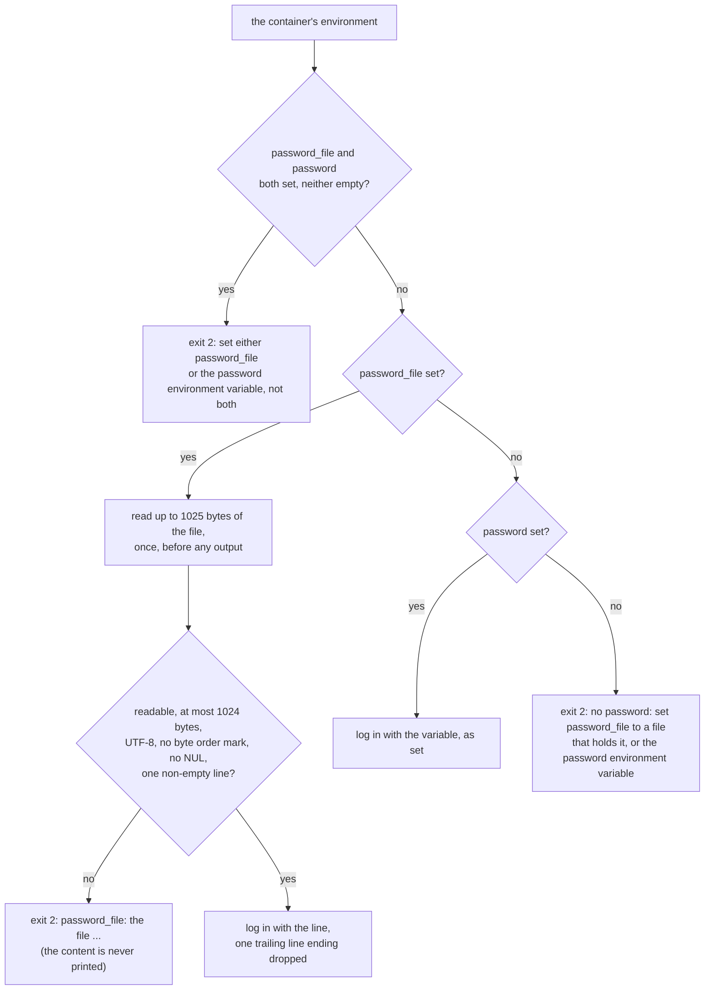

# ADR 0024: Read the password from a file

- Status: Accepted
- Date: 2026-11-12

## Context

Since [ADR 0018](0018-read-the-settings-from-the-environment.md) the bot
reads every setting from its environment, and the password only from
there, through the `password` variable. That took the password out of the
host's process list, which every user of the host can read. Two places
still show it:

- `docker inspect` prints the container's environment, `password`
  included, to anyone who can use Docker on the host. That access gives
  root on the host anyway, but the password also lands in whatever
  records the inspect output: a support paste, a monitoring agent, a
  backup of the container's configuration.
- `/proc/<pid>/environ` shows it to the process's own user and to root.

ADR 0018 named a secret file as the strongest option and left it for a
later step, because it needs a new setting and a new step for the
operator. Docker has a convention for this: Compose and swarm mount each
secret as a file under `/run/secrets/`, and many images read a variable
named after the secret with `_FILE` added.

The `tradelocker` client (0.56.2) keeps the password it is given for the
life of the process and logs in again with it when its token expires.
Whatever the source, the password is in the bot's memory while it runs.

## Decision

A new setting, `password_file`, names a file that holds the password. It
is the other way to set the password, not a second one: exactly one of
`password_file` and `password` must be set.

- **Exactly one source.** When both are set, the bot stops with exit
  status `2` and
  `error: set either password_file or the password environment variable, not both`.
  Neither wins: a `password` line left in an env file would otherwise
  decide, unseen, which password logs in. An empty value counts as not
  set, for `password` as before and for `password_file` now, so a Compose
  file that passes `${PASSWORD_FILE}` from a host that leaves it unset
  does not clash with `password`.
- **Neither set.** The message now names both ways:
  `error: no password: set password_file to a file that holds it, or the password environment variable`.
  The `--password` refusal names both too:
  `argument --password: set password_file or the password environment variable instead`.
- **The file is read once, at startup, before any output,** like every
  other setting. A file that cannot be read stops the bot as a bad
  setting does, before the greeting and the login.
- **What the file must hold: one line.**
  - It is read as bytes and decoded as UTF-8 by the bot, so every system
    reads the same line endings.
  - One trailing `\r\n`, `\n` or `\r` is dropped, since `echo` and most
    editors end a file with one. Nothing else is trimmed, as nothing is trimmed
    from the variable (ADR 0018): spaces and shell characters reach the
    login as written.
  - A file that then still holds a line boundary is refused: any that
    Python's `splitlines` knows, as for the webhook body, such as `\n`,
    `\r`, `\x0b`, `\x0c` or `\u2028`. An operator who points
    `password_file` at the env file would otherwise send every line of it
    to the broker as one password.
  - A file that holds a NUL character is refused. UTF-16 without a byte
    order mark decodes as UTF-8 with a NUL after each letter, and would
    fail the login as a wrong password.
  - A file longer than 1024 bytes, the line ending included, is refused,
    after a read of 1025 bytes and no more, so a path that names a device
    or a large file is not read into memory.
  - A file that is not UTF-8 is refused. Windows PowerShell 5.1 writes
    `>` as UTF-16.
  - A file that starts with a byte order mark is refused rather than
    having it dropped: the last line ending is the only change the bot
    makes, so the password is always what an editor shows.
  - An empty file, or one that holds only a line ending, is refused.
- **No message carries the content.** Each says what is wrong with the
  file, `password_file: the file ...`. For a file that cannot be read the
  system's reason follows in brackets, such as
  `(No such file or directory)`. The decoding error is never shown,
  because it quotes the bytes.
- **`password_file` is read from the environment only,** like `password`.
  `--password_file` is an unknown argument and is refused without being
  printed. One place to look for where the password comes from, and no
  rule to define for an option against the other source's variable.
- **`password` stays.** The frozen contract gains `password_file`; it
  loses nothing. Removing `password` would stop every deployment that
  sets it on its next pull, with `--restart unless-stopped` restarting
  it in a loop.

| Case | Before | After |
|---|---|---|
| `password` set | logs in with it | the same |
| `password_file` set to a file holding `p\n` | ignored; exit `2` without `password` | logs in with `p` |
| both set | `password_file` ignored | exit `2`, `not both` |
| neither, or both empty | exit `2`, `the password environment variable is not set or is empty` | exit `2`, `no password: set password_file ...` |
| a file that is missing, a directory, empty, longer than 1024 bytes, of two lines, with a NUL, not UTF-8, or with a byte order mark | | exit `2`, `password_file: the file ...`, content not printed |
| `--password_file` on the command line | unknown argument, not printed | the same |

## What changes

- `composition_root.password_from` picks the source. A new adapter
  module, `adapters/password_file.py`, reads the file
  (`read_password_file`) and applies the rules to its bytes
  (`password_from_bytes`, no I/O). Each returns a `Result` with the
  password or the message, and `parse_args` turns an `Err` into the
  argparse error and exit status `2`. An adapter module rather than a
  port: only the composition root asks for the password, so a port would
  have one implementation and no caller inside the layers.
- **Tests.** A new `tests/characterization/test_startup_password_file.py`
  pins:
  - the line reaching the login as written, with each line ending;
  - an empty `password_file` or `password` counting as not set;
  - each refused file stopping the bot before any output, with a marker
    in the file that must not appear in the output;
  - a missing file and a directory;
  - both sources set;
  - `--password_file` refused as unknown.

  A unit test, `tests/unit/adapters/test_password_file.py`, pins the
  bounded read against a file with no end.

  The missing-password pin, the `--password` pin and the help text pin
  flip to the new messages.
- **Mutations.** Each fails at least one test:
  - keeping the byte order mark;
  - stripping every trailing line ending;
  - stripping `\n` only, or not a lone `\r`;
  - letting the file win over the variable;
  - keeping a file of several lines, or counting only `\n` and `\r` as
    line boundaries;
  - keeping a NUL character;
  - dropping the size check, or reading the file to its end;
  - showing the decoding error;
  - reading the file in text mode.
- **CI** starts the built image with a file mounted read-only at
  `/run/secrets/password`, holding `p a $HOME *`: the greeting is
  printed, and the image's own Python reads exactly `p a $HOME *` from
  it. The file is written outside the build context, after the
  build, so no image can hold it. It also starts the image with a
  `password_file` that names no file, which must stop it with status `2`
  and `(No such file or directory)`. The step without a password checks
  the new message.
- The README's Quick start mounts the password as a file with
  `--mount type=bind,...,readonly`, not `-v`: for a source that does not
  exist, `-v` "automatically creates the directory on the host", while
  `--mount` "produces an error"
  ([Bind mounts](https://docs.docker.com/engine/storage/bind-mounts/)).
  A directory in place of the file would stop the bot with
  `(Is a directory)` and be in the operator's way. The
  Configuration table, Security section and Troubleshooting table cover
  `password_file`. ADR 0018, the roadmap's frozen contract and
  `docs/architecture.md` are updated.

## What this does not cover

- **The password in memory.** The client keeps it for the life of the
  process, so a memory dump of the bot still holds it.
- **A changed password needs a restart.** The file is read once, and the
  client logs in again with the password it was given.
- **The file's permissions are not checked.** Who can read the file on
  the host decides who can read the password, and the bot cannot see
  that from inside the container. The README tells the operator to make
  the host's file readable only by them.
- **A pipe with no writer** keeps the bot from starting, with nothing in
  the log: opening it waits for a writer. Not guarded: it is a path the
  operator chose. A device or a large file is refused after 1025 bytes.
- **Images built before this change** ignore `password_file` and stop
  with the old message when `password` is not set.

## Consequences

- With `password_file`, `docker inspect` shows only the path, and the
  password is in a file the operator controls, such as a Compose secret.
- The `password` variable works as before, so no running deployment has
  to change.
- Setting both is now an error, so an operator who moves to the file must
  remove `password` from the env file.

## Alternatives considered

- **Replace `password` with `password_file`.** The roadmap first named
  the step that way. Not taken: it changes the frozen contract and stops
  every deployment on its next pull. It can follow as a step of its own
  once deployments have moved.
- **Prefer the file when both are set**, as some images do. Rejected: a
  forgotten `password` line would be silently ignored or, after the file
  is removed, silently used; stopping names the conflict.
- **Strip all surrounding whitespace from the file's content.** Rejected:
  a password may start or end with a space, and ADR 0018 keeps the
  variable as set.
- **Accept `--password_file` as an option.** The path is not secret, but
  the option would need a rule for when it meets the `password` variable.
  Not taken for now; running outside the image can set the variable.
- **Refuse a file readable by others.** Not taken: the mode inside the
  container is whatever the mount gives it, and a secret is mounted
  "world-readable (mode `0444`)" by default
  ([Compose file reference, secrets](https://docs.docker.com/reference/compose-file/services/#secrets)),
  so the check would refuse the usual secret. It would also say nothing about who can read the host's
  copy.
