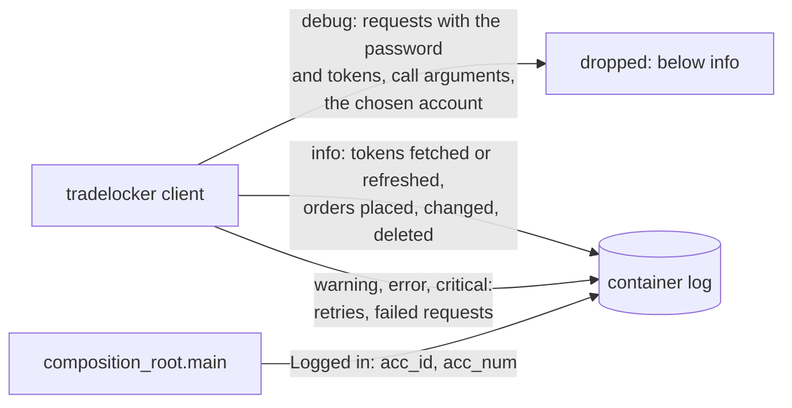

# ADR 0025: Run the broker client at `info`, and name the account in the bot's own line

- Status: Accepted
- Date: 2026-11-12

## Context

Step 6l's CI run showed the login password in the container's output. The
`tradelocker` client (0.56.2) takes a `log_level` argument that defaults to
`debug`, and the bot never passed one. At that level the client logs:

- **every request it sends, in full.** `_request` writes
  `=> REST REQUEST: <method> <url> {...}` with the request's headers and
  JSON body. That puts these in the log:
  - the login's `{'email': ..., 'password': ..., 'server': ...}`;
  - the refresh token, in each token refresh;
  - the access token, in the `Authorization: Bearer` header of every other
    request.
- **the arguments and return values** of the calls it wraps, such as the
  account list with its balances.
- **the account it chose:**
  `Logging in using the first account, account_id: 76, acc_num: 1`.

The client sets the level on its logger, `tradelocker.tradelocker_api`, and
writes to stderr, which `docker logs` keeps. So every start of every image
wrote the password to the container's log, whichever source it came from
([ADR 0024](0024-read-the-password-from-a-file.md)). The access token
lets whoever reads it trade on the account until the token expires, and the
refresh token gets new ones.

The account line had a use: the README's *Verifying the setup* section tells
the operator to check, after a start, that the bot signed in to the account
they meant to trade on. That line came from the same `debug` level.

No test saw the leak. The tests replace the client with a fake, so the
client's log never ran, and the CI steps that start the real image checked
only the exit status and the greeting.

## Decision

`log_in` passes `log_level="info"` to the client (`CLIENT_LOG_LEVEL` in
`tradelocker_broker`), whichever account selector it is given. After the
login, the bot prints the account the client chose, from the client's
`account_id` and `acc_num`:

```text
Logged in: acc_id 76, acc_num 1
```



- **`info` rather than `warning`.** Below `warning`, the client logs only
  what it did: `Successfully fetched authentication tokens`,
  `Successfully refreshed authentication tokens`, and one line per order
  placed, deleted or changed. That is the operator's record of the login
  and of each trade, and none of it holds a credential. The README shows
  the first of these lines as the sign of a good start.
- **The account line is the bot's own.** The client logs its choice only
  at `debug`, and that level cannot be had without the requests. The bot
  prints the line itself, between the login and the server start, in the
  same plain form as its other startup output. The names `acc_id` and
  `acc_num` match the settings that select the account.

## What changes

| In the container's log                      | Before                    | After |
|---------------------------------------------|---------------------------|-------|
| The login request, with the password        | On every start            | Gone |
| The refresh and access tokens               | On every refresh and every request | Gone |
| Call arguments and return values, such as the account list | On every wrapped call | Gone |
| `Successfully fetched authentication tokens` | Yes                      | Yes |
| Lines for orders placed, changed, deleted   | Yes                       | Yes |
| Retries, failed requests                    | Yes                       | Yes |
| The account the bot trades on               | The client's `debug` line | `Logged in: acc_id 76, acc_num 1` |

### Tests

- **`tests/unit/adapters/test_client_log.py`** runs `log_in` against the
  real client, with `requests` replaced by an in-memory server.
  - The first access token it hands out expires within the client's 30
    minutes, so one login sends all three secrets: the password, the
    refresh token and the new access token. The test checks that the
    server saw the login, the refresh and the account list, so a clean log
    cannot come from a client that sent nothing.
  - For each account selector, no log record holds the password or any of
    the four tokens.
  - The log holds exactly the two lines the client writes for the login
    and the refresh, which pins `info` against `warning`.
  - The test reads the records with its own handler on the client's
    logger. pytest's `caplog` would set the level that is under test.
- **The startup pins.** The login the harness records now includes
  `log_level: "info"`, so each account selector's call is pinned. The
  greeting pins add the account line, and
  `tests/characterization/test_startup_account.py` pins it for each
  selector with the fake client's `account_id` and `acc_num`, which carry
  the real client's attribute names.
- **CI.** The two steps that start the real image with a password, from a
  file and from the variable, now also require the client's
  `Failed to fetch authentication tokens` line in the output, which shows
  the client ran and logged, and refuse the password anywhere in it.

Before the fix, the four client-log tests failed with the password and two
tokens in the log, and the five account-line pins failed with no line. Each
of these mutations fails at least one test:

- leaving out `log_level` in any one of the three client calls;
- setting `debug`;
- setting `warning`;
- leaving out the account line;
- swapping `acc_id` and `acc_num` in it.

## What this does not cover

- **Logs already written.** A container started before this change keeps
  the password in its log until the container is removed: `docker rm`
  deletes the log with Docker's default `json-file` driver. A copy shipped
  off the host, to a log collector or a support thread, stays there. If
  that may have happened, change the password.
- **Images built before this change** still log at `debug`. Pull the new
  image.
- **What the server sends back.** On a failed request the client logs the
  server's answer at `error`, and a failed login logs it again at
  `critical` and raises it. If the server echoed the request in an error
  answer, the password would be there. That cannot be checked without the
  real server; the client's failed-login line in CI holds only the
  connection error.
- **A later client version.** The lock pins 0.56.2
  ([ADR 0017](0017-override-the-clients-vulnerable-pins.md)). A version
  that logs a secret at `info` or above would fail
  `test_client_log.py` for the login, the refresh and the account list,
  not for the order requests the test does not send.
- **Each client line appears twice.** The client logs once at import time
  with no handler on the root logger, which makes Python install a stderr
  handler there. Every record of the client's logger then reaches both
  the client's handler and the root's, in two formats. Fewer lines are
  logged now, but the doubling stays; it holds nothing the first copy
  does not.
- **The order lines** hold each order's request: instrument, side,
  quantity and prices. That is trading data, not a credential.

## Consequences

- No credential the bot sends reaches its log.
- The log is shorter: no request dumps and no account tables.
- An operator who read the `REST REQUEST` lines to debug the broker
  connection no longer has them. Running the client at `debug` again
  would bring the password back, so the bot has no setting for it.
- The frozen contract is unchanged: no setting is added or removed.

## Alternatives considered

- **`warning`.** It also drops the lines for the login and for each
  order, which the operator reads to know the bot logged in and traded.
- **Keep `debug` and redact the secrets from the records.** A filter would
  have to know every secret, and the tokens change on each refresh. It
  would let through anything it does not recognise, such as a secret in a
  format a later client version uses.
- **Drop only the request lines,** by filtering the client's `_request`
  records. That depends on the client's private function names, and lets
  through anything else the client adds at `debug`.
- **A setting for the client's level.** Its only use would be `debug`,
  which logs the password.
- **Name the account through `OperatorConsole`.** That port carries the
  use case's lines about signals and orders. The startup is the
  composition root's, which already prints the banners.
