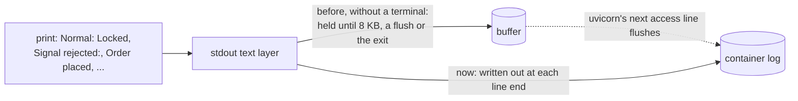

# ADR 0026: Write the bot's output line by line, with or without a terminal

- Status: Accepted
- Date: 2026-11-12

## Context

Step 6m's review found that the bot's lines can wait in a buffer. Python
opens stdout line-buffered only on a terminal. Anywhere else, such as a
pipe, a file, or a container started without `-t`, it holds what is
printed until 8 KB pile up, something flushes, or the process ends.

The image set nothing to change that. The README's `docker run` passes
`-t`, so it got a terminal, but its Compose example has no `tty: true`.
There, every line the bot printed after the start waited:

- `Normal: Locked`, `Closing:`, `Order placed successfully` and
  `Normal: Unlocked`;
- `Signal rejected:`, `Order rejected:` and `Still closing:`.

They reached `docker logs` only when uvicorn logged a request, because its
log handler flushes stdout. The webhook answers before the signal is
handled ([ADR 0023](0023-the-webhook-answer-acknowledges-receipt.md)), so
an alert's access line is written before the lines of its trade, and
those then waited for the next alert. An operator who checked the log
after an alert saw nothing about it: not the trade, not the rejection,
not a close that stayed open over a weekend.

Step 6m flushed the account line, so the startup's output stopped waiting
([ADR 0025](0025-run-the-broker-client-at-info.md)). The lines after it
still did. stderr was never affected: Python writes it out line by line,
terminal or not.

## Decision

`composition_root.main()` starts by setting stdout to line buffering:

```python
sys.stdout.reconfigure(line_buffering=True)
```

Each line is then written out when it is printed, as on a terminal. The
account line's own flush is gone, because the setting covers it.



- **In the bot rather than `ENV PYTHONUNBUFFERED=1` in the image.** The
  variable fixes the image only; the bot run under systemd, `nohup` or
  with its output piped would still hold its lines. It is also invisible
  to the tests, which run the bot in-process, and the image's environment
  is the bot's settings, where it sets no variable
  ([ADR 0018](0018-read-the-settings-from-the-environment.md)).
- **One setting rather than `flush=True` on each print.** The console
  adapter prints seven kinds of line and the colour reset; a new line
  written without the flush would bring the defect back for that line
  alone, and no test of the existing lines would notice.
- **Line buffering rather than none.** A line goes out in one write,
  as on a terminal, rather than in pieces: `print` writes the text and its
  line end separately.
- **First thing in `main()`,** before the arguments are read, so every
  line the bot prints, `--help` included, is covered, whatever branch the
  startup takes.

## What changes

| Without a terminal                     | Before                         | After |
|----------------------------------------|--------------------------------|-------|
| Greeting, generated path, account line | Written at the account line    | Written at each line |
| A trade's lines                        | At the next alert's request    | When printed |
| `Signal rejected:`, `Order rejected:`  | At the next alert's request    | When printed |
| `Still closing:`                       | At the next alert's request    | When printed |
| On a terminal (`docker run -t`)        | When printed                   | When printed |

### Tests

`tests/characterization/test_output_buffering.py` gives the bot a stdout
that is Python's own text layer over an in-memory file, opened as without
a terminal, so what reached the file is what the log would show.

- **The startup.** The greeting and the account line have reached the
  file when the server is started. The stdout records what had reached
  the file before each write, because in the tests the server start
  returns at once, where uvicorn would block.
- **After the start.** For a trade, a rejected payload and a rejected
  order, sent through the app the bot serves, the lines are in the file
  once the handler thread ends, with no request after it.

The pin of the account line's flush moved there from
`test_startup_account.py`, whose stdout recorded flushes and had no
`reconfigure`.

Before the fix, the three post-start pins failed with nothing written
out. Each of these mutations fails at least one test:

- leaving out the call;
- `line_buffering=False`;
- moving the call after `uvicorn.run`.

Checked once by hand, not in the suite: the bot's `main()` in a child
process, with the login and the server stubbed and the child kept alive,
its stdout a pipe. Before the fix the parent read the account line but
not `Normal: Locked`; after it, both.

## What this does not cover

- **Images built before this change.** Pull the new image.
- **The CI runs of the image** cannot show this: the login fails there,
  and a process that exits writes out its buffer anyway.
- **Lines printed at once from several threads** can still interleave at
  line boundaries, as on a terminal. The red lines print their reset
  inside the same call for that reason.
- **uvicorn's and the client's lines** were never held: their log
  handlers flush each record.

## Consequences

- `docker logs` shows each line when the bot prints it, with or without
  a terminal, so the README's Compose example needs no `tty: true`.
- A process killed outright, as by the kernel when memory runs out, no
  longer loses the lines it held.
- One write per line rather than per 8 KB. The bot prints a few lines
  per alert, so the cost does not matter.
- The frozen contract is unchanged: no setting is added or removed.

## Alternatives considered

- **`ENV PYTHONUNBUFFERED=1` in the Dockerfile.** Fixes the image only,
  and no test of the bot sees it.
- **`python -u` in the image's `CMD`.** The same, and the `CMD` is pinned
  as `["python", "main_without_ssl.py"]` (ADR 0018).
- **`tty: true` in the README's Compose example.** Fixes that one example,
  not a deployment written another way.
- **`flush=True` on every print.** Correct today, and lost on the first
  new line that leaves it out.
- **A logger for the operator lines.** Changes their format, which the
  operator reads; a separate behaviour step if ever wanted.
