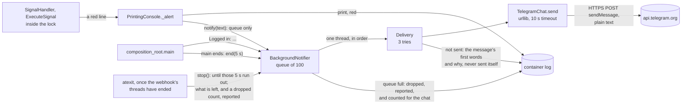

# ADR 0027: Send the operator's red lines to Telegram, off the trading path

- Status: Accepted
- Date: 2026-11-12

## Context

The webhook acknowledges an alert as soon as it arrives
([ADR 0023](0023-the-webhook-answer-acknowledges-receipt.md)), so only
the bot's log shows how a signal ended. Some of those endings need the
operator to act:

- **`Signal rejected:`** The alert or the account rules the signal out,
  and nothing traded.
- **`Order rejected:`** The positions were closed, and the broker refused
  the new one ([ADR 0021](0021-report-a-rejected-order-and-place-it-once.md)).
- **`Still closing:`** A close the broker has not filled holds every later
  signal, a weekend's close included
  ([ADR 0022](0022-pace-the-close-loop-on-a-clock.md)).
- **A broker call that got no answer.** The signal stops wherever the
  call was, possibly after the close, and the log shows only the client's
  traceback.

Nobody reads `docker logs` all day. ADR 0023 left a channel outside the
log for the owner to decide. The owner's answer: whatever is good and
reliable.

## Decision

The bot can send to a Telegram chat. It does so only when two settings
are set, and nothing changes without them:

| Setting               | Holds                                                                  |
|-----------------------|------------------------------------------------------------------------|
| `telegram_token_file` | The path of a file that holds the bot token BotFather gave, on one line |
| `telegram_chat_id`    | The chat's number, such as `-1001234567890`, or `@` and a public channel's name |

What goes to the chat, as plain text with no colours:

| Message                                       | When                                                  |
|-----------------------------------------------|-------------------------------------------------------|
| `Logged in: acc_id 76, acc_num 1`             | Each start, once logged in: a restart shows in the chat |
| `Signal rejected: ...`                        | As in the log                                         |
| `Order rejected: ...`                         | As in the log                                         |
| `Still closing: ...`                          | As in the log                                         |
| `Broker failed: a call for XAUUSD got no answer (TLAPIException); the signal stopped there, check XAUUSD in TradeLocker` | A broker call got no answer. This line is new in the log too, printed before the traceback |
| `Bot failed: an error in the bot (TypeError) while handling XAUUSD; ...` | Any other exception ended a valid signal, a bug for one. New in the log too, before the traceback |
| `Login failed: ConnectionError; the bot stops, the log has the error` | The login failed. Sent only, given up to 5 s at exit |
| `Telegram: the queue was full and dropped 3 of the bot's messages; the log has them` | Once the queue is empty again after a flood. *Update:* now in order, behind the lines that filled the queue ([ADR 0029](0029-tighten-the-notifiers-stop-and-dropped-count.md)) |

### Why

- **Telegram rather than a GitHub issue.** An issue needs a GitHub token in
  the container that can write to the repository. A leak of that token
  could change the repository, depending on its scope. A bot token can only
  act as that one bot. Telegram also pushes the message to the operator's
  phone, and needs no server of the operator's own.
- **Both settings or neither.** If only one is set, the bot stops before
  any output, as it does for a bad password file. The operator who set
  one expects messages. If the bot left Telegram off instead, they would
  learn that only when a message never came.
- **The token comes only from a file.** The file is read under the
  password file's rules: one line of UTF-8, at most 1024 bytes, one line
  ending dropped ([ADR 0024](0024-read-the-password-from-a-file.md)).
  There is no token variable, because `docker inspect` would show it. The
  chat id is not a secret, so it is a variable.
- **The token is checked against BotFather's form:** digits, a colon, then
  letters, digits, `-` and `_`. The token becomes part of the request's
  path, so a `/`, `?` or `%` in it would send the request, token included,
  to another path.
- **Only the red lines, and the account line.** A red line is one the
  operator has to act on. Sending every `Locked`/`Closing:`/`Order placed`
  line would bury those. The account line goes first, at each start, so a
  wrong chat, or a bot the operator never started a chat with, shows up in
  the log at startup rather than on the first alert that needed it.
  *Update:* the green `Closed:` line that ends a
  `Still closing:` one goes too, since it answers a message the chat
  already holds ([ADR 0028](0028-say-when-a-slow-close-ended.md)).
- **The broker failure gets its own red line, and so does any other
  exception that ends a valid signal.** The traceback says nothing to the
  operator's phone. `Broker failed:` and `Bot failed:` name the symbol and
  the exception's type only. The client's exception text can hold a token
  or the server's whole answer
  ([ADR 0025](0025-run-the-broker-client-at-info.md)), and these lines
  leave the host. The traceback after them still has the text, in the
  log.
- **A failed login is sent too, before the bot stops.** Otherwise the
  phone would only miss a `Logged in:` message. The exit function below
  gives it up to 5 seconds. Under `--restart`, that is one message per
  attempt.
- **Off the trading path.**
  - The console runs inside the lock that every signal shares, so it
    only queues the text.
  - One daemon thread sends the messages in order.
  - A slow or unreachable Telegram costs a signal nothing, and a test
    places an order while Telegram never answers.
  - The queue holds 100 messages. A message beyond that, from a flood of
    rejected alerts for instance, is dropped and reported rather than
    held in memory. Once the queue is empty again, the chat gets one
    message with how many were dropped, since one of them may have been
    the one that needed action.
    *Update:* the count now joins the queue at the first drop, behind the
    lines that filled it, grows while it waits and takes no line's slot
    ([ADR 0029](0029-tighten-the-notifiers-stop-and-dropped-count.md)).
  - When `main` ends, however it ends, it sets aside 5 seconds for the
    queue (`end`), within the 10 that `docker stop` waits after its
    SIGTERM. An exit function (`stop`) waits until those seconds run out
    for the queue to empty. It then logs how many of the bot's lines it
    could not send, and any dropped count the chat has not heard of.
    *Update:* it waits at least 2 seconds, also without an `end`, and the
    thread sends nothing after its report
    ([ADR 0029](0029-tighten-the-notifiers-stop-and-dropped-count.md)).
  - An exit function rather than code after `uvicorn.run`. Python runs
    exit functions only once every webhook thread has ended, so a signal
    still running at the stop gets its last red line queued first. Python
    also runs them however `main` ends: a return, a failed login, or
    Ctrl+C. A test runs a separate interpreter to pin that order for each
    of these endings.
  - The seconds count from the end of `main`, not from the exit
    function. A signal still running holds the exit function back, and
    `docker stop`'s seconds run all the same.
  - One condition guards the waiting messages, the one being sent and
    the counts. Each message carries how many dropped messages it reports,
    `0` for the bot's own lines. The stop therefore reports a dropped
    count that is still waiting as a count, not as a line that "the log
    has".
  - On a SIGTERM, uvicorn 0.54 restores the previous handler after its
    shutdown and raises the signal again. The default handler ends the
    process at once, before any exit function, unless Python is PID 1,
    which ignores it. The image starts Python as PID 1, so a `docker stop`
    without `--init` gives the queue its seconds. This was read from
    uvicorn's `capture_signals`, not observed on Linux.
- **Tried again when Telegram may get over it.**
  - Three tries in all, for a `429`, a `5xx`, an answer that is not
    Telegram's, and no answer at all.
  - The waits between them are 2 s and 10 s, or Telegram's own
    `retry_after` up to 10 minutes: a try before that wait ends is refused
    too, so a shorter cap would spend the tries and lose the message.
  - A `retry_after` that is negative, not finite or not a number gets
    the usual wait. The notifier decides this in one place, for any
    `Chat`; the Telegram adapter passes on whatever number it got.
  - A message sent a minute or more after the bot logged it starts with
    `(sent N seconds after the bot logged it)`, so the operator does not
    act on a state that may have changed since. The note comes first, so
    the cut at Telegram's 4096 characters cannot take it.
  - Any other `4xx` is not tried again, because the same request would get
    the same answer.
  - A message that is still not sent is reported in one red log line,
    named by its first words. That report is never sent itself, so a
    Telegram outage cannot feed on itself.
- **Plain text, with no `parse_mode`.** The lines quote the webhook's and
  the broker's text, already escaped with `repr`. Markdown or HTML would
  read that text as markup, or refuse the message.
- **No failure carries the token.**
  - A failure is the HTTP status with Telegram's `description`, cut and
    escaped like the broker's reason, or `no answer (<exception type>)`.
  - Every exception the transport raises is caught, whatever its type.
    An uncaught one would print its traceback, and the text of some, an
    invalid URL's for one, holds the URL.
  - The settings' `repr` leaves the token out.
- **A `Chat` port.** Telegram is a process boundary, so the notifier
  depends on a `Chat` protocol, `send(text) -> Result[None, SendFailure]`,
  and `TelegramChat` is its adapter. The port is declared in the
  notifier's module rather than among the use case's ports, because only
  adapters hand it text.
- **`urllib` rather than `requests`.** It is in the standard library, so
  there is no new direct dependency. `requests`' connection errors also
  name the URL, token included, in their text: a `ConnectTimeout` to a
  closed port read `Max retries exceeded with url: /bot<token>/...`,
  tried with `requests` 2.34.2.
- **In `PrintingConsole` rather than in a second console wrapped around
  it.** The red lines are built in `PrintingConsole`. A wrapper would
  have to forward every other line and build these again, and the
  wording in Telegram could then drift from the log's. Every red line
  goes through one method, `_alert`, which prints the line and hands it
  on.
- **One reader for both secrets.** `adapters/password_file.py` becomes
  `adapters/secret_file.py`, and each message names the setting whose
  file is wrong. A copy of the reader for the token would let the two
  sets of rules drift.

## What changes

| Without the settings | With them |
|----------------------|-----------|
| No thread, no request, no new line on startup | `Telegram: on; the account line and every red line also go to the chat` after the greeting, and the account line in the chat (since [ADR 0028](0028-say-when-a-slow-close-ended.md): `Telegram: on; the account line, every red line and each Closed line also go to the chat`) |
| A broker failure: the traceback | A broker failure: one red `Broker failed:` line, then the traceback, with or without the settings |
| | Each red line in the chat too |
| | A message not sent: `Telegram: the "Signal rejected" message was not sent after 3 tries: HTTP 502` in the log |

### Tests

- **`tests/unit/adapters/test_telegram_chat.py`** runs `TelegramChat` and
  the real `urllib` against an HTTP server on this machine.
  - The request goes to `/bot<token>/sendMessage` as JSON, with the chat
    id as a number, or as written for `@name`, and with no `parse_mode`.
    The text is cut at 4096 characters.
  - Every kind of answer becomes a failure that says whether to try
    again:
    - `400`, `401` and `403`;
    - a `429` with and without `retry_after`, a negative one, and one
      beyond a float's range;
    - `500`, and `502` with an HTML page;
    - a `200` that is not Telegram's;
    - a refused connection, and a timeout.
  - No failure, and nothing printed, holds the token.
- **`test_telegram_settings.py`** covers the settings:
  - neither set, and both set;
  - one without the other;
  - an empty token file;
  - nine contents that are not a token, none of them shown in the
    message;
  - eight chat ids that name no chat;
  - a `repr` without the token.
- **`test_notifier.py`** covers `Delivery`:
  - the tries and their waits;
  - Telegram's `retry_after` kept up to 10 minutes, and a negative, NaN
    or infinite one replaced;
  - one report after the last try, and an immediate one for a refused
    message;
  - the lateness note, first, from the time the message was logged.
- **`test_background_notifier.py`** covers the queue and its thread:
  - `notify` returning while a message is held, with each message's
    logged time;
  - a full queue reported;
  - the dropped count sent once the queue is empty, and not ahead of a
    line that arrives meanwhile;
  - a delivery that raises does not end the thread;
  - the stop, which waits for the queue and reports nothing, or reports
    the lines it loses;
  - the stop's seconds counted from `end`;
  - a waiting count reported as a count.
- **`test_printing_console.py`** checks that each red line is handed on as
  its text without colours, and that the other lines are not. It also
  pins `Broker failed:` and `Bot failed:` with the type alone.
- **`test_signal_handler.py`** gives the handler a use case that raises a
  `TypeError`. The handler prints `Bot failed:` with the type only,
  re-raises the same object, and releases the lock.
- **`test_broker_failures.py`** adds the `Broker failed:` line to every
  failing call's pinned lines, before the lock is released.
- **`tests/characterization/test_startup_telegram.py`** runs the startup,
  with `urlopen` and `atexit` replaced where the composition root takes
  them.
  - Without the settings, no thread starts, no exit function is
    registered, and nothing is sent.
  - With them, the account line goes to the right URL once logged in,
    and the token is not printed.
  - A rejected payload posted to the app reaches the chat.
  - An order is placed while Telegram never answers.
  - Four bad settings stop the bot before any output and before the
    login.
  - A failed login is sent by the time the exit function returns.
  - A selector that is not a number sends nothing.
  - At exit, a message Telegram never answers is reported.
- **`test_notifier_at_exit.py`** runs a separate interpreter. It starts the
  notifier and sets its stop's seconds, as `main`'s `finally` does, then
  ends four ways: a return, an exception, Ctrl+C and `sys.exit`. In each,
  a line that a thread still running queues after that point is sent
  before the process ends. That pins Python's own order: the exit function
  runs after the other threads. Calling `end` from `main`'s `finally` is
  pinned by the startup tests, not by this one.

The first tests came before the code. The console tests failed on a
constructor with no `notify`. The Telegram and notifier modules did not
exist. The failure pins lacked the new line, and the startup had no
`urlopen` to replace.

Three reviews followed, and their fixes came before their tests. Each fix
was then proven by mutation instead.

- **The first review** found ten points:
  - the cap on `retry_after`;
  - drops reaching only the log;
  - no mark on a late message;
  - a `retry_after` that stopped the sleep;
  - an unsent failed login;
  - an unreported stop;
  - no port;
  - no line for other exceptions;
  - two copies of the red-line format and of the queue's size.
- **The second and third reviews** found races in the stop and in the
  dropped count, each in code the round before had added. The stop was
  redesigned twice, into the form above, rather than patched.

One script then ran 35 mutations against the final code, and each fails
at least one test:

- **The console and the handler:**
  - the console not handing a red line on;
  - the handler leaving out `Broker failed:` or `Bot failed:`;
  - either line showing the exception's text.
- **The settings and the chat:**
  - one setting alone leaving Telegram off;
  - the token not checked;
  - adding `parse_mode`;
  - trying every `4xx` again;
  - a transport failure carrying its text;
  - an out-of-range `retry_after` raising.
- **`Delivery`:**
  - `retry_after` ignored, not capped, or capped back at 60 s;
  - any `retry_after` kept;
  - a refused message tried again;
  - no lateness note, or the note at the end;
  - the time of sending rather than of logging.
- **The queue:**
  - sending on the caller's thread;
  - the thread ending on an exception;
  - drops not counted, or not reported;
  - no dropped count sent;
  - the count taking freed slots.
- **The stop:**
  - no exit function;
  - no `end` in `main`'s `finally`;
  - the seconds counted from the exit function;
  - the stop forgetting the message being sent;
  - a waiting count reported as a line, or forgotten.
- **The startup:**
  - the notifier not started;
  - the account line not sent;
  - a failed login not sent;
  - the selectors converted inside the login's `try`.

## What this does not cover

- **A real send to Telegram.** The tests use a server on this machine and
  a replaced `urlopen`, and CI has no bot token. On the first start with
  the settings, check that the `Logged in:` message arrives.
- **Messages still queued 5 seconds into a stop are lost.** The thread is
  a daemon thread, so it does not hold the stop for minutes of tries. The
  log says how many, each of them is in the log, and the next start sends
  `Logged in:`. A process that is killed, or that gets SIGTERM while not
  PID 1 (under `docker run --init`, for one), reports nothing.
- **A signal that never ends holds the exit.** Python waits for every
  webhook thread before it runs the exit functions, and a close that
  never fills runs until Docker kills the process. That was so before
  this change; the queue then gets no seconds.
- **`Login failed:` comes once per start.** Under `--restart`, a wrong
  password sends one message per attempt, as Docker's restarts slow down.
  It also covers the client's refusal of both account selectors, which
  happens inside the login; a selector that is not a number is a bad
  setting and is not sent.
- **Telegram's texts beyond the `401`.** Only `HTTP 401, 'Unauthorized'`
  was seen from the real server, for a made-up token. The README's
  `403` and `400` texts are Telegram's documented and commonly reported
  ones, given as examples.
- **A message can arrive twice.** When the answer to a sent message is
  lost, the next try sends it again.
- **A message can wait.** Messages go one at a time, so each one waits
  behind the tries of those before it. During an outage that adds up, to
  hours behind a long queue. A message that goes a minute or more late
  says so, but not the wall-clock time it was logged. The 10-second
  timeout does not bound a slow DNS lookup.
- **Trading data leaves the host.** Telegram's servers keep the messages:
  the account's id and number, symbols, sides, the broker's reasons, and
  in some rejections the account balance. Bot chats are not end-to-end
  encrypted. Anyone in the chat reads them.
- **The chat cannot answer the bot.** The bot only sends, and reads
  nothing from the chat.
- **A flood of one kind of message can still push out another** while
  the queue is full. The chat learns how many were dropped, not which.
- **Limits of the stop and the dropped count**, found by the last review
  and left for a step of their own (6q). Each one costs a message only
  with a line in the log that says so:
  - The seconds count from the end of `main`, so a signal that runs
    5 seconds past it leaves the stop none, even when Docker's grace
    period, or a terminal's, has more.
  - If `main` never reaches its `finally`, after a second Ctrl+C at the
    wrong moment, the stop waits no time at all.
  - The dropped count waits for an empty queue, so under steady traffic
    with a slow chat it can wait for a long time, and it takes a slot
    that a line could need.
  - The stop's report can say a message was not sent while the thread
    still sends it during the rest of the shutdown.

  *Update:* [ADR 0029](0029-tighten-the-notifiers-stop-and-dropped-count.md)
  removes all four. What is left is a try already under way when the stop
  reports, which can still deliver its message.
- **A daemon thread that prints at exit.** If the notifier's thread is in
  the middle of a `print` while Python ends, Python can stop with "could
  not acquire lock for stdout". That happens only at shutdown, after the
  stop's report.
- **When a long close ended.** A `Still closing:` message has no
  follow-up yet; that is the next step. *Update:* it has one now, the
  `Closed:` line ([ADR 0028](0028-say-when-a-slow-close-ended.md)).
- **Images built before this change** ignore both settings and start
  without Telegram.

## Consequences

- The operator learns of a rejected signal, a rejected order, a stuck
  close or a broker failure on their phone, within seconds, without
  reading the log.
- A Telegram outage or a wrong setting costs trading nothing. It shows
  in the log as one red line per message not sent.
- The frozen contract gains two optional variables. None is removed.
- The log gains the `Broker failed:` and `Bot failed:` lines, with or
  without Telegram.

## Alternatives considered

- **A GitHub issue.** It needs a token in the container that can write to
  the repository (above), and an issue reaches a phone only through
  GitHub's own notifications.
- **E-mail.** It needs SMTP credentials and a mail server that accepts
  them, and mail can land in spam. That is more to set up, and a second
  secret worth more than a bot token.
- **A generic webhook URL,** for ntfy, Slack or Discord. Each service
  wants its own body, so the bot would end up shaping each one or
  sending one that suits none. That is a later step, if one is asked for.
- **Sending from the console's own call.** That runs inside the lock: a
  hung Telegram would hold every signal for the length of the timeout and
  the tries.
- **A logging handler.** The console's lines are `print`s
  ([ADR 0005](0005-execute-signal-use-case-and-ports.md)). A handler
  would see none of them without changing the log's format.
- **A `telegram_token` variable.** `docker inspect` would show it, as it
  shows `password`.
- **Every line, or the broker exception's text.** The first buries the
  lines that need action. The second can carry a token off the host.
