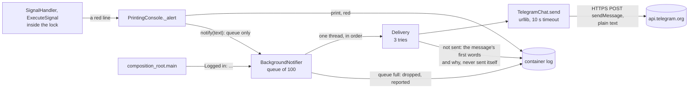

# ADR 0027: Send the operator's red lines to Telegram, off the trading path

- Status: Accepted
- Date: 2026-11-12

## Context

The webhook acknowledges an alert as soon as it arrives
([ADR 0023](0023-the-webhook-answer-acknowledges-receipt.md)), so only
the bot's log shows how a signal ended. Some of those endings need the
operator to act:

- **`Signal rejected:`** The alert or the account rules the signal out,
  and nothing traded.
- **`Order rejected:`** The positions were closed, and the broker refused
  the new one ([ADR 0021](0021-report-a-rejected-order-and-place-it-once.md)).
- **`Still closing:`** A close the broker has not filled holds every later
  signal, a weekend's close included
  ([ADR 0022](0022-pace-the-close-loop-on-a-clock.md)).
- **A broker call that got no answer.** The signal stops wherever the
  call was, possibly after the close, and the log shows only the client's
  traceback.

Nobody reads `docker logs` all day. ADR 0023 left a channel outside the
log for the owner to decide. The owner's answer: whatever is good and
reliable.

## Decision

The bot can send to a Telegram chat. It does so only when two settings
are set, and nothing changes without them:

| Setting               | Holds                                                                  |
|-----------------------|------------------------------------------------------------------------|
| `telegram_token_file` | The path of a file that holds the bot token BotFather gave, on one line |
| `telegram_chat_id`    | The chat's number, such as `-1001234567890`, or `@` and a public channel's name |

What goes to the chat, as plain text with no colours:

| Message                                       | When                                                  |
|-----------------------------------------------|-------------------------------------------------------|
| `Logged in: acc_id 76, acc_num 1`             | Each start, once logged in: a restart shows in the chat |
| `Signal rejected: ...`                        | As in the log                                         |
| `Order rejected: ...`                         | As in the log                                         |
| `Still closing: ...`                          | As in the log                                         |
| `Broker failed: a call for XAUUSD got no answer (TLAPIException); the signal stopped there, check XAUUSD in TradeLocker` | A broker call got no answer. This line is new in the log too, printed before the traceback |

### Why

- **Telegram rather than a GitHub issue.** An issue needs a GitHub token in
  the container that can write to the repository. A leak of that token
  could change the repository, depending on its scope. A bot token can only
  act as that one bot. Telegram also pushes the message to the operator's
  phone, and needs no server of the operator's own.
- **Both settings or neither.** If only one is set, the bot stops before
  any output, as it does for a bad password file. The operator who set
  one expects messages. If the bot left Telegram off instead, they would
  learn that only when a message never came.
- **The token comes only from a file.** The file is read under the
  password file's rules: one line of UTF-8, at most 1024 bytes, one line
  ending dropped ([ADR 0024](0024-read-the-password-from-a-file.md)).
  There is no token variable, because `docker inspect` would show it. The
  chat id is not a secret, so it is a variable.
- **The token is checked against BotFather's form:** digits, a colon, then
  letters, digits, `-` and `_`. The token becomes part of the request's
  path, so a `/`, `?` or `%` in it would send the request, token included,
  to another path.
- **Only the red lines, and the account line.** A red line is one the
  operator has to act on. Sending every `Locked`/`Closing:`/`Order placed`
  line would bury those. The account line goes first, at each start, so a
  wrong chat, or a bot the operator never started a chat with, shows up in
  the log at startup rather than on the first alert that needed it.
- **The broker failure gets its own red line.** The traceback says
  nothing to the operator's phone. The line names the symbol and the
  exception's type only. The client's exception text can hold a token or
  the server's whole answer
  ([ADR 0025](0025-run-the-broker-client-at-info.md)), and this line
  leaves the host. The traceback after it still has the text, in the
  log.
- **Off the trading path.**
  - The console runs inside the lock that every signal shares, so it
    only queues the text.
  - One daemon thread sends the messages in order.
  - A slow or unreachable Telegram costs a signal nothing, and a test
    places an order while Telegram never answers.
  - The queue holds 100 messages. A message beyond that, from a flood of
    rejected alerts for instance, is dropped and reported rather than
    held in memory.
- **Tried again when Telegram may get over it.**
  - Three tries in all, for a `429`, a `5xx`, an answer that is not
    Telegram's, and no answer at all.
  - The waits between them are 2 s and 10 s, or Telegram's own
    `retry_after` up to 60 s.
  - Any other `4xx` is not tried again, because the same request would get
    the same answer.
  - A message that is still not sent is reported in one red log line,
    named by its first words. That report is never sent itself, so a
    Telegram outage cannot feed on itself.
- **Plain text, with no `parse_mode`.** The lines quote the webhook's and
  the broker's text, already escaped with `repr`. Markdown or HTML would
  read that text as markup, or refuse the message.
- **No failure carries the token.**
  - A failure is the HTTP status with Telegram's `description`, cut and
    escaped like the broker's reason, or `no answer (<exception type>)`.
  - Every exception the transport raises is caught, whatever its type.
    An uncaught one would print its traceback, and the text of some, an
    invalid URL's for one, holds the URL.
  - The settings' `repr` leaves the token out.
- **`urllib` rather than `requests`.** It is in the standard library, so
  there is no new direct dependency. `requests`' connection errors also
  name the URL, token included, in their text.
- **In `PrintingConsole` rather than in a second console wrapped around
  it.** The red lines are built in `PrintingConsole`. A wrapper would
  have to forward every other line and build these again, and the
  wording in Telegram could then drift from the log's. Every red line
  goes through one method, `_alert`, which prints the line and hands it
  on.
- **One reader for both secrets.** `adapters/password_file.py` becomes
  `adapters/secret_file.py`, and each message names the setting whose
  file is wrong. A copy of the reader for the token would let the two
  sets of rules drift.

## What changes

| Without the settings | With them |
|----------------------|-----------|
| No thread, no request, no new line on startup | `Telegram: on; the account line and every red line also go to the chat` after the greeting, and the account line in the chat |
| A broker failure: the traceback | A broker failure: one red `Broker failed:` line, then the traceback, with or without the settings |
| | Each red line in the chat too |
| | A message not sent: `Telegram: the "Signal rejected" message was not sent after 3 tries: HTTP 502` in the log |

### Tests

- **`tests/unit/adapters/test_telegram_chat.py`** runs `TelegramChat` and
  the real `urllib` against an HTTP server on this machine.
  - The request goes to `/bot<token>/sendMessage` as JSON, with the chat
    id as a number, or as written for `@name`, and with no `parse_mode`.
    The text is cut at 4096 characters.
  - Every kind of answer becomes a failure that says whether to try
    again: `400`, `401`, `403`, a `429` with and without `retry_after`,
    `500`, `502` with an HTML page, a `200` that is not Telegram's, a
    refused connection and a timeout.
  - No failure, and nothing printed, holds the token.
- **`test_telegram_settings.py`** covers the settings:
  - neither set, and both set;
  - one without the other;
  - an empty token file;
  - nine contents that are not a token, none of them shown in the
    message;
  - eight chat ids that name no chat;
  - a `repr` without the token.
- **`test_notifier.py`** covers the notifier:
  - the tries and their waits, with Telegram's `retry_after` capped;
  - one report after the last try, and an immediate one for a refused
    message;
  - `notify` returning while a message is held;
  - the report for a full queue;
  - a delivery that raises does not end the thread.
- **`test_printing_console.py`** checks that each red line is handed on as
  its text without colours, and that the other lines are not. It also
  pins the `Broker failed:` line with the type alone.
- **`tests/characterization/test_startup_telegram.py`** runs the startup,
  with `urlopen` replaced where the composition root takes it.
  - Without the settings, no thread starts and nothing is sent.
  - With them, the account line is sent to the right URL once logged in,
    and the token is not printed.
  - A rejected payload posted to the app reaches the chat.
  - An order is placed while Telegram never answers.
  - Four bad settings stop the bot before any output and before the
    login.
- **`test_broker_failures.py`** adds the `Broker failed:` line to every
  failing call's pinned lines, before the lock is released.

Before the code, the new tests failed. The console tests failed on a
constructor with no `notify`, the Telegram and notifier modules did not
exist, the failure pins lacked the new line, and the startup had no
`urlopen` to replace. Each of these mutations fails at least one test:

- the console not handing a red line on;
- the handler leaving out the `Broker failed:` line;
- that line showing the exception's text;
- the notifier not started;
- the account line not sent;
- sending on the caller's thread;
- one setting alone leaving Telegram off;
- the token not checked;
- adding `parse_mode`;
- trying every `4xx` again;
- a transport failure carrying the exception's text;
- ignoring `retry_after`;
- not capping it;
- trying a refused message again;
- the thread ending on an exception;
- a full queue not reported.

## What this does not cover

- **A real send to Telegram.** The tests use a server on this machine and
  a replaced `urlopen`, and CI has no bot token. On the first start with
  the settings, check that the `Logged in:` message arrives.
- **Messages queued when the bot stops are lost.** The thread is a daemon
  thread, so it does not hold the stop for a minute of tries. Each of
  those messages is in the log, and the next start sends `Logged in:`.
- **A message can arrive twice.** When the answer to a sent message is
  lost, the next try sends it again.
- **A message can wait.** Messages go one at a time, so one can wait
  behind the tries of the one before. That wait is up to about two and a
  half minutes: three 10-second timeouts and two 60-second waits.
- **Trading data leaves the host.** Telegram's servers keep the messages:
  the account's id and number, symbols, sides, the broker's reasons, and
  in some rejections the account balance. Bot chats are not end-to-end
  encrypted. Anyone in the chat reads them.
- **The chat cannot answer the bot.** The bot only sends, and reads
  nothing from the chat.
- **When a long close ended.** A `Still closing:` message has no
  follow-up yet; that is the next step.
- **Images built before this change** ignore both settings and start
  without Telegram.

## Consequences

- The operator learns of a rejected signal, a rejected order, a stuck
  close or a broker failure on their phone, within seconds, without
  reading the log.
- A Telegram outage or a wrong setting costs trading nothing. It shows
  in the log as one red line per message not sent.
- The frozen contract gains two optional variables. None is removed.
- The log gains the `Broker failed:` line, with or without Telegram.

## Alternatives considered

- **A GitHub issue.** It needs a token in the container that can write to
  the repository (above), and an issue reaches a phone only through
  GitHub's own notifications.
- **E-mail.** It needs SMTP credentials and a mail server that accepts
  them, and mail can land in spam. That is more to set up, and a second
  secret worth more than a bot token.
- **A generic webhook URL,** for ntfy, Slack or Discord. Each service
  wants its own body, so the bot would end up shaping each one or
  sending one that suits none. That is a later step, if one is asked for.
- **Sending from the console's own call.** That runs inside the lock: a
  hung Telegram would hold every signal for the length of the timeout and
  the tries.
- **A logging handler.** The console's lines are `print`s
  ([ADR 0005](0005-execute-signal-use-case-and-ports.md)). A handler
  would see none of them without changing the log's format.
- **A `telegram_token` variable.** `docker inspect` would show it, as it
  shows `password`.
- **Every line, or the broker exception's text.** The first buries the
  lines that need action. The second can carry a token off the host.
