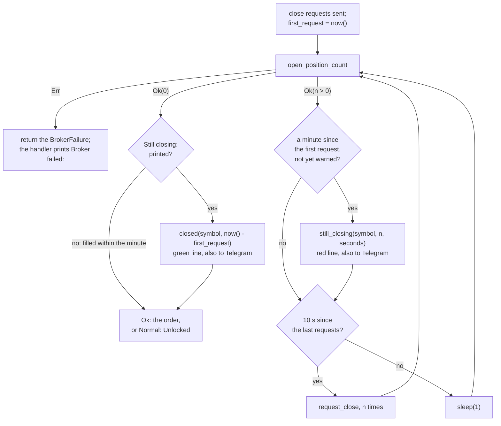

# ADR 0028: Say when a close that took a minute ended

- Status: Accepted
- Date: 2026-11-12

## Context

A close the broker has not filled a minute after the first request prints
one red line, once
([ADR 0022](0022-pace-the-close-loop-on-a-clock.md)):

```text
Still closing: the broker lists 1 open XAUUSD position 60 seconds after the first close request; later signals wait until it closes, check it in TradeLocker
```

ADR 0022 listed what came next under "What this does not cover": nothing
said when such a close ended. The next lines were the order or
`Normal: Unlocked`, with no time.

Step 6o made that gap worse. The `Still closing:` line now reaches the
operator's phone
([ADR 0027](0027-send-the-red-lines-to-telegram.md)), while `Normal:
Unlocked` and `Order placed` do not. The chat was told that later signals
wait, and was never told that they no longer do. An operator who acted on
the first message, closing the position by hand for example, had to open
the log to see whether that worked.

## Decision

- **One line when the broker lists no position, in a close that logged
  `Still closing:`:**

  ```text
  Closed after 138 seconds: the broker lists no open XAUUSD position
  ```

- **Only after the warning.** A close that fills within the minute, which
  is nearly every one, prints nothing new. Every signal that replaces a
  position closes one, and a line for each would bury the one that
  matters, in the log and in the chat.
- **The seconds run from the first close request to the count that lists
  none.** That is the same start as `Still closing:`, so the two lines
  read as one story. The clock is read at that count, not taken from an
  earlier reading. The seconds are whole, cut like those of
  `Still closing:`.
- **Green, and handed to Telegram too.** It asks nothing of the operator,
  so it is not red. It still goes to the chat: the chat holds the
  `Still closing:` message it answers. It goes through the same `notify`
  as the red lines, so the log's wording and the chat's cannot drift.
- **No word on what comes next.** For a `close` signal the lock is free
  right after. For an `open` signal, the order still follows, inside the
  lock, and it can end in `Order rejected:` or `Broker failed:`. A line
  that said "later signals no longer wait" would be false there. The line
  says only what the bot knows at that moment.
- **No line when a call fails after the warning.** The broker never
  listed none. `Broker failed:` already says the signal stopped there and
  names the symbol to check
  ([ADR 0027](0027-send-the-red-lines-to-telegram.md)).
- **One port method, `OperatorConsole.closed(symbol, seconds)`.** The use
  case decides when; the console decides the words, as for
  `still_closing`.
- **Its green line leaves in one `print`, reset included**, like
  `print_red`. The notifier's thread prints too, and a line printed between
  a colour and its reset would take the colour
  ([ADR 0026](0026-write-stdout-line-by-line.md)). `order_placed` keeps
  its two legacy prints.



## What changes

| | Before | After |
|---|---|---|
| A close that fills within the minute | `Closing:` lines, then the order or `Normal: Unlocked` | the same |
| A close that logged `Still closing:`, then fills | more `Closing:` lines, then the order or `Normal: Unlocked` | the same, with one green `Closed after N seconds: ...` line before them |
| The same, with Telegram on | the chat gets `Still closing:` only | the chat gets `Still closing:`, then `Closed after N seconds: ...` |
| A broker failure after `Still closing:` | `Broker failed:`, then the traceback | the same, with no `Closed after` line |
| The startup line with Telegram on | `Telegram: on; the account line and every red line also go to the chat` | `Telegram: on; the account line, every red line and each Closed after line also go to the chat` |

## Tests

- **`tests/unit/application/test_closed_line.py`** runs the use case on
  in-memory ports that share one journal:
  - a close and an open that logged `Still closing:` journal one `closed`
    entry, right after the count that lists none, with the seconds read
    at that count, and then `unlocked`, or the order and `unlocked`;
  - closes that fill at once, in half a minute, or at the first count a
    minute in, journal none;
  - a count or a close request that fails after the warning journals
    none.
- **`tests/unit/adapters/test_printing_console.py`** pins the line's
  exact bytes, in green, and the text handed to `notify`, without colours.
- **`tests/unit/adapters/test_ascii_alerts.py`** pins that `print_red`
  and `print_green` each print a line and its reset in one call. The bytes
  alone cannot show that: two calls print the same ones.
- **`tests/characterization/test_call_sequences.py`** gains the line in
  the row of a `close` that takes eight requests, and a new row for an
  `open` that does, with the order after the line.
- **`tests/characterization/test_startup_telegram.py`** pins the new
  startup line.

Each of these mutations of the code fails at least one test:

- no `closed` line at all;
- a line for every close;
- a line once a minute has passed, warned or not;
- the seconds from the last request rather than the first;
- the seconds from the clock read before the count;
- a line when a count fails after the warning;
- a line when a close request fails after the warning;
- the seconds not cut to whole ones;
- the line in red;
- the line not handed to `notify`;
- `print_green`, or `print_red`, printing the reset in a second call;
- the old startup line.

## What this does not cover

- **A restart between the two lines.** The close and its wait end with
  the process, so the chat holds a `Still closing:` message with no
  `Closed after` one. The startup's `Logged in:` message is the only sign
  of the restart.
- **When the position closed, to the second.** The line comes at the
  first count that lists none. Counts are about two seconds apart, and
  one that gets a slow answer takes longer, so the seconds can be late by
  that much.
- **What follows an `open` signal's close.** A placed order prints no red
  line, so the chat sees `Closed after` and then nothing. A rejected order
  and a failed call still send their own lines.

## Alternatives considered

- **A line for every close.** Rejected: nearly every signal that
  replaces a position closes one within seconds, and the chat would
  repeat that for each trade.
- **"Later signals no longer wait" in the line.** Rejected: false for an
  `open` signal, whose order still runs inside the lock after the line.
- **A red line.** Rejected: red marks a line the operator has to act on,
  and this one ends the need to.
- **A line after a failure too, such as "Stopped waiting".** Rejected:
  `Broker failed:` already says that the signal stopped, and names the
  symbol to check.
- **Sending it to Telegram from a separate path.** Rejected for the
  reason ADR 0027 gives for the red lines: one place builds the words, so
  the log and the chat cannot drift.
