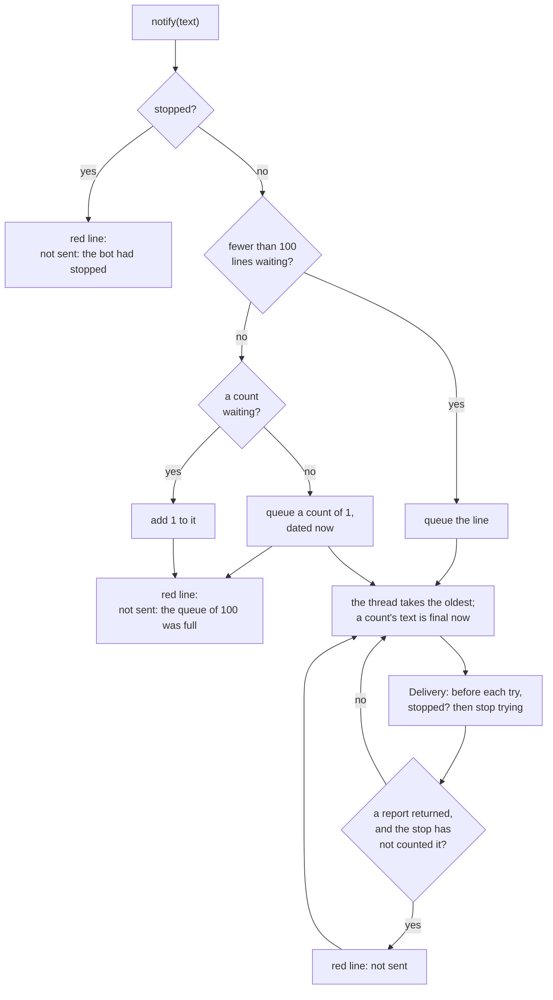
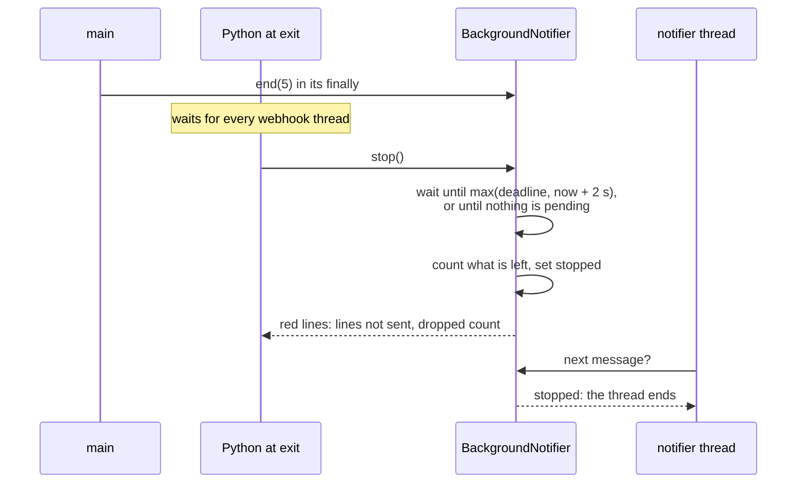

# ADR 0029: Tighten the notifier's stop and its dropped count

- Status: Accepted
- Date: 2026-11-12

## Context

The Telegram notifier queues the operator's messages for one thread of its
own ([ADR 0027](0027-send-the-red-lines-to-telegram.md)). At a stop, `main`
calls `end(5)` in its `finally`, and the exit function `stop()` waits for
the queue until those 5 seconds run out. It then reports in red what is
left. When more than 100 messages are waiting, the newest are dropped, and
the chat later gets one message saying how many.

The last review of step 6o found four limits there. ADR 0027 listed them
under "What this does not cover", and each one costs a message only with
a log line that says so:

1. **The seconds count from the end of `main`.** A signal still running
   5 seconds after that leaves its last line no time at all.
2. **If `main` never reaches its `finally`**, the stop waits no time at
   all. That happens after a second Ctrl+C at the wrong moment.
3. **The dropped count waits for an empty queue.** Under steady traffic
   with a slow chat that can take hours. Once queued, it takes a slot
   that a line could need.
4. **The stop's report can be wrong.** It can say a message was not sent
   while the thread still sends it, on its next try, during the rest of
   the shutdown.

When does a signal outlive `main`? The server installed in the image,
uvicorn 0.54.0, answers SIGTERM, and a first Ctrl+C, by waiting for every
open connection and every request still being handled. It only gives up
waiting on a second SIGINT (`Server.handle_exit`). So under
`docker stop`, which sends one SIGTERM, `main` ends only after the last
signal, and `end` comes after its last line. Limits 1 and 2 happen only
after a second Ctrl+C, on a terminal. A terminal kills nothing after a
grace period: the process then waits for the signal's thread, since
Python waits for every thread that is not a daemon before its exit
functions.

## Decision

- **A floor under the stop's wait: 2 seconds** (`STOP_FLOOR_SECONDS`).
  The stop waits until the later of two times: the deadline `end` set,
  and now plus the floor. Without an `end` it waits the floor alone.
  - The floor is long enough for one try and its answer from a chat that
    is up.
  - It is short enough that an operator who pressed Ctrl+C twice gets the
    terminal back soon.
  - It costs nothing when the queue is empty: the wait ends as soon as
    nothing is pending.
  - Under `docker stop` the deadline is 5 seconds after the last line, so
    the floor is never the longer of the two.
- **One count, waiting in order, growing in place.**
  - When a line does not fit, the count joins the queue at once, behind
    the lines that filled it.
  - Each later drop adds to that same count for as long as it waits.
  - It does not take a slot: the queue holds 100 lines, and at most one
    count beside them.
  - Its text is built when the thread takes it, and is final from then
    on. A drop after that starts a new count, so each drop is counted
    once, by one message.
  - A count is dated by its first drop. If it goes a minute late, its
    lateness note covers every drop in it.
  - A drop joins the waiting count even when lines were queued behind it
    since its first drop. The chat then reads the count before a line
    the log has before some of the drops it counts. A new count after
    each such line would keep the log's order exactly, but in a long
    flood with a slow chat every freed slot would alternate a line and a
    count. The count says how many were dropped; the log has the order.
- **No try begins after the stop's report, and each message gets one
  red line.**
  - The stop sets a flag in the same step in which it counts what is left.
  - From then on the thread takes nothing more from the queue and ends.
  - `Delivery` reads the flag before each try, and stops trying when it is
    set.
  - `Delivery` returns the report of a message it did not send, rather
    than printing it. The thread prints it only if the stop has not
    counted that message. It decides this in the same step in which it
    marks the message as handled, under the condition the stop counts
    under. A try under way at the stop that then fails, or raises, adds
    no second red line to the stop's.
  - The flag is a `threading.Event`, set while the condition is held.
    `Delivery` reads it before each try without taking the lock that
    `notify` takes on the trading path.
  - The flag reaches `Delivery` as a third argument, the event's
    `is_set`. Building one flag in the composition root and handing it to
    both would have put the notifier's state in two owners.
- **A third Ctrl+C cuts the stop's wait, not its report.** An operator
  who presses it during the floor wants out sooner, and still has to
  learn what was lost. The stop catches the interrupt around its wait,
  then counts and reports as usual.
- **A line queued after the stop is reported, not queued.** The thread
  has ended, so a queued line would wait for nobody, without a word. It
  gets the usual red report instead:
  `Telegram: the "Bot failed" message was not sent: the bot had stopped`.
  Today nothing calls `notify` that late, because the exit function runs
  only once every webhook thread has ended. The report covers a later
  change that would.

## What changes

| | Before | After |
|---|---|---|
| A signal's line queued after `end`'s seconds ran out | Reported as not sent at once | Gets up to 2 seconds, then is reported if still pending |
| No `end` before the exit function | The stop waits no time | The stop waits up to 2 seconds |
| A full queue drops lines | One count queued once the queue is empty, in a free slot | One count queued at the first drop, behind the lines that filled the queue; it grows while it waits and takes no slot |
| What the chat sees in a flood | The lines, then the count | The lines that fit, the count, then the lines queued after it |
| The stop's report, then a try | The thread could still send a message the report named | No try begins after the report |
| A try under way at the stop fails after it | Two red lines for one message: the stop's and the delivery's | The stop's only |
| A third Ctrl+C during the stop's wait | (no wait to cut) | The wait ends, and the report still comes |
| `notify` after the stop | Queued; sent if the thread got to it | A red line: `not sent: the bot had stopped` |

The texts of every report are unchanged. The one new text is the last
row's reason.

## Tests

- **`tests/unit/adapters/test_notifier_stop.py`** holds the stop's tests:
  - the ones that moved from `test_background_notifier.py`;
  - a line queued after the seconds ran out gets the floor;
  - without an `end` the stop waits the floor;
  - the floor does not cut the seconds `end` set aside;
  - after the stop the thread ends, and the message behind the one being
    sent is never sent;
  - `Delivery` learns of the stop between its tries;
  - a try under way at the stop that then fails, or raises, adds no
    second red line;
  - a delivery's report is printed when no stop counted the message;
  - an interrupt during the stop's wait cuts the wait, not the report;
  - a line after the stop is reported;
  - a count being sent and one waiting are reported as one count, the
    line between them as a line.
- **`tests/unit/adapters/test_background_notifier.py`** pins the count:
  - it waits where the first drop was;
  - it takes no line's slot;
  - it grows while it waits, dated by its first drop;
  - a drop while it is sent starts a new count;
  - the old test of a count that waited for an empty queue is replaced,
    since it pinned the order this ADR reverses.
- **`tests/unit/adapters/test_notifier.py`**:
  - no try begins once the notifier has stopped;
  - a stop during the wait between tries ends them;
  - its other tests read the report `Delivery` returns, where they read
    the one it printed before.
- **`tests/characterization/test_notifier_at_exit.py`** runs a real
  interpreter twice more, with `end(0)` and with no `end`. In both, the
  last line of a signal still running is sent before the process ends.
  Its fake `urlopen` now takes 0.3 seconds, so the stop really has to wait.
  Both runs failed before this change.
- **`tests/unit/adapters/notifier_doubles.py`** holds the gated
  deliveries both unit files share, and finds the notifier's thread by
  its name.

Each of these mutations of the code fails at least one test:

- no floor once the seconds ran out;
- no seconds without an `end`;
- the floor in place of the seconds `end` set aside;
- `Delivery` trying after the stop;
- the thread going on after the stop;
- `Delivery` never told of the stop;
- a delivery's report printed after the stop counted its message;
- a delivery's report never printed;
- a third Ctrl+C skipping the report;
- a line after the stop queued for nobody;
- the count taking a line's slot;
- a new count for every drop;
- the count in flight still taking drops;
- the count dated by its last drop;
- the stop forgetting the message being sent;
- the stop reporting counts as lines;
- the composition root not passing the floor;
- a floor of 0.

## What this does not cover

- **A try already under way when the stop reports.** The flag cannot
  recall a request already sent: its message can still arrive after the
  report has named it as not sent. The same holds for a try that began a
  moment before the flag was set.
- **A thread that outlives `main` under `docker stop`.** The floor rests
  on uvicorn waiting for every request at a SIGTERM, which holds for
  0.54.0, and on anyio ending its worker threads with the event loop. If
  a later version let a thread run on, and Python reached the exit
  function more than 3 seconds after `end`, the floor would add up to
  2 seconds past the deadline, inside `docker stop`'s 10. A run that long
  could then be killed before its report.
- **A connection that hangs.** A try can take the full 10-second timeout,
  longer than the floor. Its message is reported as not sent, and may
  still arrive.
- **A signal that holds `docker stop` past its grace period.** The server
  waits for it, so `end` comes late. The process can then be killed inside
  the stop's 5 seconds, before any report. That was so before; ADR 0027
  lists it.
- **Which messages a flood dropped.** The count says how many, and the
  log has each one.

## Alternatives considered

- **Count the stop's seconds from the exit function, not from `end`.**
  Rejected. Under `docker stop`, Python reaches the exit function only
  after the webhook threads, so those seconds would run past the grace
  period. ADR 0027 chose `end` for that reason.
- **A floor of the full 5 seconds.** Rejected. The floor applies only
  after a second Ctrl+C, so it should be short. One try and its answer
  fit in 2 seconds.
- **Keep the count out of the queue, sent whenever a slot is free.**
  Rejected. It would go ahead of lines logged before it, or wait like the
  old count. A queued count goes out where the first drop was, after the
  lines logged before it.
- **A new count after each line queued behind the waiting one.** Rejected,
  above: in a long flood the chat would get a count after every line.
- **Let the count take a slot.** Rejected. In a flood, each slot freed
  would go to a count rather than a line.
- **Wait at the stop for the try under way.** Rejected. A hung connection
  holds it for 10 seconds, the whole floor and more.
- **A flag shared through the composition root.** Rejected, as above. The
  third argument keeps the stop in one owner.
- **`Delivery` checking the flag before it prints its report.** Rejected:
  the stop could count the message between that check and the print,
  and the message would get two red lines. Only a decision made under
  the stop's own condition is exact.
- **Cap the floor at the deadline when `end` ran.** Rejected: a signal's
  line queued after the deadline, the case the floor is for, would again
  get no time.
