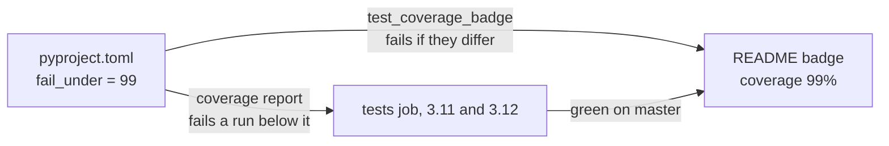

# ADR 0030: Gate the test coverage, and state the floor on the README

- Status: Accepted
- Date: 2026-11-12

## Context

The suite had never been measured. Run under `coverage` with branch
measurement, it covers 99.62% of the `tradelocker_bot` package: three
lines and one branch out of 849 statements and 216 branches are left out.
None of them depends on the platform.

The README is the page a user reads before running the bot on a live
account, and it showed no figure for how much of the code the tests run.
A figure there is worth something only if it cannot drift away from what
CI checks.

## Decision

- **CI measures, and fails below a floor.** The `tests` job runs the suite
  under `coverage run`, on Python 3.11 and 3.12, and then `coverage report`,
  which fails the leg below `fail_under` in `pyproject.toml`: 99, compared
  at two decimals. Measurement is by line and by branch, of the
  `tradelocker_bot` package. The same step writes the report as Markdown
  to the run's summary, so a pull request shows which lines its tests left
  out. The step stays inside `tests`: `ci-ok` and the publish workflow
  depend on the job and workflow names.
- **The badge states the floor, not the last figure.** It is a fixed
  shields.io image beside the README's title, `coverage 99%`, linking to
  the README's *Test coverage* section. `tests/test_coverage_badge.py`
  fails when its number differs from `fail_under`, and when the workflow
  stops running `coverage report`. A green `master` therefore proves the
  badge true, and raising one without the other fails a test.
- **`coverage` is pinned in `requirements-dev.txt`.** It has no
  dependencies of its own, so it cannot move a locked package, which the
  `tests` job checks after the dev install anyway.
- **`main_without_ssl.py` is not measured.** It only calls `main()`, and
  the tests import the composition root instead; CI starts the file
  inside the image.
- **`.coverage` and `htmlcov/` are ignored**, by git and by the Docker
  build context, which `COPY . /app` would otherwise bake into the image.

## What changes

| Where | Before | After |
|-------|--------|-------|
| `tests` job | `python -m pytest` | `python -m coverage run -m pytest`, then a `Coverage` step that writes the report to the summary and runs `coverage report` |
| `pyproject.toml` | no coverage settings | `[tool.coverage.run]` and `[tool.coverage.report]` |
| README | no figure | a badge on the title line, a *Test coverage* section with the local commands |

## Tests

`tests/test_coverage_badge.py`, written before the change and failing on
both tests:

- the badge on the title line states `fail_under`, whole or with
  decimals;
- the `tests` job runs `coverage run`, then `coverage report` on a line of
  its own, and no step of it has `continue-on-error`.

Mutations, each killed: a floor of 98, a badge of 100%, the enforcing
report removed, `coverage run` replaced by plain pytest, and
`continue-on-error` on the coverage step.

## What this does not cover

- Lines run only in a separate interpreter: the at-exit pins start one,
  and `coverage` does not follow it. The lines they run are also run in
  the main process by the unit tests.
- How good the tests are. A line counts as covered once any test runs
  it, whether or not a test checks what it does; the mutation runs
  recorded in each step's ADR are the measure of that.
- A floor below the measured figure lets coverage fall by up to 0.62
  points before a run fails. Raising the floor is a one-line change to
  `pyproject.toml` and the badge, together.

## Alternatives

- **A coverage service, such as Codecov or Coveralls**, which redraws the
  badge after each run. Rejected for now: it needs an account and a token
  the owner would have to create, and sends every run's report to a third
  party. The fixed badge plus the gate gives the same guarantee, a floor
  rather than the exact figure, with nothing outside GitHub.
- **A badge the workflow redraws and commits.** Rejected: it gives the
  tests job write access to the repository, which every pull request's
  code runs in.
- **A floor of 100%.** Rejected: the three lines left out are a defensive
  `raise` for a refusal no use case returns, and a read of an HTTP error's
  body that fails. Forcing tests for them adds pins on unreachable paths,
  not safety.
