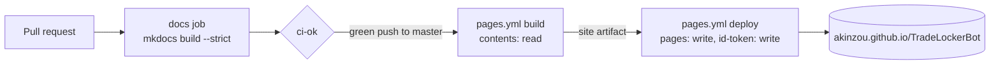

# ADR 0031: Publish the documentation on GitHub Pages

- Status: Accepted
- Date: 2026-11-12

## Context

The documentation is Markdown in the repository: the README, the
architecture, the roadmap and 30 decision records, with 36 Mermaid
diagrams. GitHub renders each file on its own, with no search across
them, no navigation between them, and no page to send a user to that is
not the repository itself.

The rule so far was Markdown in `docs/`, rendered by GitHub, with a site
generator allowed later as long as the content needs no migration. A site
is wanted now. The question is which generator builds these files as they
are, and how it is published without new risk to the repository.

## Decision

- **MkDocs with the Material theme**, from `mkdocs.yml`, publishing `docs/`
  to <https://akinzou.github.io/TradeLockerBot/>. It builds the existing
  files unchanged and renders Mermaid. The home page is the README itself:
  `docs/index.md` includes it and rewrites its links into the site, so the
  two never differ.
- **The build is strict.** A link to a missing page, an anchor that names
  no heading, or a page the navigation leaves out fails it. The navigation
  lists every page, so a new decision record must be added to it, or the
  build fails.
- **Three Markdown extensions make GitHub's syntax read the same:**
  - `github-callouts` turns `> [!WARNING]` into a warning box;
  - `mdx_truly_sane_lists` nests a list under two spaces, as GitHub does;
  - `md_in_html` renders the README's centred title, which now carries
    `markdown="1"`.
- **CI builds the site on every pull request.** A `docs` job in the
  `Python (3.11, 3.12) ,` workflow builds it in strict mode, and `ci-ok`
  needs it. A broken link therefore fails the pull request, not the
  publish after the merge.
- **The publish mirrors the image's.** `pages.yml` runs after a green CI
  run of a push to `master` and builds the commit CI validated. Its build
  job runs the pip-installed tools with read access only. A separate deploy
  job has `pages: write` and `id-token: write`, and runs only GitHub's
  `deploy-pages` action. The actions are pinned to commits, like every
  other.
- **The tools have their own lock**, `requirements-docs.txt`, compiled by
  uv from `requirements-docs.in` with hashes and installed with
  `--require-hashes`. They are not in `requirements-dev.txt`: their own
  packages, `requests` among them, would move locked ones in the `tests`
  job.
- **Mermaid at an exact version, checked by its hash.** The theme loads the
  newest `mermaid@11` from unpkg, with no check. `docs-theme/main.html`
  defines `mermaid` first instead: 11.17.2 from jsDelivr, with a
  subresource-integrity hash taken from the npm package. The package was
  verified against the registry's integrity value, and the CDN's file
  against that hash. A changed file on the CDN does not run on the site.
- **No web fonts.** `font: false` keeps the pages off Google Fonts; the
  system's own fonts are used.
- **The README gets a docs badge, and the coverage badge a logo**, both on
  the title line.

## What changes

| Where | Before | After |
|-------|--------|-------|
| `mkdocs.yml`, `docs/index.md`, `docs-theme/main.html` | none | the site's configuration, home page and Mermaid pin |
| `requirements-docs.in`, `requirements-docs.txt` | none | the build tools, locked with hashes |
| `python-package.yml` | `ci-ok` needs three jobs | a `docs` job, and `ci-ok` needs four |
| `pages.yml` | none | builds and deploys the site from a validated `master` |
| README | the `
` around the title | `markdown="1"` on it; a docs badge; the `docs/adr` link points to the decision index in `architecture.md`, a page the site has |
| `.gitignore`, `.dockerignore` | | `site/`, the build output |

## What this does not cover

- **The first publish is not proved by the pull request.** A
  `workflow_run` workflow runs only from `master`, so the deploy is first
  seen working after the merge.
- **Material for MkDocs reaches end of life on 5 May 2027**, with security
  fixes until then. Its successor, Zensical, by the same team, reads
  `mkdocs.yml`, but is at 0.1 and was not tried here. Moving to it is the
  next step for the site, before that date.
- **The theme's ResizeObserver polyfill still comes from unpkg**, without a
  hash, but only in a browser that has no ResizeObserver of its own, which
  no current browser lacks.
- **The site is public, as the repository is.** It holds nothing the
  repository does not.

## Alternatives

- **Jekyll, GitHub Pages' default.** Rejected: it renders no Mermaid, and
  the 36 diagrams are half of what the documentation shows.
- **Sphinx with MyST.** Rejected for now: its value is generated API
  references, and the bot has no API worth one. Its Markdown dialect
  would also need the diagrams and callouts adapted.
- **Zensical now.** Rejected: at 0.1 its plugins, including the one that
  includes the README, are not settled.
- **A copy of the README as the home page.** Rejected: two copies drift
  apart, and the include costs one plugin.
- **Mermaid served from the site itself.** Rejected: 3.5 MB committed or
  fetched at every build, for the same guarantee the hash gives.
