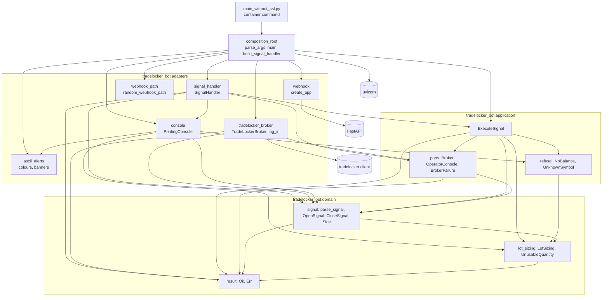
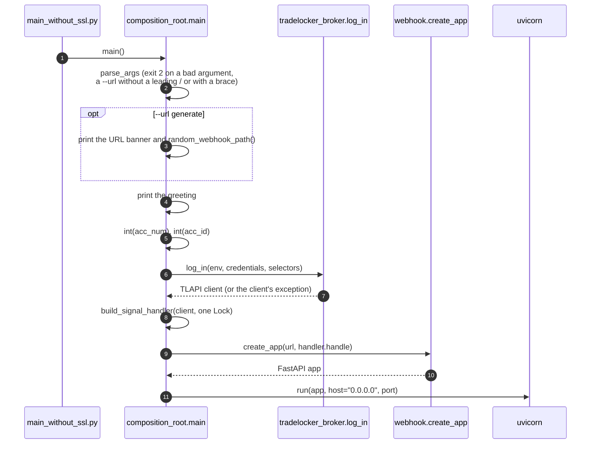
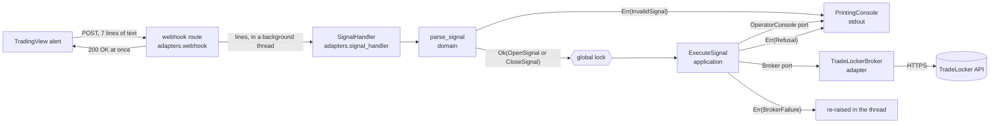
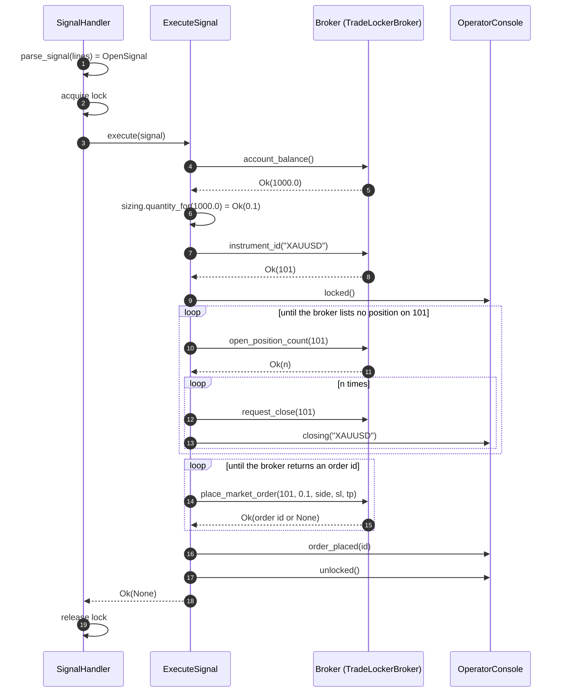
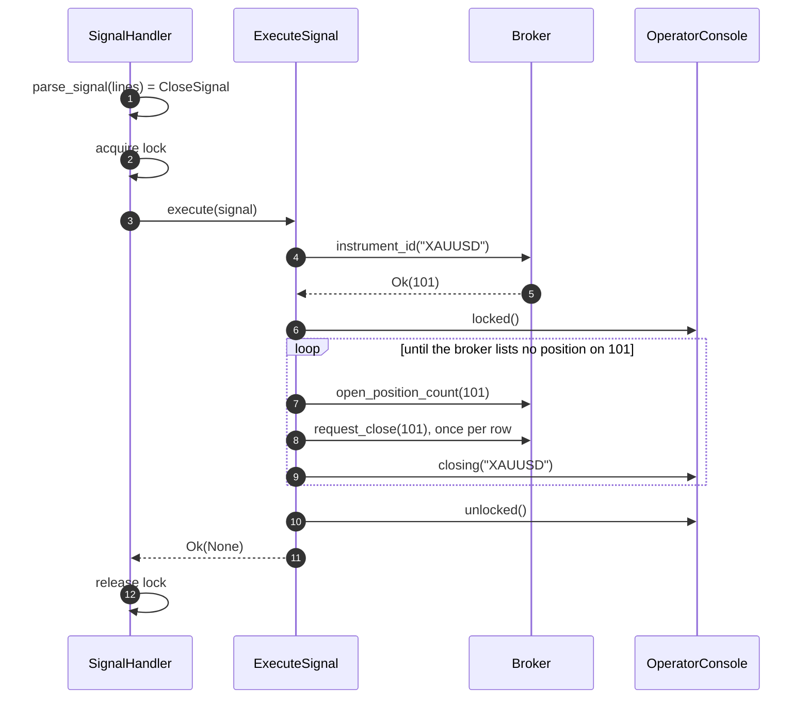
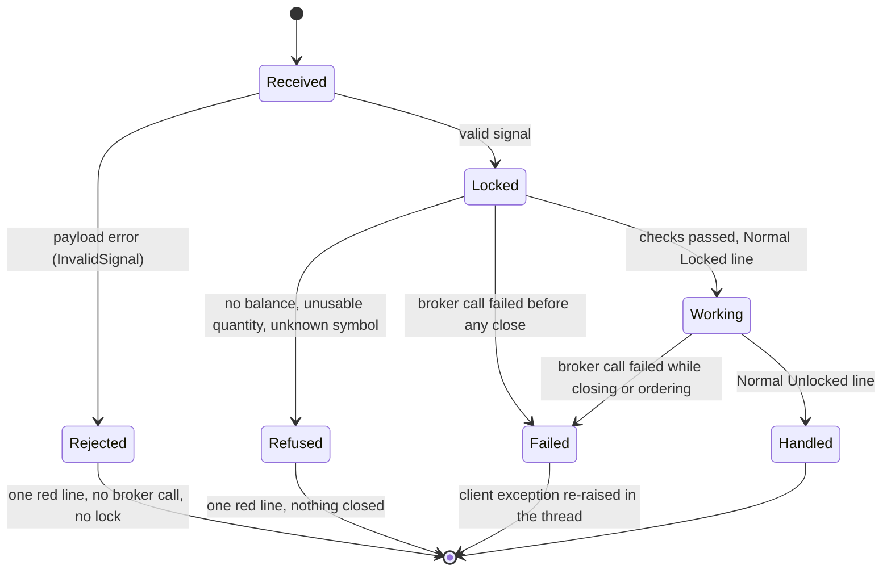

# Architecture

The bot is moving from a single script to a layered design
([ADR 0001](adr/0001-incremental-layered-migration.md)). The
[migration roadmap](migration-roadmap.md) tracks where it stands. This page
describes the code as it is on `master`.

## Contents

- [Layers](#layers)
- [Startup](#startup)
- [Data flow](#data-flow)
- [Handling one signal](#handling-one-signal)
- [How a signal can end](#how-a-signal-can-end)
- [Domain model](#domain-model)
- [Application](#application)
- [Adapters](#adapters)
- [Composition root](#composition-root)
- [Decisions](#decisions)

## Layers

| Layer             | Package                            | May depend on                                   | Holds                                                          |
|-------------------|------------------------------------|-------------------------------------------------|----------------------------------------------------------------|
| Domain            | `tradelocker_bot.domain`           | standard library                                | Trading rules as plain values and functions, with no I/O       |
| Application       | `tradelocker_bot.application`      | domain                                          | Use cases and the ports they need                              |
| Adapters          | `tradelocker_bot.adapters`         | application, domain, third-party clients        | TradeLocker client and login, operator console, HTTP webhook, signal handler |
| Composition root  | `tradelocker_bot.composition_root` | everything above                                | Start arguments, banners, wiring, the lock, the server start   |
| Entrypoint        | `main_without_ssl.py`              | the composition root                            | The container's command; calls `main()` and nothing else       |

Every arrow below is an import in the code. The entrypoint keeps its name
because the container command is part of the frozen contract
([roadmap](migration-roadmap.md#frozen-contract)).

Dependencies point inwards only. `tests/test_layer_dependencies.py` enforces
this for the inner layers with an explicit allow-list:

- The domain may import its own package and a named set of pure
  standard-library modules (`dataclasses`, `enum`, `math`, `typing` and
  similar).
- The application may import the same, plus the domain.
- Anything else fails, including `datetime` (the clock), `random`, `os`, the
  adapters and every third-party package.
- The same test forbids builtins that do I/O or load code, such as `open`,
  `print` and `eval`, in both layers.

Adapters exist to depend on third-party clients, so the allow-list does not
cover them. The same test keeps them inward of the composition root: an
adapter may import neither `composition_root` nor `main_without_ssl`, so no
adapter can reach another's wiring, such as the shared lock or the
logged-in client, behind the root's back
([ADR 0010](adr/0010-webhook-adapter-and-composition-root.md)).

## Startup

A bad argument stops at step 2, a bad account selector at step 5, and a
failed login at step 6. Each leaves every later step undone, so the server
never starts on a half-built bot.

## Data flow

What happens to one alert, from TradingView to the broker. Text from the
webhook becomes a typed signal at the first step and stays typed from then
on.

| Value                         | Made by                    | Read by                                   |
|-------------------------------|----------------------------|-------------------------------------------|
| webhook lines (`list[str]`)   | `create_app`'s route       | `SignalHandler.handle`, then `parse_signal` |
| `OpenSignal` / `CloseSignal`  | `parse_signal`             | `ExecuteSignal`                           |
| `InvalidSignal`               | `parse_signal`             | `PrintingConsole.rejected`                |
| balance (`float` or `None`)   | `TradeLockerBroker`        | `ExecuteSignal`, then `LotSizing`         |
| quantity (`float`)            | `LotSizing.quantity_for`   | `Broker.place_market_order`               |
| instrument id (`int` or `None`) | `TradeLockerBroker`      | `ExecuteSignal`                           |
| `Refusal`                     | `ExecuteSignal`, `LotSizing` | `PrintingConsole.rejected`              |
| `BrokerFailure`               | `TradeLockerBroker`        | `SignalHandler`, which re-raises its cause |

## Handling one signal

### `open`

Steps 4 to 8 can end the signal early (ADR 0009). No balance, an unusable
quantity or an unknown symbol is a `Refusal`. A call that fails is a
`BrokerFailure`. Either way nothing has been closed yet. The close loop and
the order retry still have no delay or limit; the roadmap lists both as
defects for step 6.

### `close`

`close` sizes nothing, so it reads no balance (ADR 0008).

## How a signal can end

| End      | Broker calls          | Positions touched  | Operator sees                 | Thread         |
|----------|-----------------------|--------------------|-------------------------------|----------------|
| Rejected | none                  | no                 | `Signal rejected: line N ...` | ends normally  |
| Refused  | balance and/or lookup | no                 | `Signal rejected: ...`        | ends normally  |
| Failed   | up to the failing one | possibly closed    | the client's traceback        | raises         |
| Handled  | all                   | replaced or closed | `Normal: Locked` ... `Unlocked` | ends normally |

The webhook answers `200 OK` before any of this, so the caller never learns
the outcome. That is a known defect, and step 6 changes it.

## Domain model

- `parse_signal` turns the webhook's lines into an `OpenSignal` or a
  `CloseSignal`, or returns the first `InvalidSignal`. It runs before any
  broker call ([ADR 0008](adr/0008-validate-the-signal-before-any-broker-call.md)).
  An `OpenSignal` already holds the `Side` to trade, with the inversion
  applied.
- `LotSizing` is the position size per unit of account balance, parsed from
  the webhook's `<lot>/<balance step>` field. Both numbers must be positive
  and finite, and the constructor refuses anything else. `quantity_for`
  returns the rounded lots for a balance. If that number is not finite or
  not above zero, it returns `UnusableQuantity` instead
  ([ADR 0009](adr/0009-refuse-what-the-broker-rules-out-before-closing.md)).
- `Side` is `buy` or `sell`, with its `opposite`.
- `Ok` / `Err` (`Result`) is an outcome returned as a value. A result refuses
  truth testing, so a forgotten unwrap fails loudly
  ([ADR 0006](adr/0006-result-at-the-broker-boundary.md)).

## Application

[ADR 0005](adr/0005-execute-signal-use-case-and-ports.md) describes the
design.

- `ExecuteSignal` runs one valid signal.
  - `close` looks up the instrument and closes its positions.
  - `open` reads the balance, sizes the position and looks up the
    instrument. Only then does it close the instrument's positions and place
    a market order.
  - The instrument is looked up once.
  - The legacy close loop and order retry are kept. The roadmap lists them
    as defects.
- `execute` returns `Ok(None)`, a `Refusal` or the first `BrokerFailure`.
  - A `Refusal` (`NoBalance`, `UnknownSymbol`, `UnusableQuantity`) means the
    broker answered and ruled the signal out. It always comes before any
    close request (ADR 0009).
  - A `BrokerFailure` means a broker call did not answer. It holds the
    client's own exception (ADR 0006).
- `Broker` and `OperatorConsole` are its ports, one per process boundary.
  - `Broker.account_balance` returns `Ok(None)` when the answer holds no
    number.
  - `Broker.instrument_id` returns `Ok(None)` for a name the broker does not
    list. Its `Err` means only that the broker did not answer.

## Adapters

- `TradeLockerBroker` implements `Broker` over the `tradelocker` client.
  - Each method makes the legacy handler's call with the same arguments.
    The exception is the instrument lookup, which reads the instrument list
    rather than parsing the client's `ValueError` (ADR 0009).
  - Only the client call runs inside the exception guard. A fault in the
    adapter's own handling of the answer raises, so it cannot pose as an
    outage.
  - `log_in`, in the same module, logs in to the demo or live server, on the account that
    `--acc_num` or `--acc_id` names. It refuses both at once before sending
    any credentials.
- `PrintingConsole` implements `OperatorConsole` as the legacy coloured
  stdout lines.
  - Its `rejected` prints one red line for an `InvalidSignal` or a
    `Refusal`, using the same "found, expected" shape for both.
  - Webhook text in that line is escaped with `repr` and cut after 40
    characters.
- `create_app` (`webhook`) is the inbound HTTP adapter. It serves the
  webhook path, splits the body into lines and starts one thread per
  request. It serves nothing else: no OpenAPI schema and no docs pages,
  because the schema would name the secret path
  ([ADR 0011](adr/0011-serve-no-api-docs.md)). It redirects nothing: a path
  one slash away answers `404`, because the redirect pointed senders at
  plain `http://` ([ADR 0013](adr/0013-no-trailing-slash-redirect.md)).
- `SignalHandler` runs one request's lines. It parses them before the lock
  and runs a valid signal inside it.
  - A rejection or a refusal gets one operator line.
  - A broker failure is re-raised as the client's own exception, so the
    webhook thread fails as before.
- `ascii_alerts` holds the console's colours and the startup banners, and
  `webhook_path` makes the random path for `--url generate`, from
  `secrets` ([ADR 0012](adr/0012-generate-the-webhook-path-with-secrets.md)).

## Composition root

`tradelocker_bot/composition_root.py` is the only module that knows every
layer ([ADR 0010](adr/0010-webhook-adapter-and-composition-root.md)).

- `main()` reads the arguments, prints the banners, logs in, builds the
  app and starts the server, in the order the [startup](#startup) diagram
  shows.
- It creates the one lock that every request shares.
- `webhook_url` checks `--url` as the arguments are read: `generate` or a
  path that starts with `/` and has no `{` or `}`, so the route is matched
  as written. Anything else exits with status `2`, like any bad argument,
  and the message leaves the value out
  ([ADR 0014](adr/0014-require-a-leading-slash.md),
  [ADR 0015](adr/0015-refuse-braces-in-the-webhook-path.md)).
- `build_signal_handler(client, lock)` builds the console, the broker adapter, the
  use case and the handler once, at startup. The characterization tests
  build theirs through the same function.
- `main_without_ssl.py` imports `main` and calls it, and does nothing else.

## Decisions

| ADR | Decision |
|-----|----------|
| [0001](adr/0001-incremental-layered-migration.md) | Migrate step by step, behind characterization tests |
| [0002](adr/0002-ci-quality-gates.md) | CI quality gates and image publishing |
| [0003](adr/0003-publish-with-workflow-token.md) | Publish the image with the workflow token |
| [0004](adr/0004-flat-application-package.md) | A flat `tradelocker_bot` package next to the legacy entrypoint |
| [0005](adr/0005-execute-signal-use-case-and-ports.md) | Execute-signal use case behind broker and console ports |
| [0006](adr/0006-result-at-the-broker-boundary.md) | Broker failures as a Result |
| [0007](adr/0007-locked-runtime-dependencies.md) | Lock every runtime dependency |
| [0008](adr/0008-validate-the-signal-before-any-broker-call.md) | Validate the whole signal before any broker call |
| [0009](adr/0009-refuse-what-the-broker-rules-out-before-closing.md) | Refuse what the broker rules out before closing anything |
| [0010](adr/0010-webhook-adapter-and-composition-root.md) | Inbound webhook adapter and a composition root |
| [0011](adr/0011-serve-no-api-docs.md) | Serve no API docs, so no page names the webhook path |
| [0012](adr/0012-generate-the-webhook-path-with-secrets.md) | Generate the webhook path with `secrets` |
| [0013](adr/0013-no-trailing-slash-redirect.md) | No trailing-slash redirect on the webhook |
| [0014](adr/0014-require-a-leading-slash.md) | Refuse a webhook path without a leading slash |
| [0015](adr/0015-refuse-braces-in-the-webhook-path.md) | Refuse braces in the webhook path |
