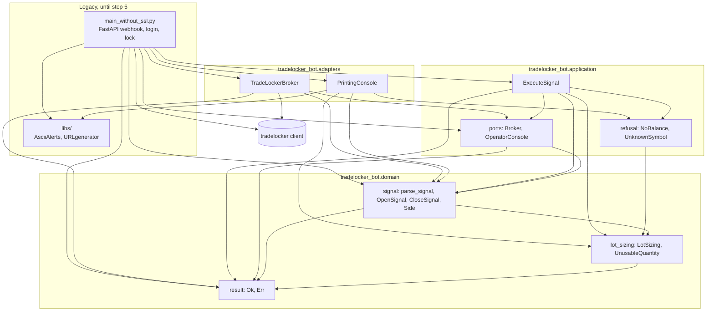
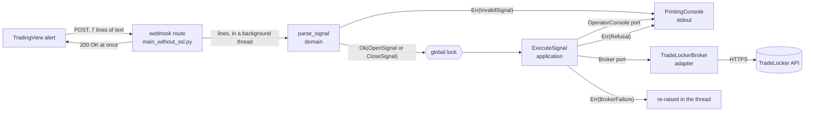
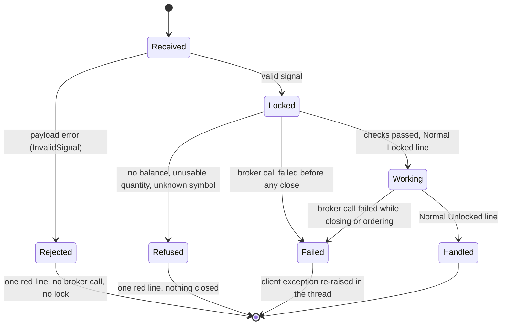

# Architecture

The bot is moving from a single script to a layered design
([ADR 0001](adr/0001-incremental-layered-migration.md)). The
[migration roadmap](migration-roadmap.md) tracks where it stands. This page
describes the code as it is on `master`.

## Contents

- [Layers](#layers)
- [Data flow](#data-flow)
- [Handling one signal](#handling-one-signal)
- [How a signal can end](#how-a-signal-can-end)
- [Domain model](#domain-model)
- [Application](#application)
- [Adapters](#adapters)
- [Decisions](#decisions)

## Layers

| Layer       | Package                       | May depend on      | Holds                                                         |
|-------------|-------------------------------|--------------------|---------------------------------------------------------------|
| Domain      | `tradelocker_bot.domain`      | standard library   | Trading rules as plain values and functions, with no I/O      |
| Application | `tradelocker_bot.application` | domain             | Use cases and the ports they need                             |
| Adapters    | `tradelocker_bot.adapters`    | application, domain, third-party clients, legacy `libs/` until step 5 | TradeLocker client, operator console; HTTP webhook in step 5 |
| Legacy      | `main_without_ssl.py`, `libs/` | anything          | Code not migrated yet; shrinks with every structure step      |

Dependencies point inwards only. `tests/test_layer_dependencies.py` enforces
this for the inner layers with an explicit allow-list:

- The domain may import its own package and a named set of pure
  standard-library modules (`dataclasses`, `enum`, `math`, `typing` and
  similar).
- The application may import the same, plus the domain.
- Anything else fails, including `datetime` (the clock), `random`, `os`, the
  adapters and every third-party package.
- The same test forbids builtins that do I/O or load code, such as `open`,
  `print` and `eval`, in both layers.

Adapters exist to depend on third-party clients, so the rule does not cover
them.

## Data flow

What happens to one alert, from TradingView to the broker. Text from the
webhook becomes a typed signal at the first step and stays typed from then
on.

| Value                         | Made by                    | Read by                                   |
|-------------------------------|----------------------------|-------------------------------------------|
| webhook lines (`list[str]`)   | FastAPI route              | `parse_signal`                            |
| `OpenSignal` / `CloseSignal`  | `parse_signal`             | `ExecuteSignal`                           |
| `InvalidSignal`               | `parse_signal`             | `PrintingConsole.rejected`                |
| balance (`float` or `None`)   | `TradeLockerBroker`        | `ExecuteSignal`, then `LotSizing`         |
| quantity (`float`)            | `LotSizing.quantity_for`   | `Broker.place_market_order`               |
| instrument id (`int` or `None`) | `TradeLockerBroker`      | `ExecuteSignal`                           |
| `Refusal`                     | `ExecuteSignal`, `LotSizing` | `PrintingConsole.rejected`              |
| `BrokerFailure`               | `TradeLockerBroker`        | the legacy handler, which re-raises it    |

## Handling one signal

### `open`

Steps 4 to 8 can end the signal early (ADR 0009). No balance, an unusable
quantity or an unknown symbol is a `Refusal`. A call that fails is a
`BrokerFailure`. Either way nothing has been closed yet. The close loop and
the order retry still have no delay or limit; the roadmap lists both as
defects for step 6.

### `close`

`close` sizes nothing, so it reads no balance (ADR 0008).

## How a signal can end

| End      | Broker calls          | Positions touched  | Operator sees                 | Thread         |
|----------|-----------------------|--------------------|-------------------------------|----------------|
| Rejected | none                  | no                 | `Signal rejected: line N ...` | ends normally  |
| Refused  | balance and/or lookup | no                 | `Signal rejected: ...`        | ends normally  |
| Failed   | up to the failing one | possibly closed    | the client's traceback        | raises         |
| Handled  | all                   | replaced or closed | `Normal: Locked` ... `Unlocked` | ends normally |

The webhook answers `200 OK` before any of this, so the caller never learns
the outcome. That is a known defect, and step 6 changes it.

## Domain model

- `parse_signal` turns the webhook's lines into an `OpenSignal` or a
  `CloseSignal`, or returns the first `InvalidSignal`. It runs before any
  broker call ([ADR 0008](adr/0008-validate-the-signal-before-any-broker-call.md)).
  An `OpenSignal` already holds the `Side` to trade, with the inversion
  applied.
- `LotSizing` is the position size per unit of account balance, parsed from
  the webhook's `<lot>/<balance step>` field. Both numbers must be positive
  and finite, and the constructor refuses anything else. `quantity_for`
  returns the rounded lots for a balance. If that number is not finite or
  not above zero, it returns `UnusableQuantity` instead
  ([ADR 0009](adr/0009-refuse-what-the-broker-rules-out-before-closing.md)).
- `Side` is `buy` or `sell`, with its `opposite`.
- `Ok` / `Err` (`Result`) is an outcome returned as a value. A result refuses
  truth testing, so a forgotten unwrap fails loudly
  ([ADR 0006](adr/0006-result-at-the-broker-boundary.md)).

## Application

[ADR 0005](adr/0005-execute-signal-use-case-and-ports.md) describes the
design.

- `ExecuteSignal` runs one valid signal.
  - `close` looks up the instrument and closes its positions.
  - `open` reads the balance, sizes the position and looks up the
    instrument. Only then does it close the instrument's positions and place
    a market order.
  - The instrument is looked up once.
  - The legacy close loop and order retry are kept. The roadmap lists them
    as defects.
- `execute` returns `Ok(None)`, a `Refusal` or the first `BrokerFailure`.
  - A `Refusal` (`NoBalance`, `UnknownSymbol`, `UnusableQuantity`) means the
    broker answered and ruled the signal out. It always comes before any
    close request (ADR 0009).
  - A `BrokerFailure` means a broker call did not answer. It holds the
    client's own exception (ADR 0006).
- `Broker` and `OperatorConsole` are its ports, one per process boundary.
  - `Broker.account_balance` returns `Ok(None)` when the answer holds no
    number.
  - `Broker.instrument_id` returns `Ok(None)` for a name the broker does not
    list. Its `Err` means only that the broker did not answer.

## Adapters

- `TradeLockerBroker` implements `Broker` over the `tradelocker` client.
  - Each method makes the legacy handler's call with the same arguments.
    The exception is the instrument lookup, which reads the instrument list
    rather than parsing the client's `ValueError` (ADR 0009).
  - Only the client call runs inside the exception guard. A fault in the
    adapter's own handling of the answer raises, so it cannot pose as an
    outage.
- `PrintingConsole` implements `OperatorConsole` as the legacy coloured
  stdout lines.
  - Its `rejected` prints one red line for an `InvalidSignal` or a
    `Refusal`, using the same "found, expected" shape for both.
  - Webhook text in that line is escaped with `repr` and cut after 40
    characters.
- `main_without_ssl.py` still receives the webhook, logs in and holds the
  lock. It parses the payload before the lock and runs a valid signal inside
  it.
  - A rejection or a refusal gets one operator line.
  - A broker failure is re-raised as the client's own exception, so the
    webhook thread fails as before.
  - Step 5 moves this into an inbound adapter and a composition root.

## Decisions

| ADR | Decision |
|-----|----------|
| [0001](adr/0001-incremental-layered-migration.md) | Migrate step by step, behind characterization tests |
| [0002](adr/0002-ci-quality-gates.md) | CI quality gates and image publishing |
| [0003](adr/0003-publish-with-workflow-token.md) | Publish the image with the workflow token |
| [0004](adr/0004-flat-application-package.md) | A flat `tradelocker_bot` package next to the legacy entrypoint |
| [0005](adr/0005-execute-signal-use-case-and-ports.md) | Execute-signal use case behind broker and console ports |
| [0006](adr/0006-result-at-the-broker-boundary.md) | Broker failures as a Result |
| [0007](adr/0007-locked-runtime-dependencies.md) | Lock every runtime dependency |
| [0008](adr/0008-validate-the-signal-before-any-broker-call.md) | Validate the whole signal before any broker call |
| [0009](adr/0009-refuse-what-the-broker-rules-out-before-closing.md) | Refuse what the broker rules out before closing anything |
