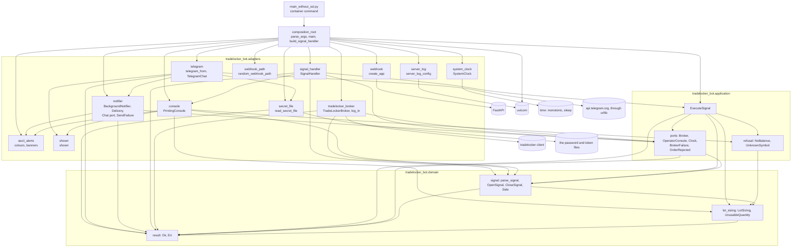
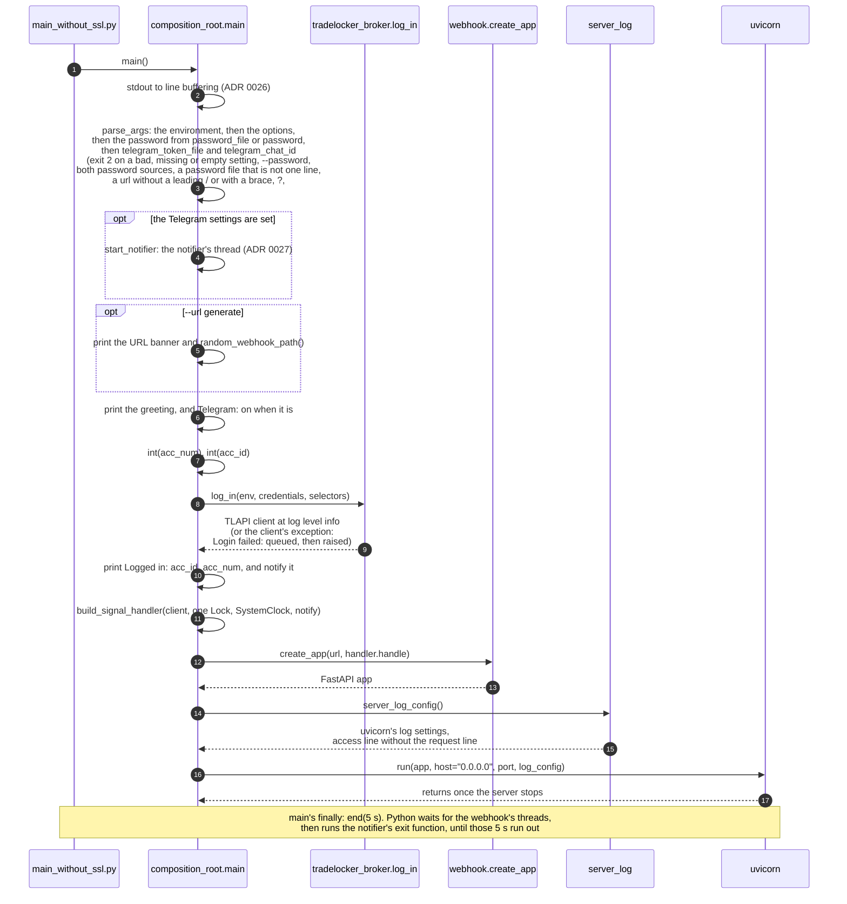
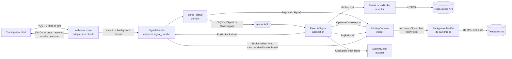
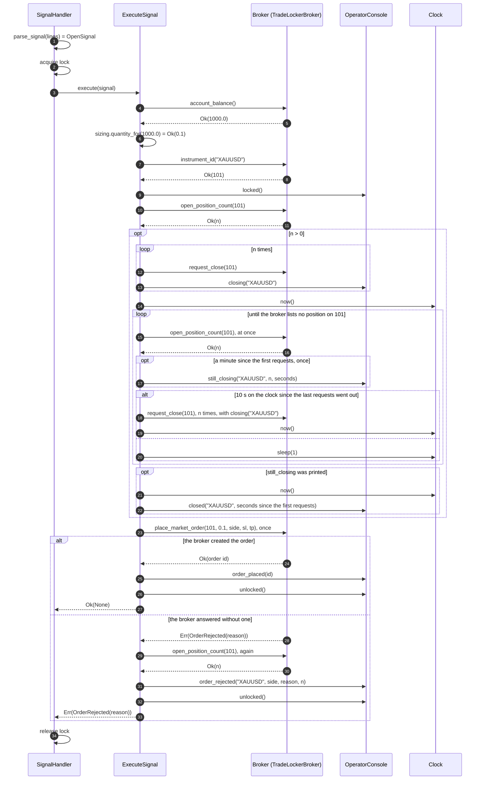
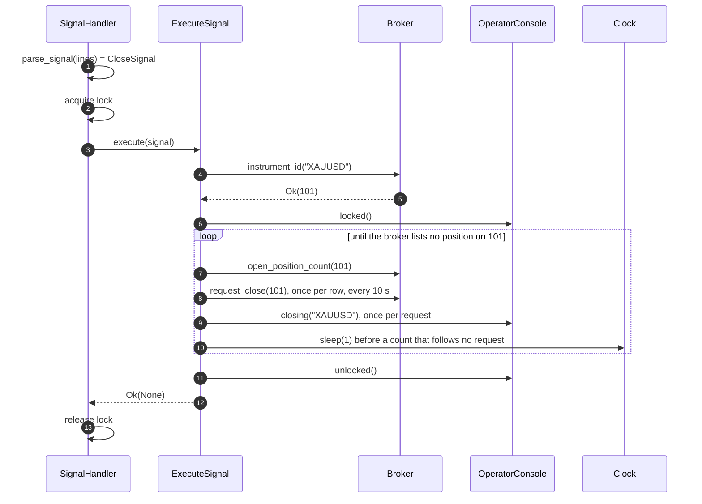
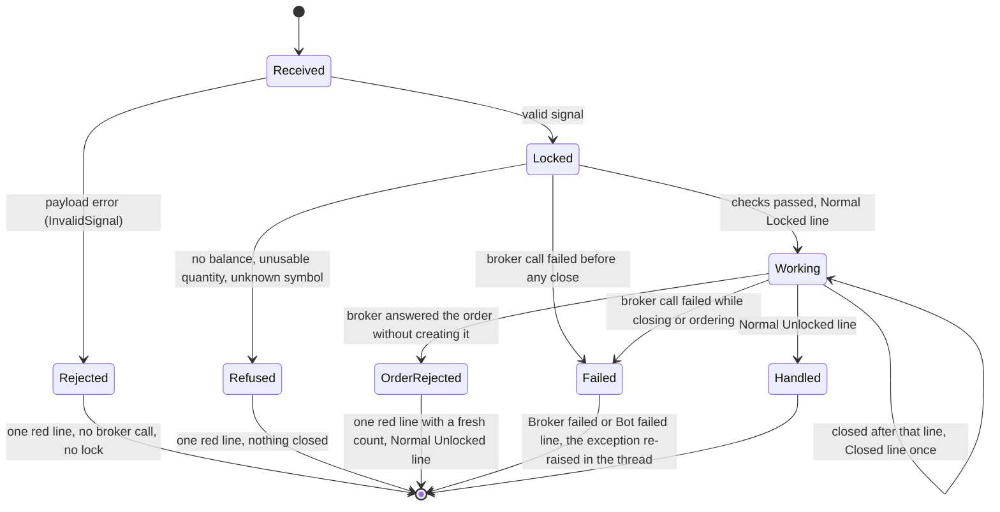

# Architecture

The bot is moving from a single script to a layered design
([ADR 0001](adr/0001-incremental-layered-migration.md)). The
[migration roadmap](migration-roadmap.md) tracks where it stands. This page
describes the code as it is on `master`.

## Contents

- [Layers](#layers)
- [Startup](#startup)
- [Data flow](#data-flow)
- [Handling one signal](#handling-one-signal)
- [How a signal can end](#how-a-signal-can-end)
- [Domain model](#domain-model)
- [Application](#application)
- [Adapters](#adapters)
- [Composition root](#composition-root)
- [Decisions](#decisions)

## Layers

| Layer             | Package                            | May depend on                                   | Holds                                                          |
|-------------------|------------------------------------|-------------------------------------------------|----------------------------------------------------------------|
| Domain            | `tradelocker_bot.domain`           | standard library                                | Trading rules as plain values and functions, with no I/O       |
| Application       | `tradelocker_bot.application`      | domain                                          | Use cases and the ports they need                              |
| Adapters          | `tradelocker_bot.adapters`         | application, domain, third-party clients        | TradeLocker client and login, operator console, system clock, HTTP webhook, signal handler, secret files, Telegram chat and notifier |
| Composition root  | `tradelocker_bot.composition_root` | everything above                                | Start settings, banners, wiring, the lock, the server start    |
| Entrypoint        | `main_without_ssl.py`              | the composition root                            | The container's command; calls `main()` and nothing else       |

Every arrow below is an import in the code. The entrypoint keeps its name
because the container command is part of the frozen contract
([roadmap](migration-roadmap.md#frozen-contract)).

Dependencies point inwards only. `tests/test_layer_dependencies.py` enforces
this for the inner layers with an explicit allow-list:

- The domain may import its own package and a named set of pure
  standard-library modules (`dataclasses`, `enum`, `math`, `typing` and
  similar).
- The application may import the same, plus the domain.
- Anything else fails, including `datetime` (the clock), `random`, `os`, the
  adapters and every third-party package.
- The same test forbids builtins that do I/O or load code, such as `open`,
  `print` and `eval`, in both layers.

Adapters exist to depend on third-party clients, so the allow-list does not
cover them. The same test keeps them inward of the composition root: an
adapter may import neither `composition_root` nor `main_without_ssl`, so no
adapter can reach another's wiring, such as the shared lock or the
logged-in client, behind the root's back
([ADR 0010](adr/0010-webhook-adapter-and-composition-root.md)).

## Startup

A bad setting stops at step 3, a bad account selector at step 7, and a
failed login at step 8. Each leaves every later step undone, so the server
never starts on a half-built bot.

## Data flow

What happens to one alert, from TradingView to the broker. Text from the
webhook becomes a typed signal at the first step and stays typed from then
on.

The console's red lines, and the green `Closed:` line that ends a
`Still closing:` one
([ADR 0028](adr/0028-say-when-a-slow-close-ended.md)), reach Telegram only
when its settings are set,
and only through the notifier's queue, so no signal waits on Telegram
([ADR 0027](adr/0027-send-the-red-lines-to-telegram.md)).

| Value                         | Made by                    | Read by                                   |
|-------------------------------|----------------------------|-------------------------------------------|
| webhook lines (`list[str]`)   | `create_app`'s route       | `SignalHandler.handle`, then `parse_signal` |
| `OpenSignal` / `CloseSignal`  | `parse_signal`             | `ExecuteSignal`                           |
| `InvalidSignal`               | `parse_signal`             | `PrintingConsole.rejected`                |
| balance (`float` or `None`)   | `TradeLockerBroker`        | `ExecuteSignal`, then `LotSizing`         |
| quantity (`float`)            | `LotSizing.quantity_for`   | `Broker.place_market_order`               |
| instrument id (`int` or `None`) | `TradeLockerBroker`      | `ExecuteSignal`                           |
| `Refusal`                     | `ExecuteSignal`, `LotSizing` | `PrintingConsole.rejected`              |
| `OrderRejected`               | `TradeLockerBroker`        | `ExecuteSignal`, which reports it through `OperatorConsole.order_rejected` |
| `BrokerFailure`               | `TradeLockerBroker`        | `SignalHandler`, which re-raises its cause |

## Handling one signal

### `open`

Steps 4 to 8 can end the signal early (ADR 0009). No balance, an unusable
quantity or an unknown symbol is a `Refusal`. A call that fails is a
`BrokerFailure`. Either way nothing has been closed yet.

The close has no time limit. After a request the positions are counted
again at once, since a close usually fills by then. While one stays open,
the use case pauses a second between counts, on top of the second the
client waits before every request, and asks again only once 10 seconds
have passed on the `Clock`. A minute after the first request it prints one
red `Still closing:` line. A count or request that gets no answer still
ends the loop as a `BrokerFailure`
([ADR 0022](adr/0022-pace-the-close-loop-on-a-clock.md)). A close that
printed that line ends with one green `Closed:` line, at
the count that lists no position; one that failed does not
([ADR 0028](adr/0028-say-when-a-slow-close-ended.md)).

The order is placed once. If the broker answers without creating it, the
positions are already closed. The use case counts them again, since a
resent order may have filled, and prints one red `Order rejected:` line
with the broker's reason and what the broker lists now, then
`Normal: Unlocked`; the thread ends normally. An order request that gets no
answer is a `BrokerFailure` and still raises, since the order may exist
([ADR 0021](adr/0021-report-a-rejected-order-and-place-it-once.md)).

### `close`

`close` sizes nothing, so it reads no balance (ADR 0008).

## How a signal can end

| End      | Broker calls          | Positions touched  | Operator sees                 | Thread         |
|----------|-----------------------|--------------------|-------------------------------|----------------|
| Rejected | none                  | no                 | `Signal rejected: line N ...` | ends normally  |
| Refused  | balance and/or lookup | no                 | `Signal rejected: ...`        | ends normally  |
| Order rejected | all, order once, a recount | closed, none opened | `Order rejected: ...`, `Unlocked` | ends normally |
| Failed   | up to the failing one | possibly closed    | `Broker failed: ...`, then the client's traceback | raises |
| Handled  | all                   | replaced or closed | `Normal: Locked` ... `Unlocked` | ends normally |

The webhook answers `200 OK` before any of this, so the caller never learns
the outcome. That is by decision: the answer acknowledges receipt.
TradingView cancels a request not answered within three seconds, which a
signal that trades already takes, and sends an alert again after a `5xx`,
so an answer after handling would be cancelled and one by outcome could run
the signal twice. Only a body that is not UTF-8 answers otherwise, `500`,
and it starts no thread ([ADR 0023](adr/0023-the-webhook-answer-acknowledges-receipt.md)).

## Domain model

- `parse_signal` turns the webhook's lines into an `OpenSignal` or a
  `CloseSignal`, or returns the first `InvalidSignal`. It runs before any
  broker call ([ADR 0008](adr/0008-validate-the-signal-before-any-broker-call.md)).
  An `OpenSignal` already holds the `Side` to trade, with the inversion
  applied.
- `LotSizing` is the position size per unit of account balance, parsed from
  the webhook's `<lot>/<balance step>` field. Both numbers must be positive
  and finite, and the constructor refuses anything else. `quantity_for`
  returns the rounded lots for a balance. If that number is not finite or
  not above zero, it returns `UnusableQuantity` instead
  ([ADR 0009](adr/0009-refuse-what-the-broker-rules-out-before-closing.md)).
- `Side` is `buy` or `sell`, with its `opposite`.
- `Ok` / `Err` (`Result`) is an outcome returned as a value. A result refuses
  truth testing, so a forgotten unwrap fails loudly
  ([ADR 0006](adr/0006-result-at-the-broker-boundary.md)).

## Application

[ADR 0005](adr/0005-execute-signal-use-case-and-ports.md) describes the
design.

- `ExecuteSignal` runs one valid signal.
  - `close` looks up the instrument and closes its positions.
  - `open` reads the balance, sizes the position and looks up the
    instrument. Only then does it close the instrument's positions and place
    a market order.
  - The instrument is looked up once.
  - The close waits, with no time limit, until the broker lists no
    position. It counts again at once after a request, then a second
    apart, asks again every 10 seconds on the `Clock`, and reports a close
    still open a minute after the first request once (ADR 0022).
  - The order is placed once (ADR 0021).
- `execute` returns `Ok(None)`, a `Refusal`, an `OrderRejected` or the
  first `BrokerFailure`.
  - A `Refusal` (`NoBalance`, `UnknownSymbol`, `UnusableQuantity`) means the
    broker answered and ruled the signal out. It always comes before any
    close request (ADR 0009).
  - An `OrderRejected` means the broker answered the order without creating
    it. It comes after the close, and holds the broker's reason or `None`.
    The use case reports it with a fresh position count before returning it
    (ADR 0021).
  - A `BrokerFailure` means a broker call did not answer. It holds the
    client's own exception (ADR 0006).
- `Broker`, `OperatorConsole` and `Clock` are its ports, one per process
  boundary. `Clock` gives `now()`, seconds that never go back, and
  `sleep(seconds)`.
  - `Broker.account_balance` returns `Ok(None)` when the answer holds no
    number.
  - `Broker.instrument_id` returns `Ok(None)` for a name the broker does not
    list. Its `Err` means only that the broker did not answer.
  - `Broker.place_market_order` returns an id only for an order the broker
    created; otherwise `OrderRejected` or `BrokerFailure`.

## Adapters

- `TradeLockerBroker` implements `Broker` over the `tradelocker` client.
  - Each method makes the legacy handler's call with the same arguments.
    The exception is the instrument lookup, which reads the instrument list
    rather than parsing the client's `ValueError` (ADR 0009).
  - Only the client call runs inside the exception guard. A fault in the
    adapter's own handling of the answer raises, so it cannot pose as an
    outage.
  - The client's `TLAPIOrderException`, and `None` for an order, become
    `OrderRejected` with the broker's `errmsg`, else its whole answer; every other client
    exception stays a `BrokerFailure` (ADR 0021).
  - `log_in`, in the same module, logs in to the demo or live server, on the account that
    `--acc_num` or `--acc_id` names. It refuses both at once before sending
    any credentials. It runs the client at `info` (`CLIENT_LOG_LEVEL`):
    at its default, `debug`, the client logs each request whole, the
    password and tokens included
    ([ADR 0025](adr/0025-run-the-broker-client-at-info.md)).
- `PrintingConsole` implements `OperatorConsole` as the legacy coloured
  stdout lines.
  - Each line reaches the log when printed, terminal or not: `main()`
    sets stdout to line buffering before anything else
    ([ADR 0026](adr/0026-write-stdout-line-by-line.md)).
  - Its `rejected` prints one red line for an `InvalidSignal` or a
    `Refusal`, using the same "found, expected" shape for both.
  - Webhook text in that line is escaped with `repr` and cut after 40
    characters.
  - Its `order_rejected` prints one red line for an `OrderRejected`, with
    the broker's reason escaped the same way and cut after 160 characters.
  - Its `still_closing` prints one red line with the open positions, the
    whole seconds since the first close request, and that later signals
    wait.
  - Its `closed` prints one green line with the whole seconds from the
    first close request to the count that listed none, and hands it on
    like a red line
    ([ADR 0028](adr/0028-say-when-a-slow-close-ended.md)).
  - Its `broker_failed` and `bot_failed` print one red line each with the
    symbol and the exception's type, never its text.
  - Every red line goes through `_alert`, which prints it and hands its
    text, without colours, to the `notify` it was built with: the
    notifier's, or `no_notification` when Telegram is off
    ([ADR 0027](adr/0027-send-the-red-lines-to-telegram.md)).
- `shown` escapes a value from outside with `repr` and cuts it, for the
  console's lines and Telegram's error descriptions alike.
- `telegram_from` (`telegram`) reads the two Telegram settings, both or
  neither, and checks the token's form before it goes into a URL.
  `TelegramChat` sends one plain-text message through `urllib` and
  returns a `SendFailure` that says whether to try again; nothing it
  returns holds the token. `urlopen` is an argument with no default.
  It is the adapter of the `Chat` port, which `notifier` declares.
- `BackgroundNotifier` (`notifier`) queues each message, with the time it
  was logged, up to 100, for one daemon thread, and tells the chat how
  many it dropped once the queue is empty. `Delivery` tries a message
  three times, waiting 2 s and 10 s or Telegram's `retry_after` up to 10
  minutes, marks a message a minute late or more, and reports one it
  could not send in a red line that is never sent itself. `end(seconds)`
  sets the stop's deadline; `stop()` waits for the queue until then and
  reports the lines it loses, and a dropped count the chat has not heard
  of. One condition guards the queue, the message being sent and the
  counts.
- `SystemClock` implements `Clock` over `time.monotonic` and `time.sleep`.
  The monotonic clock, because the wall clock can step after an NTP
  correction or a manual change (ADR 0022).
- `create_app` (`webhook`) is the inbound HTTP adapter. It serves the
  webhook path, splits the body into lines and starts one thread per
  request. It serves nothing else: no OpenAPI schema and no docs pages,
  because the schema would name the secret path
  ([ADR 0011](adr/0011-serve-no-api-docs.md)). It redirects nothing: a path
  one slash away answers `404`, because the redirect pointed senders at
  plain `http://` ([ADR 0013](adr/0013-no-trailing-slash-redirect.md)).
  It answers `200` once the thread has started, without waiting for it,
  and starts the thread last, so the bot answers no `5xx`, which
  TradingView would send again, once a signal is on its way
  ([ADR 0023](adr/0023-the-webhook-answer-acknowledges-receipt.md)).
- `server_log_config` (`server_log`) is uvicorn's default log settings with
  an access line that keeps the client and the status but not the request
  line, which holds the secret path. Only the documented `fmt` changes, so
  no code reads uvicorn's internal log records. It sits in a module of its
  own because the app does not know which server runs it
  ([ADR 0016](adr/0016-hide-the-request-line-in-the-access-log.md)).
- `SignalHandler` runs one request's lines. It parses them before the lock
  and runs a valid signal inside it.
  - A rejection or a refusal gets one operator line.
  - A broker failure gets one red `Broker failed:` line, then is re-raised
    as the client's own exception, so the webhook thread fails as before.
  - Any other exception from the use case gets one red `Bot failed:`
    line, then is re-raised as it was.
- `ascii_alerts` holds the console's colours and the startup banners, and
  `webhook_path` makes the random path for `--url generate`, from
  `secrets` ([ADR 0012](adr/0012-generate-the-webhook-path-with-secrets.md)).
- `secret_file` reads the file `password_file` or `telegram_token_file`
  names, at most 1025 bytes, and checks the bytes in a function with no
  I/O; each message names the setting. An adapter module rather than a
  port: only the composition root asks for a secret
  ([ADR 0024](adr/0024-read-the-password-from-a-file.md),
  [ADR 0027](adr/0027-send-the-red-lines-to-telegram.md)).

## Composition root

`tradelocker_bot/composition_root.py` is the only module that knows every
layer ([ADR 0010](adr/0010-webhook-adapter-and-composition-root.md)).

- `main()` reads the settings, prints the banners, logs in, builds the
  app and starts the server, in the order the [startup](#startup) diagram
  shows.
- `parse_args` reads the settings from the environment variables the
  image is started with. An option of the same name on the command line
  replaces its variable. Each variable the command line does not replace
  becomes `--name=value` ahead of it, so one parser checks both sources.
  The password is read only from the environment, and `--password` is
  refused without its value, because the host's process list shows every
  command line. Unknown or shortened arguments are refused without being
  printed
  ([ADR 0018](adr/0018-read-the-settings-from-the-environment.md)).
- `password_from` takes the password from exactly one of two sources: the
  file `password_file` names, such as a Docker secret, which keeps it out
  of `docker inspect`, or the `password` variable. Both set stops the bot,
  as does a file that is not one line of UTF-8 text of at most 1024
  bytes; one trailing line ending is dropped and nothing else. The
  adapter `secret_file` reads the file and checks its bytes. No message
  prints the content
  ([ADR 0024](adr/0024-read-the-password-from-a-file.md)).
- `start_notifier` starts Telegram's notifier when `telegram_from` gave
  settings, and registers its `stop` as an exit function, which Python
  runs once the webhook's threads have ended. `main` hands the banners,
  the login and the server to `log_in_and_serve`, with the notifier's
  `notify` or `no_notification`, and in a `finally` gives the queue 5
  seconds from that moment (`end`), however it ends. A failed login is
  sent as `Login failed:` before its exception leaves. Both
  Telegram settings come only from the environment
  ([ADR 0027](adr/0027-send-the-red-lines-to-telegram.md)).
- It creates the one lock that every request shares.
- `webhook_url` checks `url` as the settings are read: `generate` or a
  path that starts with `/` and has no `{` or `}`, so the route is one
  path, not a pattern, and no `?`, `#` or `%`, so a sender reaches it as
  typed. Anything else exits with status `2`, like any bad setting,
  and the message leaves the value out
  ([ADR 0014](adr/0014-require-a-leading-slash.md),
  [ADR 0015](adr/0015-refuse-braces-in-the-webhook-path.md),
  [ADR 0020](adr/0020-refuse-query-fragment-and-escape-characters-in-the-webhook-path.md)).
- `build_signal_handler(client, lock, clock, notify)` builds the console,
  the broker adapter, the use case and the handler once, at startup. The
  characterization tests build theirs through the same function, with a
  fake clock that records each pause and `no_notification`; neither has a
  default, so no test can get the real clock or Telegram by leaving it
  out.
- `main_without_ssl.py` imports `main` and calls it, and does nothing else.

## Decisions

| ADR | Decision |
|-----|----------|
| [0001](adr/0001-incremental-layered-migration.md) | Migrate step by step, behind characterization tests |
| [0002](adr/0002-ci-quality-gates.md) | CI quality gates and image publishing |
| [0003](adr/0003-publish-with-workflow-token.md) | Publish the image with the workflow token |
| [0004](adr/0004-flat-application-package.md) | A flat `tradelocker_bot` package next to the legacy entrypoint |
| [0005](adr/0005-execute-signal-use-case-and-ports.md) | Execute-signal use case behind broker and console ports |
| [0006](adr/0006-result-at-the-broker-boundary.md) | Broker failures as a Result |
| [0007](adr/0007-locked-runtime-dependencies.md) | Lock every runtime dependency |
| [0008](adr/0008-validate-the-signal-before-any-broker-call.md) | Validate the whole signal before any broker call |
| [0009](adr/0009-refuse-what-the-broker-rules-out-before-closing.md) | Refuse what the broker rules out before closing anything |
| [0010](adr/0010-webhook-adapter-and-composition-root.md) | Inbound webhook adapter and a composition root |
| [0011](adr/0011-serve-no-api-docs.md) | Serve no API docs, so no page names the webhook path |
| [0012](adr/0012-generate-the-webhook-path-with-secrets.md) | Generate the webhook path with `secrets` |
| [0013](adr/0013-no-trailing-slash-redirect.md) | No trailing-slash redirect on the webhook |
| [0014](adr/0014-require-a-leading-slash.md) | Refuse a webhook path without a leading slash |
| [0015](adr/0015-refuse-braces-in-the-webhook-path.md) | Refuse braces in the webhook path |
| [0016](adr/0016-hide-the-request-line-in-the-access-log.md) | Hide the request line in the access log |
| [0017](adr/0017-override-the-clients-vulnerable-pins.md) | Override the broker client's pins on vulnerable packages |
| [0018](adr/0018-read-the-settings-from-the-environment.md) | Read the settings from the environment, not the command line |
| [0019](adr/0019-pin-the-base-image-by-digest.md) | Pin the base image by digest |
| [0020](adr/0020-refuse-query-fragment-and-escape-characters-in-the-webhook-path.md) | Refuse `?`, `#` and `%` in the webhook path |
| [0021](adr/0021-report-a-rejected-order-and-place-it-once.md) | Report a rejected order in one line and place it once |
| [0022](adr/0022-pace-the-close-loop-on-a-clock.md) | Pace the close loop on a clock and say when a close takes a minute |
| [0023](adr/0023-the-webhook-answer-acknowledges-receipt.md) | The webhook's answer acknowledges receipt, not the outcome |
| [0024](adr/0024-read-the-password-from-a-file.md) | Read the password from a file |
| [0025](adr/0025-run-the-broker-client-at-info.md) | Run the broker client at `info`, and name the account in the bot's own line |
| [0026](adr/0026-write-stdout-line-by-line.md) | Write the bot's output line by line, with or without a terminal |
| [0027](adr/0027-send-the-red-lines-to-telegram.md) | Send the operator's red lines to Telegram, off the trading path |
| [0028](adr/0028-say-when-a-slow-close-ended.md) | Say when a close that took a minute ended |
