# Migration roadmap

This is the live state of the migration described in
[ADR 0001](adr/0001-incremental-layered-migration.md). Update it in every
migration pull request.

## Steps

| #  | Step                                                                                                                                                        | Kind      | Status                               |
|----|-------------------------------------------------------------------------------------------------------------------------------------------------------------|-----------|--------------------------------------|
| 1  | Characterization tests, CI gates, publish only from `master`                                                                                                | safety    | done                                 |
| 1a | Restore image publishing with the workflow token and report publish failures ([ADR 0003](adr/0003-publish-with-workflow-token.md))                         | safety    | done                                 |
| 1b | Delete the `PERSONAL_ACCESS_TOKEN` secret after the first successful publish                                                                                | safety    | done                                 |
| 1c | Pin malformed-payload behaviour (direction case, action case, malformed lot)                                                                                | safety    | done                                 |
| 2  | Domain: lot sizing as a pure value object (the only logic identical for every input today), plus a layer import contract and an image smoke run            | structure | done                                 |
| 2a | Pin exact broker call sequences, lock coverage and operator console lines; make the domain dependency rule a true allow-list                                | safety    | done                                 |
| 2b | Pin the `tradelocker` client to the version the broker fake mirrors, checked in the built image                                                             | safety    | done                                 |
| 2c | Lock every runtime dependency (direct and transitive) and check the image against the lock ([ADR 0007](adr/0007-locked-runtime-dependencies.md))            | safety    | done                                 |
| 2d | Pin exact call sequences and exception types on raising paths, and inputs legacy never validates                                                            | safety    | done                                 |
| 2e | Pin whitespace variants of `open`/`close` and the retry line's inverted side                                                                             | safety    | done                                 |
| 2f | Pin a failure at every broker call: calls made, console lines, lock released, the client's exception re-raised as the same object                        | safety    | done                                 |
| 2g | Pin the base image `python:3.11-slim` by digest, so a rebuild cannot change the interpreter or system libraries unreviewed; Dependabot proposes the tag's new digest, and a weekly check keeps an issue open while the pin is behind ([ADR 0019](adr/0019-pin-the-base-image-by-digest.md)). New pins: every `FROM` has a full digest, the tag matches the lock's Python, and the image runs it | safety | done |
| 2h | Lift the `tradelocker` client's exact pins on PyJWT, requests and python-dotenv, whose pinned versions have published advisories; install the lock with `--no-deps` and check in CI that it holds what its packages need ([ADR 0017](adr/0017-override-the-clients-vulnerable-pins.md)). No pin changed: the suite passes against the new versions | safety | done |
| 3  | Validate the whole signal before any broker call, as a Result, and report a rejection by one operator line ([ADR 0008](adr/0008-validate-the-signal-before-any-broker-call.md)). Pins updated: wrong-side and NonInvert-forwarding, invalid-invert-after-close, invalid invert ignored outside `open`, truncated payload, non-numeric take profit and stop loss, unknown action, malformed and nonsensical lot; `close` no longer reads the balance | behaviour | done |
| 3b | Refuse, before the first close request, what needs the broker's answer: an account state without a balance, an unknown symbol, a quantity that is not finite or not above zero ([ADR 0009](adr/0009-refuse-what-the-broker-rules-out-before-closing.md)). The instrument is looked up once, from the instrument list. Pins updated: missing balance, unknown symbol and unusable quantity refused; second lookup gone; a lookup failure no longer prints `Normal: Locked` | behaviour | done |
| 4  | Application: execute-signal use case behind broker and console ports; TradeLocker and console adapters implement them ([ADR 0005](adr/0005-execute-signal-use-case-and-ports.md)) | structure | done                                 |
| 4b | Broker failures as a Result at the port and use-case boundary; the legacy delegate re-raises the client's own exception ([ADR 0006](adr/0006-result-at-the-broker-boundary.md))| structure | done                                 |
| 5a | Pin the startup and the webhook route through the real entrypoint: argument checks, banners, login, server start, the HTTP answer, body decoding and line splitting, one thread per request, one lock for every request, the API docs the app serves | safety | done |
| 5  | Inbound HTTP adapter, signal handler and composition root; `libs/` moved into the adapters; `main_without_ssl.py` becomes a thin entrypoint ([ADR 0010](adr/0010-webhook-adapter-and-composition-root.md)) | structure | done |
| 6a | Serve no OpenAPI schema and no docs pages, so no page names the webhook path ([ADR 0011](adr/0011-serve-no-api-docs.md)). Pin replaced: the four former docs addresses answer like any unknown one | behaviour | done |
| 6b | Generate the `url=generate` path with `secrets`, as the README advises for a path chosen by hand ([ADR 0012](adr/0012-generate-the-webhook-path-with-secrets.md)). Pin replaced: one segment of 32 URL-safe characters; a new unit pin on the source | behaviour | done |
| 6c | Redirect no request to a path one slash away; such a path answers `404` like any unknown address ([ADR 0013](adr/0013-no-trailing-slash-redirect.md)). Pin replaced: a trailing slash added or missing is not redirected, followed or handled | behaviour | done |
| 6d | Refuse a `url` without a leading `/` at startup, with exit status `2` and a message that leaves the value out ([ADR 0014](adr/0014-require-a-leading-slash.md)). Pin replaced: such a value stops the bot before any output, the login and the server | behaviour | done |
| 6e | Refuse a `url` with `{` or `}` at startup, with exit status `2` and a message that leaves the value out, so an accepted `url` is one path, not a pattern ([ADR 0015](adr/0015-refuse-braces-in-the-webhook-path.md)). Pins replaced: patterns, broken patterns and literal braces stop the bot before any output, the login and the server; a path set by hand handles no other path | behaviour | done |
| 6f | Write each request's access line without the request line, keeping the client and the status, so the log never holds the webhook path ([ADR 0016](adr/0016-hide-the-request-line-in-the-access-log.md)). New pin against a real uvicorn server: a hit, a query string, a near miss, a `GET` and a `500` each leave one line with the exact status, and no output names the path | behaviour | done |
| 6g | Start the image with no shell and no arguments, and read the settings from the environment; the password only from there, `--password` refused without its value ([ADR 0018](adr/0018-read-the-settings-from-the-environment.md)). Pins replaced: the startup pins set the image's variables, the usage line drops `--password`; new pins on verbatim credentials, the option winning over its variable, a missing or empty password, and the image's `CMD` | behaviour | done |
| 6h | Refuse a `url` with `?`, `#` or `%` at startup, with exit status `2` and a message that leaves the value out, so an accepted `url` is reached as typed ([ADR 0020](adr/0020-refuse-query-fragment-and-escape-characters-in-the-webhook-path.md)). New pins: each character stops the bot before any output, the login and the server; the slash, brace and new checks run in that order | behaviour | done |
| 6i | Report an order the broker rejects in one operator line instead of a traceback, and place the order once rather than again until an id comes back ([ADR 0021](adr/0021-report-a-rejected-order-and-place-it-once.md)). Flipped pins: the rejected order after the close raises nothing; new pins for the line, the thread and the adapter's mapping; an order request that gets no answer still raises | behaviour | done |
| 6j | Pace the close loop on a `Clock` port: count again at once after a request, then a second apart, ask again only every 10 seconds of the clock, and log one `Still closing:` line a minute after the first request; no upper limit ([ADR 0022](adr/0022-pace-the-close-loop-on-a-clock.md)). Flipped pins: a close requested again every 10 seconds, with each pause pinned among the broker calls; new pins for the line, the clock's seconds rather than polls, and a failure after a pause | behaviour | done |
| 6k | Keep the webhook's immediate `200` and record what it means: receipt, not the outcome; TradingView cancels a request after 3 seconds and sends it again after a `5xx`, so an answer after handling would be cancelled and one by outcome sent again ([ADR 0023](adr/0023-the-webhook-answer-acknowledges-receipt.md)). No behaviour change; the known defect becomes a decision. New pin: a rejected payload, a refusal, a rejected order and a trade get the same `200` | decision | done |
| 6l | Read the password from the file `password_file` names, such as a Docker secret, so `docker inspect` shows only the path; beside the `password` variable rather than in its place, exactly one of the two set; one line, one trailing line ending dropped, nothing trimmed; a file that cannot be read, is empty, is longer than 1024 bytes, holds more than one line or a NUL, is not UTF-8 or starts with a byte order mark stops the bot without printing its content ([ADR 0024](adr/0024-read-the-password-from-a-file.md)). Pins flipped: the messages for a missing password and for `--password` name both ways; new pins for the file, both sources set and `--password_file` refused | behaviour | done |
| 6m | Run the broker client at `info` rather than its default `debug`, which logged every request whole: the password, the refresh token and the bearer token; the bot prints `Logged in: acc_id ..., acc_num ...` itself, since the client names the account only at `debug` ([ADR 0025](adr/0025-run-the-broker-client-at-info.md)). Pins flipped: the login carries `log_level`, the greeting pins add the account line; new pins run the real client on a stubbed transport and find no secret in its log, and CI refuses the password in the image's output | behaviour | done |
| 6n | Set stdout to line buffering at the start of `main()`, so each line reaches the log when printed, with or without a terminal; without one, a trade's lines and every rejection waited for the next alert's request ([ADR 0026](adr/0026-write-stdout-line-by-line.md)). The account line's own flush is gone. New pins give the bot a block-buffered stdout and find the startup's lines written out when the server starts, and a trade's, a close's, a rejected payload's and a rejected order's lines written out with no request after them; a missing stdout or one that is not Python's text layer is left as it is | behaviour | done |
| 6o | With `telegram_token_file` and `telegram_chat_id` set, send the account line at each start, a failed login, and every red line (`Signal rejected:`, `Order rejected:`, `Still closing:`, and new `Broker failed:` and `Bot failed:` lines that name the symbol and the exception's type) to a Telegram chat. A queue and one thread of its own keep it off the trading path; it tries each message three times, keeping Telegram's own wait, marks a message a minute late, tells the chat how many a full queue dropped, gives the queue 5 seconds at a stop, and logs every message it could not send. One setting alone, a file with no bot token or a bad chat id stops the bot. No token in any output ([ADR 0027](adr/0027-send-the-red-lines-to-telegram.md)). Pins: the broker-failure pins gain the `Broker failed:` line; new pins run the chat over the real `urllib` against a local server, the notifier's tries and queue, and the startup with and without the settings | behaviour | done |
| 6p | Log, and send, one green `Closed after N seconds from the first close request: the broker lists no open XAUUSD position` line when a close that logged `Still closing:` ends: only after that line, the seconds from the first request to the count that lists none, nothing after a failed call, and no word on what follows, since an `open` signal's order still runs ([ADR 0028](adr/0028-say-when-a-slow-close-ended.md)). Pins: the slow-close row of the operator lines gains the line and an `open` row joins it, the startup line with Telegram on names it; new pins for when the use case calls it, its seconds, its bytes and the text handed on, and one `print` per coloured line | behaviour | done |
| 6q | The notifier's stop and dropped count: a floor under the stop's seconds when a signal runs past the end of `main`, a deadline even without `end`, one count entry kept up to date in place rather than one that waits for an empty queue and takes a slot, and no send after the stop's report ([ADR 0027](adr/0027-send-the-red-lines-to-telegram.md), "What this does not cover") | behaviour | next |

```mermaid
flowchart LR
    S1[1 harness and CI gates] --> S2[2 domain: lot sizing]
    S1 --> S1abc[1a-1c publishing, pins]
    S1 --> S2af[2a-2f pins, client and lock]
    S2 --> S4[4 use case and ports]
    S4 --> S4b[4b Result at the broker]
    S4b --> S3[3 validate the payload]
    S3 --> S3b[3b refuse before closing]
    S3b --> S5a[5a pin startup and route]
    S5a --> S5[5 inbound adapter, composition root]
    S5 --> S6a[6a no API docs]
    S6a --> S6b[6b secrets path]
    S6b --> S6c[6c no slash redirect]
    S6c --> S6d[6d leading slash]
    S6d --> S6e[6e no braces]
    S6e --> S6f[6f access log]
    S6f --> S6g[6g settings from the environment]
    S6g --> S6h["6h no ?, # or %"]
    S6h --> S6i[6i rejected order]
    S6i --> S6j[6j paced close loop]
    S6j --> S6k[6k answer means receipt]
    S6k --> S6l[6l password file]
    S6l --> S6m[6m client log level]
    S6m --> S6n[6n line-buffered output]
    S6n --> S6o[6o Telegram notifications]
    S6o --> S6p[6p Closed after line]
    S6o --> S6q[6q notifier stop and count]
    S2af --> S2g[2g base image digest]
    S2af --> S2h[2h patched client pins]
    classDef done fill:#d4edda,stroke:#28a745,color:#155724
    class S1,S1abc,S2,S2af,S2g,S2h,S4,S4b,S3,S3b,S5a,S5,S6a,S6b,S6c,S6d,S6e,S6f,S6g,S6h,S6i,S6j,S6k,S6l,S6m,S6n,S6o,S6p done
```

Each arrow points from a step to one that builds on it. Green is done.

No known defect is open, and no decision waits on the owner. The owner
asked for whatever is good and reliable:

- a channel outside the log: Telegram, in step 6o
  ([ADR 0027](adr/0027-send-the-red-lines-to-telegram.md));
- answering `4xx` for a payload the bot rejects: kept at `200`
  (see [Kept by decision](#kept-by-decision));
- removing the `password` variable: kept (see
  [Kept by decision](#kept-by-decision)).

Structure steps must keep `tests/characterization/` green with **unchanged
assertions**. Only the seam may move, meaning the module the tests import
or patch, and the pull request must call it out.

Decision steps change no behaviour either: they keep every assertion, may
add pins of what stays, and record in an ADR why a known defect is kept
rather than fixed.

## Frozen contract

These stay unchanged until an ADR changes them:

- Docker image name `ghcr.io/akinzou/tradelocker_bot:latest`, and
  `main_without_ssl.py` as the container command.
- Container environment variables `username`, `password`, `server`, `env`,
  `url`, `acc_num`, `acc_id`, since ADR 0024 `password_file`, and since
  ADR 0027 the optional `telegram_token_file` and `telegram_chat_id`.
- Default webhook path `/strategy`, `url=generate` for a random path, and port
  443 by default.
- The webhook body: seven newline-separated lines (symbol, `buy`/`sell`,
  `<lot>/<divider>`, take-profit offset, stop-loss offset, `open`/`close`,
  `Invert`/`NonInvert`). Since ADR 0008, lines 2 and 6 ignore case and
  surrounding spaces, and `close` reads only lines 1 and 6.

## Known defects

Fixed in behaviour steps, never during restructuring.

None open.

## Kept by decision

Listed as known defects once, then kept as they are, each with the ADR
that says why.

- **The webhook answers `200` before the signal is handled** (step 6k).
  The answer acknowledges receipt, not the outcome: a rejected or refused
  signal, a rejected order and a broker failure are in the bot's log only.
  TradingView cancels a request not answered within three seconds, which a
  signal that trades already takes, and sends an alert again after a
  `5xx`, so an answer after handling or by outcome would be cancelled or
  run the signal twice. Pinned by
  `test_the_answer_is_200_with_a_null_body_before_the_signal_is_handled`,
  `test_the_answer_is_the_same_whatever_the_signal_comes_to` and
  `test_a_broker_failure_ends_the_handler_thread_with_the_clients_exception`
  ([ADR 0023](adr/0023-the-webhook-answer-acknowledges-receipt.md)).
  A `4xx` for a rejected payload was weighed again in step 6o and kept
  out. TradingView does not send an alert again after a `4xx` and shows
  the answer only in its alert log. The operator now gets the
  `Signal rejected:` line on Telegram, which says more
  ([ADR 0027](adr/0027-send-the-red-lines-to-telegram.md)).
- **The `password` variable stays beside `password_file`** (step 6o).
  Removing it would stop every deployment that still sets it at its next
  update, and a bot that does not start misses trades. `docker inspect`
  shows it; the README steers to `password_file`
  ([ADR 0024](adr/0024-read-the-password-from-a-file.md)).

## Fixed defects

- **Without a terminal, the bot's lines waited in a buffer** (found in
  step 6m's review, fixed in step 6n). Python buffers stdout when it is
  not a terminal, and the README's Compose example has no `tty: true`.
  There, `Normal: Locked`, `Signal rejected:`, `Order placed`,
  `Order rejected:` and `Still closing:` reached `docker logs` only when
  uvicorn logged the next request, so a trade's lines waited for the next
  alert. The bot now sets stdout to line buffering as it starts
  ([ADR 0026](adr/0026-write-stdout-line-by-line.md)).
- **The client wrote the password and its tokens to the container's log**
  (found in step 6l, fixed in step 6m). The `tradelocker` client logs at
  `debug` unless told otherwise, and at that level it writes each request
  whole: the login's password, the refresh token, and the access token in
  every request's `Authorization` header. Every start of every image put
  the password in `docker logs`. The bot now runs the client at `info`,
  and prints the account it trades on itself, since the client named it
  only at `debug`. Logs written before the fix still hold the password
  until the container is removed; images built before step 6m still log
  it ([ADR 0025](adr/0025-run-the-broker-client-at-info.md)).
- **A close that did not fill was requested again every other second,
  with no word in the log** (step 6j). The bot's loop had no pause; the
  client's own second before each request set its pace. With the market
  closed, that was up to 43,200 close requests and `Closing:` lines a day,
  while every other signal waited on the lock. The bot now counts again at
  once after a request, then a second apart, and asks again only every 10
  seconds of a monotonic clock. A close still open a minute after the first
  request logs one red `Still closing: ...` line. There is still no upper
  limit, by decision: later signals keep waiting until the close fills
  ([ADR 0022](adr/0022-pace-the-close-loop-on-a-clock.md)).
- **A rejected order ended the handler thread with a traceback** (step
  6i). The close had already run, and no line said what the account
  held. The bot now counts the positions again and logs one red line, such
  as
  `Order rejected: the broker refused to buy XAUUSD ('Not enough margin'); no XAUUSD position is open`,
  then `Normal: Unlocked`, and the thread ends normally. The order is
  placed once: an answer
  without an id was ordered again with no pause or end. An order request
  that gets no answer still raises, since the order may exist. Images
  built before step 6i still raise on a rejection
  ([ADR 0021](adr/0021-report-a-rejected-order-and-place-it-once.md)).
- **A `url` with `?`, `#` or `%` was reached only percent-encoded** (step
  6h). A sender reads them as the query, the fragment and an escape, and
  uvicorn decodes the path before it is matched, so every alert sent to
  the URL as typed got `404`. Any of the three in `url` now stops the bot
  at startup with exit status `2` and
  `argument --url: must not contain ?, # or %`, before any output or the
  login. Images built before step 6h still start with it; there, keep the
  three out of `url` ([ADR 0020](adr/0020-refuse-query-fragment-and-escape-characters-in-the-webhook-path.md)).
- **The password and the webhook path were in the command line, through
  an unquoted shell** (step 6g). The image ran `sh -c` over every setting,
  so `ps` on the host showed the password, the username and the webhook
  path. The shell also split and globbed each value, so a password with a
  space, `*`, `?` or `[` stopped the bot or changed what the login was
  sent. The image now runs `python main_without_ssl.py` with no shell and
  no arguments, the bot reads its settings from the environment, and
  `--password` is refused without its value. Images built before step 6g
  still pass every setting through the shell; there, use a password
  without those characters
  ([ADR 0018](adr/0018-read-the-settings-from-the-environment.md)).
- **The image shipped PyJWT, requests and python-dotenv at versions with
  published advisories** (step 2h). The `tradelocker` client pins
  `PyJWT==2.8.0`, `requests==2.32.2` and `python-dotenv==1.0.0`, which
  carried 17 Dependabot alerts, one critical. The bot reaches none of them
  in a way shown to be exploitable, but the image shipped them. The lock now
  overrides those pins with PyJWT 2.15.1, requests 2.34.2 and
  python-dotenv 1.2.4. Images built before step 2h still hold the old
  versions
  ([ADR 0017](adr/0017-override-the-clients-vulnerable-pins.md)).
- **The access log wrote the webhook path** (step 6f). uvicorn's default
  access line held the request line, so the secret path, query string
  included, was in the container's log on every alert, and a near miss
  wrote most of it. Each line now reads
  `INFO:     <client> - "<request line hidden>" <status>`: the client and
  the status stay, the method, path, query and protocol are gone. Images
  built before step 6f still write the path; there, treat the log as
  secret ([ADR 0016](adr/0016-hide-the-request-line-in-the-access-log.md)).
- **A `url` with `{name}` was a pattern** (step 6e). FastAPI read
  `{name}` and `{name:convertor}` as a path parameter, so the bot
  handled signals on paths the operator never set: `/{x}` any
  one-segment path, `/{x:path}` every path. A pattern Starlette cannot
  compile, such as `/{x:foo}`, stopped the bot with a traceback after
  the login. Any `{` or `}` in `url` now stops the bot at startup with
  exit status `2` and `argument --url: must not contain { or }`, before
  any output or the login. Braces that were literal, as in `/a{b`, are
  refused too. Images built before step 6e still read `{name}` as a
  pattern; there, keep `{` and `}` out of `url`
  ([ADR 0015](adr/0015-refuse-braces-in-the-webhook-path.md)).
- **A `url` without a leading `/` was accepted** (step 6d). The route
  matched no request, so the bot printed its banners, logged in and
  served while every alert got `404`. Such a value now stops the bot at
  startup with exit status `2` and
  `argument --url: must start with / or be generate`, before any output
  or the login. Images built before step 6d still start with it; there,
  start the path with `/`
  ([ADR 0014](adr/0014-require-a-leading-slash.md)).
- **A path one slash away from the webhook path was redirected** (step 6c).
  Starlette answered it with a `307` whose `Location` took the scheme the
  bot saw, `http://` behind a TLS proxy uvicorn does not trust, so a sender
  that followed it sent the secret path and the signal again in plain text.
  Such a path now answers `404` like any unknown address. Images built
  before step 6c still redirect; there, forward only the exact path from the
  proxy and use it in the alerts
  ([ADR 0013](adr/0013-no-trailing-slash-redirect.md)).
- **The generated webhook path came from `random`** (step 6b), a
  generator meant for simulations whose state any code in the process can
  seed. It now comes from `secrets.token_urlsafe(24)`, the generator the
  README advises. The old path is not known to be guessable; images built
  before step 6b still use `random`, and an operator who wants the
  stronger source there can pass a path made with the README's command
  instead of `generate`
  ([ADR 0012](adr/0012-generate-the-webhook-path-with-secrets.md)).
- **The API docs named the webhook path** (step 6a). The app served
  FastAPI's default `/openapi.json`, `/docs`, `/docs/oauth2-redirect` and
  `/redoc`, and the schema listed the secret path. Images built before
  step 6a still serve them; the README's earlier advice applies there:
  let the reverse proxy forward only the webhook path
  ([ADR 0011](adr/0011-serve-no-api-docs.md)).
- **The invalid escape sequences in the greeting banner** (`libs/AsciiAlerts.py`,
  a `SyntaxWarning` on stderr, an error in a future Python), fixed during
  restructuring. Step 5 moved the banner into
  `tradelocker_bot/adapters/ascii_alerts.py` as a raw string with the same
  bytes, which the startup tests pin byte for byte. Copying the warning into
  the package would have gained nothing
  ([ADR 0010](adr/0010-webhook-adapter-and-composition-root.md)).

## Not covered by tests

- Whether Dependabot proposes the base image's new digest (step 2g). It is
  read from Dependabot's source, not yet observed; a weekly check opens an
  issue once the tag has moved past the pin. That check runs only from
  `master`, so it was run locally before the merge
  ([ADR 0019](adr/0019-pin-the-base-image-by-digest.md)).
- Whether the handler thread is a daemon. The test client starts it from its
  own daemon thread, while uvicorn starts it from the main thread, so a pin
  would record the test setup rather than production.
- The real `TLAPI` login and `uvicorn` server. The tests replace both at
  their call, so they pin the arguments and the order, not the libraries.
  One exception: `test_server_log.py` serves the bot's app with the bot's
  own uvicorn options on a real server, to pin what it writes per request.
- The `if __name__ == "__main__"` guard in `main_without_ssl.py`. The tests
  call its `main`; CI's image smoke run (`main_without_ssl.py --help`) runs
  the script itself, and two CI steps run the image's own start command
  ([ADR 0018](adr/0018-read-the-settings-from-the-environment.md)).
- A login against the real broker with the PyJWT and requests versions the
  lock overrides (step 2h). The client's PyJWT call was run on a hand-made
  token, and its requests call only against a closed port, so no answer
  was ever parsed
  ([ADR 0017](adr/0017-override-the-clients-vulnerable-pins.md)).
