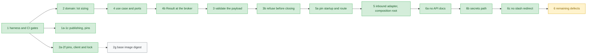

# Migration roadmap

This is the live state of the migration described in
[ADR 0001](adr/0001-incremental-layered-migration.md). Update it in every
migration pull request.

## Steps

| #  | Step                                                                                                                                                        | Kind      | Status                               |
|----|-------------------------------------------------------------------------------------------------------------------------------------------------------------|-----------|--------------------------------------|
| 1  | Characterization tests, CI gates, publish only from `master`                                                                                                | safety    | done                                 |
| 1a | Restore image publishing with the workflow token and report publish failures ([ADR 0003](adr/0003-publish-with-workflow-token.md))                         | safety    | done                                 |
| 1b | Delete the `PERSONAL_ACCESS_TOKEN` secret after the first successful publish                                                                                | safety    | done                                 |
| 1c | Pin malformed-payload behaviour (direction case, action case, malformed lot)                                                                                | safety    | done                                 |
| 2  | Domain: lot sizing as a pure value object (the only logic identical for every input today), plus a layer import contract and an image smoke run            | structure | done                                 |
| 2a | Pin exact broker call sequences, lock coverage and operator console lines; make the domain dependency rule a true allow-list                                | safety    | done                                 |
| 2b | Pin the `tradelocker` client to the version the broker fake mirrors, checked in the built image                                                             | safety    | done                                 |
| 2c | Lock every runtime dependency (direct and transitive) and check the image against the lock ([ADR 0007](adr/0007-locked-runtime-dependencies.md))            | safety    | done                                 |
| 2d | Pin exact call sequences and exception types on raising paths, and inputs legacy never validates                                                            | safety    | done                                 |
| 2e | Pin whitespace variants of `open`/`close` and the retry line's inverted side                                                                             | safety    | done                                 |
| 2f | Pin a failure at every broker call: calls made, console lines, lock released, the client's exception re-raised as the same object                        | safety    | done                                 |
| 2g | Pin the base image `python:3.11-slim` by digest, so a rebuild cannot change the interpreter or system libraries unreviewed                               | safety    | todo                                 |
| 3  | Validate the whole signal before any broker call, as a Result, and report a rejection by one operator line ([ADR 0008](adr/0008-validate-the-signal-before-any-broker-call.md)). Pins updated: wrong-side and NonInvert-forwarding, invalid-invert-after-close, invalid invert ignored outside `open`, truncated payload, non-numeric take profit and stop loss, unknown action, malformed and nonsensical lot; `close` no longer reads the balance | behaviour | done |
| 3b | Refuse, before the first close request, what needs the broker's answer: an account state without a balance, an unknown symbol, a quantity that is not finite or not above zero ([ADR 0009](adr/0009-refuse-what-the-broker-rules-out-before-closing.md)). The instrument is looked up once, from the instrument list. Pins updated: missing balance, unknown symbol and unusable quantity refused; second lookup gone; a lookup failure no longer prints `Normal: Locked` | behaviour | done |
| 4  | Application: execute-signal use case behind broker and console ports; TradeLocker and console adapters implement them ([ADR 0005](adr/0005-execute-signal-use-case-and-ports.md)) | structure | done                                 |
| 4b | Broker failures as a Result at the port and use-case boundary; the legacy delegate re-raises the client's own exception ([ADR 0006](adr/0006-result-at-the-broker-boundary.md))| structure | done                                 |
| 5a | Pin the startup and the webhook route through the real entrypoint: argument checks, banners, login, server start, the HTTP answer, body decoding and line splitting, one thread per request, one lock for every request, the API docs the app serves | safety | done |
| 5  | Inbound HTTP adapter, signal handler and composition root; `libs/` moved into the adapters; `main_without_ssl.py` becomes a thin entrypoint ([ADR 0010](adr/0010-webhook-adapter-and-composition-root.md)) | structure | done |
| 6a | Serve no OpenAPI schema and no docs pages, so no page names the webhook path ([ADR 0011](adr/0011-serve-no-api-docs.md)). Pin replaced: the four former docs addresses answer like any unknown one | behaviour | done |
| 6b | Generate the `url=generate` path with `secrets`, as the README advises for a path chosen by hand ([ADR 0012](adr/0012-generate-the-webhook-path-with-secrets.md)). Pin replaced: one segment of 32 URL-safe characters; a new unit pin on the source | behaviour | done |
| 6c | Redirect no request to a path one slash away; such a path answers `404` like any unknown address ([ADR 0013](adr/0013-no-trailing-slash-redirect.md)). Pin replaced: a trailing slash added or missing is not redirected, followed or handled | behaviour | done |
| 6  | Remaining behaviour changes from the defect list below, one pull request and one ADR each                                                                   | behaviour | next                                 |

Each arrow points from a step to one that builds on it. Green is done,
yellow is next, grey is still to do. The dotted step blocks nothing.

Structure steps must keep `tests/characterization/` green with **unchanged
assertions**. Only the seam may move, meaning the module the tests import
or patch, and the pull request must call it out.

## Frozen contract

These stay unchanged until an ADR changes them:

- Docker image name `ghcr.io/akinzou/tradelocker_bot:latest`, and
  `main_without_ssl.py` as the container command.
- Container environment variables `username`, `password`, `server`, `env`,
  `url`, `acc_num`, `acc_id`.
- Default webhook path `/strategy`, `url=generate` for a random path, and port
  443 by default.
- The webhook body: seven newline-separated lines (symbol, `buy`/`sell`,
  `<lot>/<divider>`, take-profit offset, stop-loss offset, `open`/`close`,
  `Invert`/`NonInvert`). Since ADR 0008, lines 2 and 6 ignore case and
  surrounding spaces, and `close` reads only lines 1 and 6.

## Known defects

Fixed in behaviour steps, never during restructuring.

| Defect                                                                                                                                                              | Pinned by                                                                   |
|---------------------------------------------------------------------------------------------------------------------------------------------------------------------|-----------------------------------------------------------------------------|
| A rejected order raises inside the background handler *after* the existing position was closed, leaving the account flat; the `while not order_id` retry loop never runs because the client raises rather than returning an empty id | `test_broker_rejection_propagates_after_existing_position_was_closed`, `test_raising_path_call_sequence` |
| Closing polls in a tight loop with no delay or limit, re-sending a close request on every poll until the broker fills it, while holding the global lock | `test_close_request_is_resent_on_every_poll_until_the_broker_fills_it` |
| The webhook returns 200 before the signal is handled; a rejected or refused signal or a broker failure is reported only in the bot's log, and the caller never learns | `test_the_answer_is_200_with_a_null_body_before_the_signal_is_handled`, `test_a_broker_failure_ends_the_handler_thread_with_the_clients_exception`, `test_rejected_signals.py` |
| uvicorn's access log, on by default, writes every request line to stdout, so the secret webhook path is in the log of every alert; anyone who can read the container's log can read the path | not pinned (the server is replaced in the tests) |
| A `url` without a leading `/` is accepted at startup, but the route can never match a request, so every alert gets `404` while the bot looks healthy | `test_a_path_without_a_leading_slash_starts_but_is_never_reachable` |
| The account password is passed as a command-line argument, so it shows up in the process list                                                                      | `test_startup_greets_logs_in_and_serves_on_every_interface_at_port_443` (the argv the startup reads)                                                 |
| Only `tradelocker` is pinned (#23); `pandas`, `fastapi`, `uvicorn` and the rest float, and the Dockerfile runs `apt-get update`, so a rebuilt image can change behaviour with no code change | step 2c: lock file |
| The image's start command expands the credentials unquoted in `sh -c`, so a password with spaces or shell characters is split or glob-expanded and the login fails | not pinned (startup wiring) |

## Fixed defects

- **A path one slash away from the webhook path was redirected** (step 6c).
  Starlette answered it with a `307` whose `Location` took the scheme the
  bot saw, `http://` behind a TLS proxy uvicorn does not trust, so a sender
  that followed it sent the secret path and the signal again in plain text.
  Such a path now answers `404` like any unknown address. Images built
  before step 6c still redirect; there, forward only the exact path from the
  proxy and use it in the alerts
  ([ADR 0013](adr/0013-no-trailing-slash-redirect.md)).
- **The generated webhook path came from `random`** (step 6b), a
  generator meant for simulations whose state any code in the process can
  seed. It now comes from `secrets.token_urlsafe(24)`, the generator the
  README advises. The old path is not known to be guessable; images built
  before step 6b still use `random`, and an operator who wants the
  stronger source there can pass a path made with the README's command
  instead of `generate`
  ([ADR 0012](adr/0012-generate-the-webhook-path-with-secrets.md)).
- **The API docs named the webhook path** (step 6a). The app served
  FastAPI's default `/openapi.json`, `/docs`, `/docs/oauth2-redirect` and
  `/redoc`, and the schema listed the secret path. Images built before
  step 6a still serve them; the README's earlier advice applies there:
  let the reverse proxy forward only the webhook path
  ([ADR 0011](adr/0011-serve-no-api-docs.md)).
- **The invalid escape sequences in the greeting banner** (`libs/AsciiAlerts.py`,
  a `SyntaxWarning` on stderr, an error in a future Python), fixed during
  restructuring. Step 5 moved the banner into
  `tradelocker_bot/adapters/ascii_alerts.py` as a raw string with the same
  bytes, which the startup tests pin byte for byte. Copying the warning into
  the package would have gained nothing
  ([ADR 0010](adr/0010-webhook-adapter-and-composition-root.md)).

## Not covered by tests

- Whether the handler thread is a daemon. The test client starts it from its
  own daemon thread, while uvicorn starts it from the main thread, so a pin
  would record the test setup rather than production.
- The real `TLAPI` login and `uvicorn` server. The tests replace both at
  their call, so they pin the arguments and the order, not the libraries.
- The `if __name__ == "__main__"` guard in `main_without_ssl.py`. The tests
  call its `main`; CI's image smoke run (`main_without_ssl.py --help`) runs
  the script itself.
