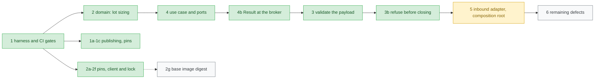

# Migration roadmap

This is the live state of the migration described in
[ADR 0001](adr/0001-incremental-layered-migration.md). Update it in every
migration pull request.

## Steps

| #  | Step                                                                                                                                                        | Kind      | Status                               |
|----|-------------------------------------------------------------------------------------------------------------------------------------------------------------|-----------|--------------------------------------|
| 1  | Characterization tests, CI gates, publish only from `master`                                                                                                | safety    | done                                 |
| 1a | Restore image publishing with the workflow token and report publish failures ([ADR 0003](adr/0003-publish-with-workflow-token.md))                         | safety    | done                                 |
| 1b | Delete the `PERSONAL_ACCESS_TOKEN` secret after the first successful publish                                                                                | safety    | done                                 |
| 1c | Pin malformed-payload behaviour (direction case, action case, malformed lot)                                                                                | safety    | done                                 |
| 2  | Domain: lot sizing as a pure value object (the only logic identical for every input today), plus a layer import contract and an image smoke run            | structure | done                                 |
| 2a | Pin exact broker call sequences, lock coverage and operator console lines; make the domain dependency rule a true allow-list                                | safety    | done                                 |
| 2b | Pin the `tradelocker` client to the version the broker fake mirrors, checked in the built image                                                             | safety    | done                                 |
| 2c | Lock every runtime dependency (direct and transitive) and check the image against the lock ([ADR 0007](adr/0007-locked-runtime-dependencies.md))            | safety    | done                                 |
| 2d | Pin exact call sequences and exception types on raising paths, and inputs legacy never validates                                                            | safety    | done                                 |
| 2e | Pin whitespace variants of `open`/`close` and the retry line's inverted side                                                                             | safety    | done                                 |
| 2f | Pin a failure at every broker call: calls made, console lines, lock released, the client's exception re-raised as the same object                        | safety    | done                                 |
| 2g | Pin the base image `python:3.11-slim` by digest, so a rebuild cannot change the interpreter or system libraries unreviewed                               | safety    | todo                                 |
| 3  | Validate the whole signal before any broker call, as a Result, and report a rejection by one operator line ([ADR 0008](adr/0008-validate-the-signal-before-any-broker-call.md)). Pins updated: wrong-side and NonInvert-forwarding, invalid-invert-after-close, invalid invert ignored outside `open`, truncated payload, non-numeric take profit and stop loss, unknown action, malformed and nonsensical lot; `close` no longer reads the balance | behaviour | done |
| 3b | Refuse, before the first close request, what needs the broker's answer: an account state without a balance, an unknown symbol, a quantity that is not finite or not above zero ([ADR 0009](adr/0009-refuse-what-the-broker-rules-out-before-closing.md)). The instrument is looked up once, from the instrument list. Pins updated: missing balance, unknown symbol and unusable quantity refused; second lookup gone; a lookup failure no longer prints `Normal: Locked` | behaviour | done |
| 4  | Application: execute-signal use case behind broker and console ports; TradeLocker and console adapters implement them ([ADR 0005](adr/0005-execute-signal-use-case-and-ports.md)) | structure | done                                 |
| 4b | Broker failures as a Result at the port and use-case boundary; the legacy delegate re-raises the client's own exception ([ADR 0006](adr/0006-result-at-the-broker-boundary.md))| structure | done                                 |
| 5  | Inbound HTTP adapter and composition root; `main_without_ssl.py` becomes a thin entrypoint (ADR 0006's condition met by 3b)                                | structure | next                                 |
| 6  | Remaining behaviour changes from the defect list below, one pull request and one ADR each                                                                   | behaviour | todo                                 |

Each arrow points from a step to one that builds on it. Green is done,
yellow is next, grey is still to do. The dotted step blocks nothing.

Structure steps must keep `tests/characterization/` green with **unchanged
assertions**. Only the seam may move, meaning the module the tests import
or patch, and the pull request must call it out.

## Frozen contract

These stay unchanged until an ADR changes them:

- Docker image name `ghcr.io/akinzou/tradelocker_bot:latest`, and
  `main_without_ssl.py` as the container command.
- Container environment variables `username`, `password`, `server`, `env`,
  `url`, `acc_num`, `acc_id`.
- Default webhook path `/strategy`, `url=generate` for a random path, and port
  443 by default.
- The webhook body: seven newline-separated lines (symbol, `buy`/`sell`,
  `<lot>/<divider>`, take-profit offset, stop-loss offset, `open`/`close`,
  `Invert`/`NonInvert`). Since ADR 0008, lines 2 and 6 ignore case and
  surrounding spaces, and `close` reads only lines 1 and 6.

## Known defects

Fixed in behaviour steps, never during restructuring.

| Defect                                                                                                                                                              | Pinned by                                                                   |
|---------------------------------------------------------------------------------------------------------------------------------------------------------------------|-----------------------------------------------------------------------------|
| A rejected order raises inside the background handler *after* the existing position was closed, leaving the account flat; the `while not order_id` retry loop never runs because the client raises rather than returning an empty id | `test_broker_rejection_propagates_after_existing_position_was_closed`, `test_raising_path_call_sequence` |
| Closing polls in a tight loop with no delay or limit, re-sending a close request on every poll until the broker fills it, while holding the global lock | `test_close_request_is_resent_on_every_poll_until_the_broker_fills_it` |
| The webhook returns 200 before the signal is handled; a rejected or refused signal or a broker failure is reported only in the bot's log, and the caller never learns | `test_rejected_signals.py`, `test_raising_path_call_sequence` |
| The generated webhook path, the only thing protecting the endpoint, comes from `random` instead of a cryptographically secure source                                | `test_generated_webhook_url_has_two_lowercase_alphanumeric_segments`        |
| The account password is passed as a command-line argument, so it shows up in the process list                                                                      | not pinned (startup wiring)                                                 |
| `libs/AsciiAlerts.py` contains an invalid escape sequence (a `SyntaxWarning` today, an error in a future Python)                                                     | not pinned                                                                  |
| Only `tradelocker` is pinned (#23); `pandas`, `fastapi`, `uvicorn` and the rest float, and the Dockerfile runs `apt-get update`, so a rebuilt image can change behaviour with no code change | step 2c: lock file |
| The image's start command expands the credentials unquoted in `sh -c`, so a password with spaces or shell characters is split or glob-expanded and the login fails | not pinned (startup wiring) |

## Not covered by tests yet

The webhook route is registered inside `main()`, behind the TradeLocker login
and `uvicorn.run`, so the characterization tests stop at
`handle_position_normal`. Step 5 brings the route under test.
